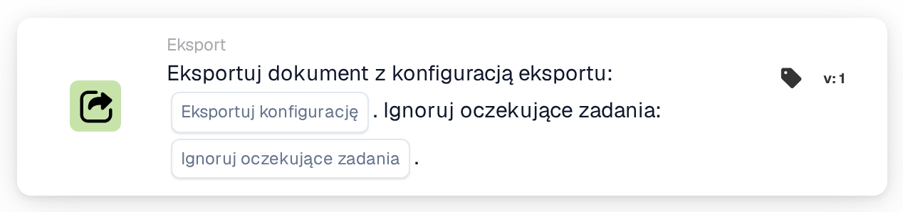
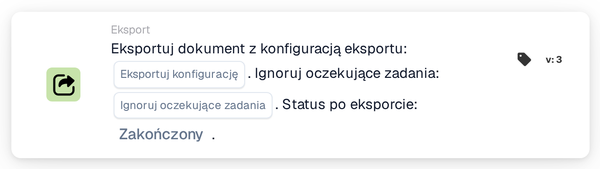
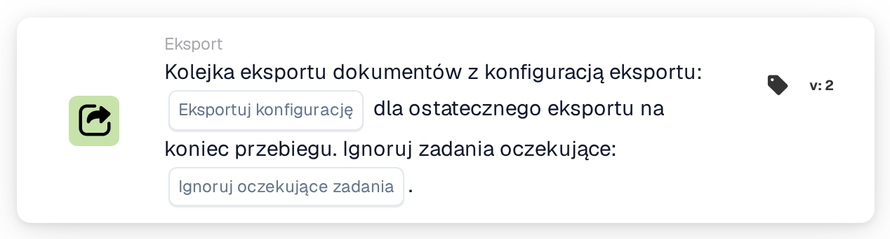
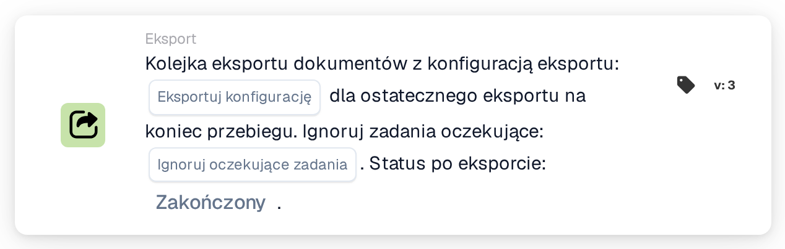

# Eksportuj z konfiguracją eksportu

<figure><figcaption>
Wersja 1
</figcaption></figure>

<figure><figcaption>
Wersja 3
</figcaption></figure>

<figure><figcaption>
Kolejka eksportu dokumentów z konfiguracją eksportu: … dla ostatecznego eksportu na koniec przebiegu. Ignoruj zadania oczekujące: …. — Wersja 2
</figcaption></figure>

<figure><figcaption>
Kolejka eksportu dokumentów z konfiguracją eksportu: … dla ostatecznego eksportu na koniec przebiegu. Ignoruj zadania oczekujące: …. Status po eksporcie: …. — Wersja 3
</figcaption></figure>

## **Cel:**

Karta przepływu pracy **„Eksportuj dokument z konfiguracją eksportu”** przeznaczona jest do eksportowania dokumentu przy użyciu określonej konfiguracji eksportu. Zapewnia elastyczność ignorowania wszelkich oczekujących zadań związanych z dokumentem, zapewniając płynny proces eksportu niezależnie od jego bieżącego stanu.

## **Elementy karty:**

1. **Eksportuj konfigurację**
   * **Opis**: Określa konfigurację eksportu, która ma być używana do przetwarzania dokumentu.
   * **Szczegół**: Ta konfiguracja określa format, strukturę i miejsce docelowe eksportowanego dokumentu.
2. **Ignoruj oczekujące zadania**
   * **Opis**: Określa, czy oczekujące zadania powiązane z dokumentem powinny być pomijane podczas procesu eksportu.
   * **Opcje**:
     * **True**: Eksportuje dokument niezależnie od oczekujących zadań.
     * **False**: Zapewnia zakończenie oczekujących zadań przed eksportem.

## **Funkcjonalność:**

* **Ocena warunku**: System ocenia warunki ustawione w **„Kiedy”** i **„I sekcje”** przepływu pracy. Jeżeli oba warunki są spełnione, rozpoczyna się proces eksportu.
* **Eksport dokumentu**: Przy użyciu określonej **Konfiguracji eksportu** dokument jest przetwarzany i eksportowany w zdefiniowanym formacie i miejscu docelowym.
* **Obsługa oczekujących zadań**: Jeśli **Ignoruj oczekujące zadania** jest ustawione na **True**, proces eksportu pomija wszelkie zaległe zadania powiązane z dokumentem. Jeśli ustawione na **False**, oczekujące zadania mogą uniemożliwić eksport. Rozwiąż je i zorganizuj zamierzony wyzwalacz przepływu pracy lub spróbuj ponownie.

## **Instalacja i konfiguracja:**

Aby skonfigurować tę kartę, użytkownicy muszą:

1. Wybierz żądaną **Konfigurację eksportu**, aby zdefiniować sposób eksportu dokumentu.
2. Wybierz, czy **Ignoruj oczekujące zadania**, ustawiając wartość na **True** lub **False.**
3. Upewnij się, że warunki w **„Kiedy”** i **„I Sekcje”** są poprawnie ustawione, ponieważ karta wykonuje swoją akcję tylko wtedy, gdy te warunki są spełnione.

## **Konkluzja:**

Karta przepływu pracy **„Eksportuj dokument z konfiguracją eksportu”** zapewnia wydajny eksport dokumentów i zgodnie z predefiniowanymi konfiguracjami. Dzięki możliwości ignorowania oczekujących zadań karta ta zapewnia elastyczność w obsłudze dokumentów na różnych etapach, redukując opóźnienia i usprawniając proces eksportu.

## Aktualne wersje i oczekujące zadania

W wersji 3 wybierz także **Status po eksporcie**: `finished` zamyka dokument po pomyślnym eksporcie; `exported` pozostawia otwarte do dalszego przetwarzania. Wcześniejsze wersje zachowują `finished`. Brakujący wybór domyślnie to `finished`; nieprawidłowy wybór zostanie odrzucony.

Jeżeli otwarte zadania uniemożliwiają eksport, karta zgłasza odmowę. Rozwiąż zadania i zorganizuj zamierzony wyzwalacz lub spróbuj ponownie; ta karta nie gwarantuje automatycznego oczekiwania i wznowienia. Oddzielna karta do eksportu oczekującego w kolejce gromadzi konfigurację do ostatecznego eksportu na koniec przebiegu. Zobacz [Eksportuj karty i status wyników](../../cards-overview/export-cards-guide.md).

<!-- workflow-card-practical-example-20261021 -->

## Praktyczny przykład

**Kiedy używać:** Wybierz konkretną konfigurację eksportu dla zatwierdzonego dokumentu.

**Konfiguracja:** Wybierz skonfigurowanego eksportera wersji demonstracyjnych i ustaw Ignoruj oczekujące zadania na `false`. Użyj dokumentu z otwartym zadaniem, a następnie osobnego testu bez otwartych zadań.

**Oczekiwany wynik i kontrprzykład:** Nie należy zakładać, że sprawa z otwartym zadaniem zostanie wznowiona automatycznie. Po rozwiązaniu zadania ponownie uruchom zamierzony eksport i sprawdź wynik eksportera oraz obsługiwany status.

To jest ilustracyjna konfiguracja i oczekiwany wynik. Korzystaj z pól, użytkowników i grup skonfigurowanych w Twojej organizacji testowej; nie jest to twierdzenie, że ten przykład został wykonany.
