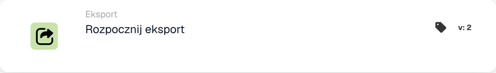

# Rozpocznij eksport

<figure><figcaption>
Pola karty w pokazanej wersji. Pola nie są jeszcze skonfigurowane.
</figcaption></figure>

## **Cel:**

Karta przepływu pracy **„Rozpocznij eksport”** przeznaczona jest do inicjowania procesu eksportu dokumentu. Ta karta działa jako wyzwalacz w przepływie pracy, aby bezproblemowo rozpocząć operację eksportu po spełnieniu warunków opisanych w poprzednich sekcjach.

## **Elementy karty:**

1. **Akcja**
   1. **Opis**: Inicjuje proces eksportu dokumentu.
   2. **Szczegóły**: Karta wykorzystuje skonfigurowane ustawienia eksportu w systemie do przetwarzania i eksportowania dokumentu.

## **Funkcjonalność:**

* **Ocena warunku**: System ocenia warunki ustawione w **„Kiedy”** i **„I sekcje”** przepływu pracy. Jeśli wszystkie warunki są spełnione, rozpoczyna się proces eksportu.
* **Eksport dokumentu**: Dokument jest przetwarzany i eksportowany przy użyciu domyślnej lub wcześniej zdefiniowanej konfiguracji eksportu.

## **Instalacja i konfiguracja:**

Wcześniejsze wersje korzystają z ustawień eksportu zdefiniowanych już w systemie. W wersji 4 skonfiguruj sprawdzanie poprawności i wybierz opcję Stan po eksporcie. Sprawdź także, że:

1. Warunki **„Kiedy”** i **„I sekcje”** są poprawnie skonfigurowane, ponieważ karta jest wykonywana tylko wtedy, gdy te warunki mają wartość true.
2. Z dokumentem w systemie powiązana jest prawidłowa konfiguracja eksportu.

## **Konkluzja:**

Karta przepływu pracy **„Rozpocznij eksport”** zapewnia usprawniony i zautomatyzowany sposób uruchomienia procesu eksportu. Opierając się na wstępnie skonfigurowanych ustawieniach i ocenach warunkowych, zapewnia wydajne i dokładne przetwarzanie dokumentów.

## Wersje kart i status wyników

Powyższe stwierdzenie o braku konfiguracji specyficznej dla karty nie dotyczy wcześniejszej karty Start Export. Rozpocznij eksport z walidacją v4 obejmuje weryfikację i **Status po eksporcie**. Wybierz `finished`, aby zamknąć pomyślnie wyeksportowany dokument, lub `exported`, aby pozostawić go otwartym do dalszego przetwarzania. Wcześniejsze wersje zachowują `finished`. Zobacz [Eksportuj karty i status wyników](../../cards-overview/export-cards-guide.md), aby zapoznać się z wartościami domyślnymi, błędami i testami.

<!-- workflow-card-practical-example-20261021 -->

## Praktyczny przykład

**Kiedy używać:** Eksportuj dokument po przejściu wymaganych kontroli.

**Konfiguracja:** Wybierz obsługiwany status poeksportowy, na przykład `exported`, gdy dokument musi pozostać dostępny do dalszego przetwarzania. Upewnij się, że skonfigurowany eksporter i wymagane dane są gotowe.

**Oczekiwany wynik i kontrprzykład:** Po pomyślnym eksporcie stosowany jest status wybranego wyniku. Błąd eksportera nie oznacza eksportu zakończonego; sprawdź jego dziennik i przetestuj gałąź awarii.

To jest ilustracyjna konfiguracja i oczekiwany wynik. Korzystaj z pól, użytkowników i grup skonfigurowanych w Twojej organizacji testowej; nie jest to twierdzenie, że ten przykład został wykonany.
