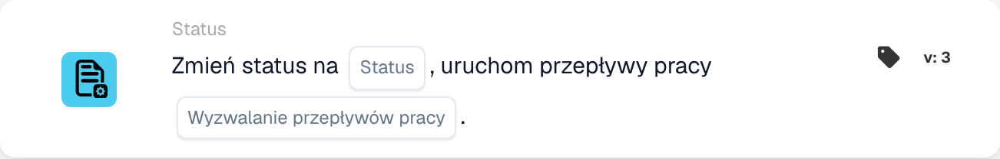

# Zmień stan na

<figure><figcaption>
Pola karty w pokazanej wersji. Pola nie są jeszcze skonfigurowane.
</figcaption></figure>

## **Cel:**

Karta przepływu pracy **"Change Status"** służy do zmiany statusu dokumentu na jeden z predefiniowanych stanów — **Błąd, odrzucony, gotowy do sprawdzenia, oczekujący na zatwierdzenie, oczekujący na drugie zatwierdzenie** — i opcjonalnie wyzwala powiązane przepływy pracy na podstawie zmiany statusu. Karta ta automatyzuje proces aktualizacji statusów i wyzwalania przepływów pracy, zapewniając efektywne zarządzanie dokumentami i obsługę błędów.

## **Komponenty karty:**

1. **Stan**
   * **Opis**: Określa nowy status, który ma zostać zastosowany do dokumentu.
   * **Opcje**:
     * **Error**: Oznacza dokument jako taki, który napotkał błąd.
     * **Odrzucony**: Wskazuje, że dokument został odrzucony i nie będzie dalej procesowany.
     * **Gotowy do walidacji**: Ustawia dokument do przeglądu i walidacji przez następnego użytkownika lub proces systemowy.
     * **Oczekujące na zatwierdzenie**: Umieszcza dokument w stanie oczekiwania na zatwierdzenie.
     * **Oczekuje na drugie zatwierdzenie**: Wstrzymuje dokument do drugiego poziomu zatwierdzenia, jeśli dotyczy.
2. **Wyzwalaj przepływy pracy**
   * **Opis**: Określa, czy po zmianie statusu powinny zostać wyzwolone jakiekolwiek kolejne przepływy pracy.
   * **Opcje**:
     * **True**: Inicjuje wszelkie istotne przepływy pracy na podstawie zmiany statusu.
     * **False**: Zapobiega wykonaniu przepływu pracy po zmianie statusu.

## **Funkcjonalność:**

* **Ocena warunku**: System ocenia warunki ustawione w sekcjach **„Kiedy”** i **„I sekcje”.** Jeśli te warunki są prawdziwe, karta przystępuje do zmiany statusu dokumentu na wybraną wartość.
* **Aktualizacja statusu**: Gdy warunki są spełnione, status dokumentu jest aktualizowany na jedną z predefiniowanych opcji (Error, Rejected, Ready for Validation, Pending Approval, Pending Second Approval), w zależności od wyboru użytkownika.
* **Akcja wyzwalania przepływu pracy**: Jeśli **Wyzwalaj przepływy pracy** jest ustawione na **True**, system automatycznie inicjuje wszelkie powiązane przepływy pracy po aktualizacji statusu. Jeśli ustawione na **False**, nie są wyzwalane żadne dodatkowe przepływy pracy, a proces kończy się zmianą statusu.

## **Konfiguracja:**

Aby skonfigurować tę kartę, użytkownicy muszą:

1. Określić żądany **Stan**, na który dokument zostanie ustawiony po ocenie warunku (Error, Rejected, Ready for Validation, Pending Approval lub Pending Second Approval).
2. Wybrać, czy **Wyzwalaj przepływy pracy** po zmianie statusu, wybierając **True** lub **False**.
3. Karta wykonuje swoją akcję tylko wtedy, gdy oba warunki w sekcjach **„Kiedy”** i **„I sekcje”** są prawdziwe.

## **Podsumowanie:**

Karta przepływu pracy **"Change Status"** oferuje usprawnione podejście do zarządzania statusami dokumentów i wyzwalania powiązanych przepływów pracy. Zapewnia, że dokumenty są automatycznie kierowane do właściwego statusu i że podejmowane są niezbędne akcje, w zależności od zmiany statusu. Ustawiając jasne warunki wykonania, redukuje ręczny wysiłek i zwiększa efektywność przepływu pracy.

<!-- workflow-card-practical-example-20261021 -->

## Przykład praktyczny

**Zastosowanie:** Przekazanie sprawdzonego dokumentu do etapu zatwierdzania.

**Gdzie:** Standardowy projektant procesów → Następnie → Status → Zmień status na.

**Konfiguracja:** Wybierz wersję 3 karty `staus_change`, status Oczekuje na zatwierdzenie (`validated_pending_approval`) i ustaw uruchamianie innych procesów na `false` (`trigger_docflow=false`). Użyj odizolowanej faktury syntetycznej, która spełnia wcześniejsze warunki kontrolne.

**Oczekiwany wynik i kontrprzykład:** Dozwolona i pomyślna aktualizacja nadaje dokumentowi wybrany status. Jeśli wcześniejszy warunek jest fałszywy, ta akcja nie zostaje osiągnięta i nie zmienia statusu. Odrzucona lub nieudana aktualizacja API nie jest sukcesem: sprawdź rzeczywisty status i logi. Sama karta nie wykonuje eksportu.

### Wersje karty

Jawny przełącznik uruchamiania innych procesów jest dostępny w wersji 3. Wersje 1 i 2 go nie mają; starsza ścieżka aktualizacji używa domyślnego sposobu wyzwalania procesów. Nie zakładaj, że ustawienie `false` z wersji 3 obowiązuje po przejściu na starszą wersję.

Konfigurację i oczekiwany wynik zweryfikowano w kodzie wykonawczym. Nie uruchomiono procesu ani zmiany statusu.
