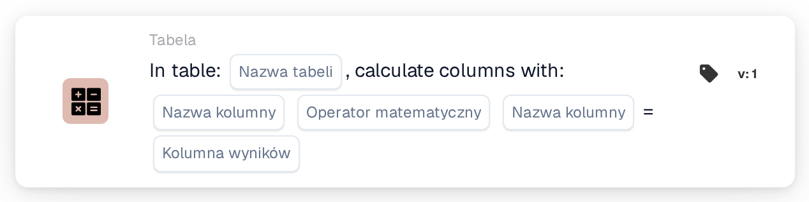
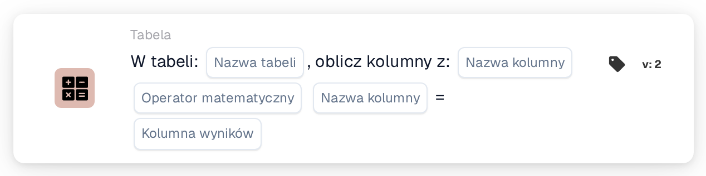

# Oblicz kolumny za pomocą

<figure><figcaption>
Wersja 1
</figcaption></figure>

<figure><figcaption>
Wersja 2
</figcaption></figure>

## Cel:

Ta karta przepływu pracy oblicza, wiersz po wierszu, wartość z dwóch kolumn tabeli w dokumencie i zapisuje wynik w kolumnie wyniku. Może być używana na przykład do obliczania sum pozycji na podstawie ilości i ceny jednostkowej.

## Film administratora:



[Obejrzyj film z polskimi napisami](https://docbits-videos.fra1.cdn.digitaloceanspaces.com/settings-assistant/workflow-card-calc-columns-admin/v1/pl.html) · [Przeczytaj transkrypcję](https://docbits-videos.fra1.cdn.digitaloceanspaces.com/settings-assistant/workflow-card-calc-columns-admin/v1/pl.txt)

## Komponenty karty:

1. **Tabela**
   * **Opis:** Tabela w dokumencie, w której wykonywane jest obliczenie.
2. **Pierwsza kolumna**
   * **Opis:** Kolumna z pierwszą wartością każdego wiersza.
3. **Operacja**
   * **Opcje:**
     * **+** dodaje drugą wartość do pierwszej.
     * **-** odejmuje drugą wartość od pierwszej.
     * **\*** mnoży obie wartości.
     * **/** dzieli pierwszą wartość przez drugą.
4. **Druga kolumna**
   * **Opis:** Kolumna z drugą wartością każdego wiersza.
5. **Kolumna wyniku**
   * **Opis:** Kolumna, w której zapisywany jest wynik każdego wiersza.
   * **Szczegóły:** Nazwa jest zapisywana wielkimi literami, a spacje są zastępowane podkreśleniami (`total amount` staje się `TOTAL_AMOUNT`). Jeśli kolumna jeszcze nie istnieje, karta ją dodaje; jeśli istnieje, jej wartości są zastępowane.

Wersje 1 i 2 karty mają te same ustawienia i działają tak samo.

## Funkcjonalność:

* **Obliczenie:** Dla każdego wiersza tabeli karta odczytuje obie kolumny (wielkość liter w nazwach kolumn nie ma znaczenia), stosuje operację i zapisuje wynik w kolumnie wyniku. Wyniki są zaokrąglane do czterech miejsc po przecinku. Następnie dokument jest zapisywany z nowymi wartościami.
  * Pusta lub brakująca wartość jest liczona jako `0`. Jeśli obie wartości wiersza są puste, wynik tego wiersza pozostaje pusty.
  * Dzielenie przez zero pozostawia wynik tego wiersza pusty.
  * Przy **+** dwie wartości, które nie są liczbami, są łączone spacją zamiast dodawane. Przy pozostałych operacjach wartość, która nie jest liczbą, powoduje błąd i żadne wyniki nie są zapisywane.
* **Wykonanie akcji:** Jeśli obliczenie i zapis się powiodą, przepływ pracy jest kontynuowany kolejnymi kartami. Jeśli tabela nie istnieje w dokumencie, nie można obliczyć wartości lub nie można zapisać dokumentu, karta zgłasza błąd w dzienniku przepływu pracy.
* **Karta testowa:** Gdy karta jest uruchamiana za pomocą **Karta testowa**, obliczenie jest tylko symulowane, a dokument nie jest zmieniany.

## Instalacja i konfiguracja:

* Kartę można dodać jako akcję Then z kategorii **Tabela**. Następnie wybiera się tabelę, obie kolumny, operację i kolumnę wyniku.
* **Przykład:** Tabela `INVOICE_TABLE`, `QUANTITY` **\*** `UNIT_PRICE`, kolumna wyniku `TOTAL_AMOUNT`. Wiersz z ilością 2 i ceną jednostkową 10 otrzymuje 20, wiersz z 3 i 4 otrzymuje 12.
* Ponieważ pusta wartość jest liczona jako `0`, brakująca cena daje wynik `0`. Sprawdzenie, czy kolumny wejściowe są wypełnione, na przykład za pomocą warunku przed tą kartą, może pomóc uniknąć błędnych sum.
* Przy odejmowaniu i dzieleniu kolejność obu kolumn ma znaczenie.

## Podsumowanie:

Karta przepływu pracy „Calculate Columns with” automatycznie dodaje obliczone wartości do wierszy tabeli. Sumy pozycji i podobne wartości są dostępne dla kolejnych kart i dla eksportu bez ręcznego obliczania.
