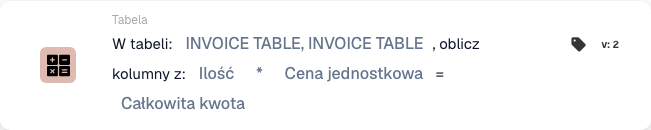
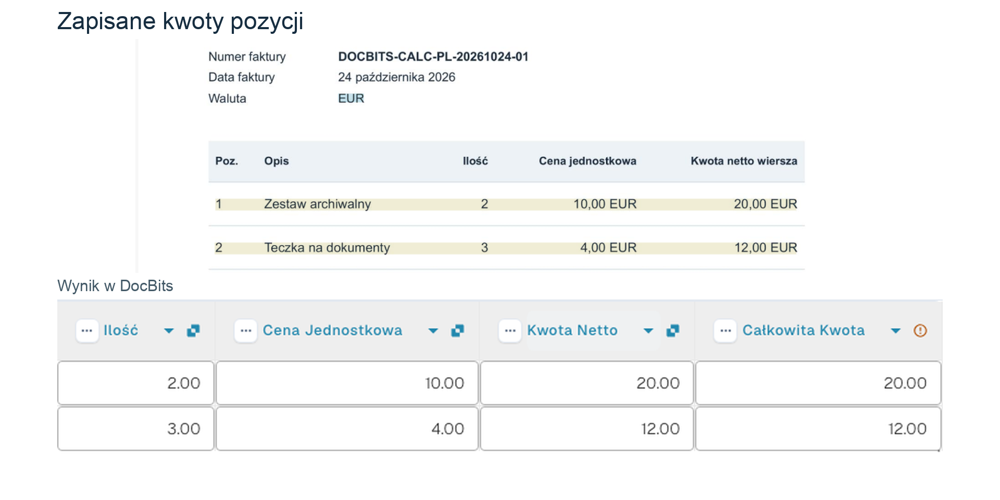

# Obliczanie kolumn w tabeli

## Kiedy i gdzie używać

Użyj tej karty, gdy następny krok wymaga wyniku obliczenia dla każdego wiersza tabeli, na przykład iloczynu ilości i ceny jednostkowej. Dodaj ją w standardowym workflow w sekcji **Następnie**, w kategorii **Tabela**, po sprawdzeniu danych wejściowych.

Karta oblicza wartości między dwiema kolumnami tego samego wiersza i zapisuje wynik w wybranej kolumnie. Nie sumuje wszystkich wierszy do jednej kwoty faktury.

## Film administratora

**35 sekund · polski.** Piotr wyjaśnia zastosowanie karty, wybiera mnożenie i pokazuje zapisane wyniki na tej samej przykładowej fakturze.



[Obejrzyj film z polskimi napisami](https://docbits-videos.fra1.cdn.digitaloceanspaces.com/settings-assistant/workflow-card-calc-columns-admin/v1/pl.html) · [Przeczytaj transkrypcję](https://docbits-videos.fra1.cdn.digitaloceanspaces.com/settings-assistant/workflow-card-calc-columns-admin/v1/pl.txt)

## Konfiguracja karty

<figure><figcaption>
Skonfigurowana karta w polskim interfejsie. Nazwa INVOICE TABLE jest wyświetlana dwukrotnie mimo jednego wyboru tabeli; pola wejściowe i kolumna wyniku pozostają widoczne.
</figcaption></figure>

| Ustawienie | Wybór w przykładzie |
| --- | --- |
| Tabela | `INVOICE_TABLE` |
| Pierwsza kolumna | `QUANTITY` — Ilość |
| Działanie | `*` — mnożenie |
| Druga kolumna | `UNIT_PRICE` — Cena jednostkowa |
| Kolumna wyniku | `TOTAL_AMOUNT` — Całkowita kwota |

Dostępne są także `+` (dodawanie), `-` (odejmowanie) i `/` (dzielenie). Przy odejmowaniu i dzieleniu kolejność kolumn ma znaczenie. Wybierz rzeczywiste kolumny skonfigurowane w swojej organizacji; klucze w tabeli pochodzą z tego przykładu.

Istniejące wartości w kolumnie wyniku zostają zastąpione. Przed uruchomieniem sprawdź, czy wybrana kolumna jest właściwym miejscem na obliczony wynik.

<!-- workflow-card-practical-example-20261021 -->

## Praktyczny przykład

Faktura szkoleniowa `DOCBITS-CALC-PL-20261024-01` ma dwa wiersze. W pierwszym ilość wynosi `2`, a cena jednostkowa `10`; w drugim ilość wynosi `3`, a cena jednostkowa `4`.

Po wykonaniu mnożenia i ponownym otwarciu tego samego dokumentu kolumna **Całkowita kwota** zawiera odpowiednio `20.00` i `12.00`. W filmie pokazano te zapisane komórki. Kolumny wejściowe pozostają bez zmian.

Kolumna `NET_AMOUNT` — Kwota Netto — była już obecna przed obliczeniem. W tym przykładzie wynikiem działania karty jest `TOTAL_AMOUNT`, a nie wcześniej wyodrębniona kwota netto.

Pomarańczowy wskaźnik przy kolumnie wyniku pozostaje widoczny. Zapisanie obliczenia nie potwierdza kompletności danych, zatwierdzenia faktury ani eksportu do innego systemu.

<figure><picture><source srcset="../../../../.gitbook/assets/workflow-card-calc-columns-saved-result-pl-dark-20261025.png" media="(prefers-color-scheme: dark)"></picture><figcaption>
Po ponownym otwarciu tej samej faktury kolumna TOTAL_AMOUNT zawiera 20.00 i 12.00 dla dwóch pozycji. Oryginalne kwoty w NET_AMOUNT pozostają bez zmian.
</figcaption></figure>

## Sprawdzanie i kontrprzykłady

Sprawdź oba wiersze niezależnie: `2 × 10 = 20` oraz `3 × 4 = 12`. Nie traktuj poprawnego wyniku jednego wiersza jako potwierdzenia całej tabeli.

Brak ceny może w tym przykładzie dać `0`; nie oznacza to, że dane są kompletne. Tekst, na przykład `ABC` zamiast ilości, powoduje błąd obliczenia. Te dwa przypadki graniczne są oczekiwanymi wynikami przykładu; film przedstawia rzeczywiście zapisane wyniki dla dwóch poprawnych wierszy.

Przed użyciem w swoim workflow przetestuj brakujące i nienumeryczne dane oraz zachowanie dzielenia przez zero. Dobierz warunki uruchomienia do swojego procesu.
