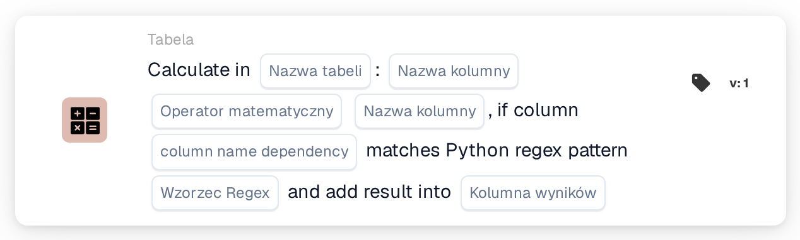
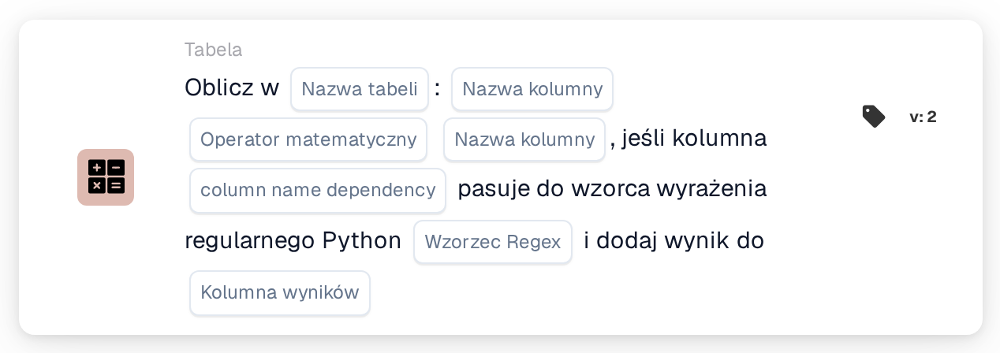

# Oblicz w

<figure><figcaption>
Wersja 1
</figcaption></figure>

<figure><figcaption>
Wersja 2
</figcaption></figure>

## **Cel:**

Karta przepływu pracy **„Oblicz za pomocą zależności wyrażeń regularnych”** umożliwia użytkownikom wykonywanie obliczeń między kolumnami w wybranej tabeli, z dodatkowym warunkiem opartym na wzorcu wyrażenia regularnego (regex) zastosowanym do kolumny zależności. Jeśli wzorzec pasuje, obliczenie jest wykonywane, a wynik jest przechowywany w określonej kolumnie wynikowej.

## **Komponenty karty:**

1. **Nazwa tabeli**
   * **Opis:** Określa **tabelę**, w której kolumny będą obliczane.
   * **Szczegóły:** Do wyboru udostępniana jest lista rozwijana wszystkich dostępnych **tabel**.
2. **Nazwa kolumny (pierwsza kolumna)**
   * **Opis:** Określa **pierwszą kolumnę** uwzględnioną w obliczeniach.
   * **Szczegóły:** Do wyboru udostępniana jest lista wszystkich dostępnych **kolumna**.
3. **Działanie**
   * **Opis:** Definiuje operację matematyczną, która ma być zastosowana między wybranymi kolumnami.
   * **Opcje:**
     * **Add (+):** Dodaje wartość drugiej kolumny do wartości pierwszej kolumny.
     * **Odejmij (-):** Odejmuje wartość drugiej kolumny od pierwszej kolumny.
     * **Multiply (\*):** Mnoży wartość pierwszej kolumny przez wartość w drugiej kolumnie.
     * **Podziel (/):** Dzieli wartość pierwszej kolumny przez drugą kolumnę.
4. **Nazwa kolumny (druga kolumna)**
   * **Opis:** Określa **drugą kolumnę** uwzględnioną w obliczeniach.
   * **Szczegóły:** Do wyboru udostępniana jest lista wszystkich dostępnych **kolumna**.
5. **Nazwa kolumny (zależność)**
   * **Opis:** Określa **kolumnę zależności**, do której zostanie zastosowany wzorzec regex.
   * **Szczegóły:** Do dopasowania wzorca udostępniana jest lista wszystkich dostępnych **kolumna**.
6. **Wzorzec regularny**
   * **Opis:** Definiuje **wzorzec regex**, który zostanie użyty do dopasowania względem kolumny zależności.
   * **Szczegóły:** Jeśli wartość w kolumnie zależności odpowiada wzorcowi regex, obliczenie zostanie wykonane.
7. **Kolumna wyników**
   * **Opis:** Określa **kolumnę wynikową**, w której zostanie zapisany wynik obliczeń.
   * **Szczegóły:** Może to być nowa lub istniejąca kolumna, w której zostanie zapisana obliczona wartość.

## **Funkcjonalność:**

* **Ocena warunku:**
  * Karta wykonuje swoją akcję tylko wtedy, gdy zarówno **„Kiedy”**, jak i **„I sekcje”** są prawdziwe.
  * Karta wykonuje swoją akcję tylko wtedy, gdy wartość w kolumnie zależności odpowiada podanemu **wzorcowi regex**.
* **Obliczanie kolumn:**\
  Jeśli wzorzec regex pasuje, karta wykonuje wybraną operację matematyczną między dwiema wybranymi kolumnami.
* **Przechowywanie wyniku:**\
  Wynik obliczeń jest przechowywany w wybranej **kolumnie wynikowej**.

## **Konfiguracja:**

* **Wybierz tabelę:**\
  Wybierz **tabelę**, w której kolumny będą obliczane.
* **Wybierz kolumny:**\
  Wybierz **pierwszą kolumnę** i **drugą kolumnę**, które zostaną użyte w obliczeniach.
* **Wybierz operację:**\
  Wybierz operację matematyczną (**Add (+)**, **Odejmij (-)**, **Multiply (\*)**, **Divide (/)**), która ma być zastosowana między kolumnami.
* **Wybierz kolumnę zależności:**\
  Wybierz **kolumnę zależności**, do której zostanie zastosowany wzorzec regex.
* **Zdefiniuj wzór wyrażenia regularnego:**\
  Wprowadź **wzorzec regex**, któremu powinna odpowiadać kolumna zależności.
* **Wybierz kolumnę wyników:**\
  Wybierz **kolumnę wynikową**, w której zostanie zapisana obliczona wartość.

## **Podsumowanie:**

Karta przepływu pracy **„Oblicz za pomocą zależności wyrażeń regularnych”** zapewnia potężny sposób wykonywania obliczeń z logiką warunkową opartą na wzorcu regex. Zapewnia to, że tylko wiersze, w których kolumna zależności odpowiada określonemu wzorcowi, zostaną poddane określonemu obliczeniu, a wynik jest przechowywany w wybranej kolumnie wynikowej.

<!-- workflow-card-practical-example-20261021 -->

## Praktyczny przykład

**Kiedy używać:** Oblicz tylko wybrane wiersze tabeli.

**Konfiguracja:** Użyj tabeli demonstracyjnej `lines` z kolumnami numerycznymi `quantity` i `unit_price`. Wybierz pasujące wiersze w kolumnie zależności i wyrażeniu regularnym, pomnóż kolumny numeryczne i zapisz do `line_total`.

**Oczekiwany wynik i kontrprzykład:** Wybrany wiersz z `2` i `10` otrzymuje `20`. Niepasujący wiersz należy sprawdzić osobno, aby potwierdzić, że nie został wybrany do obliczeń.

To jest ilustracyjna konfiguracja i oczekiwany wynik. Korzystaj z pól, użytkowników i grup skonfigurowanych w Twojej organizacji testowej; nie jest to twierdzenie, że ten przykład został wykonany.
