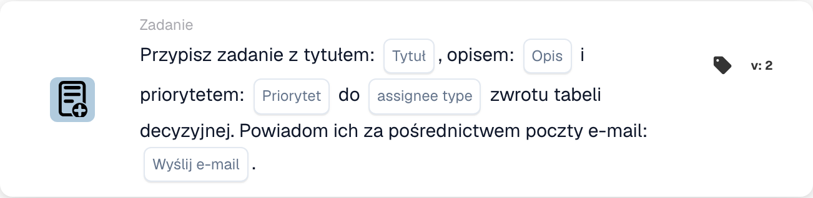

# Przypisz zadanie z tytułem

<figure><figcaption>
Pola karty w pokazanej wersji. Pola nie są jeszcze skonfigurowane. Niektóre etykiety tej wersji interfejsu nie są jeszcze przetłumaczone lub mają nieprawidłowe tłumaczenie. Objaśnienia na tej stronie używają właściwych terminów; obraz przedstawia rzeczywisty interfejs.
</figcaption></figure>

## **Cel:**

Karta przepływu pracy "Assign Task / Notification from Decision Table" służy do dynamicznego przypisywania zadań lub powiadomień na podstawie wyników tabeli decyzyjnej. Karta ta zapewnia, że zadania lub powiadomienia są przypisywane do właściwego użytkownika lub grupy zgodnie z logiką zdefiniowaną w tabeli decyzyjnej, z opcjonalnym powiadomieniem e-mail wysyłanym do odbiorcy.

## **Komponenty karty:**

1. **Tytuł**
   * **Opis**: Określa tytuł tworzonego zadania lub powiadomienia.
   * **Szczegóły**: Tytuł powinien zapewniać kontekst i opisywać cel zadania lub powiadomienia.
2. **Opis**
   * **Opis**: Definiuje treść lub cel zadania lub powiadomienia.
   * **Szczegóły**: Dostarcza dodatkowych informacji o zadaniu lub powiadomieniu, wyjaśniając kontekst lub wymaganą akcję.
3. **Priorytet**
   * **Opis**: Definiuje poziom pilności zadania lub powiadomienia.
   * **Opcje**:
     * **High**: Zadania lub powiadomienia wymagające natychmiastowej uwagi.
     * **Średni**: Ważne zadania, które powinny zostać szybko obsłużone.
     * **Low**: Zadania, którymi można się zająć później.
4. **Typ przypisanego**
   * **Opis**: Określa użytkownika lub grupę przypisaną do zadania lub powiadomienia na podstawie wyniku tabeli decyzyjnej.
   * **Szczegóły**: Tabela decyzyjna dynamicznie ocenia warunki i zwraca odpowiedniego użytkownika lub grupę do przypisania.
5. **Powiadomienie e-mail**
   * **Opis**: Konfiguruje, czy powiadomienie e-mail zostanie wysłane do przypisanego użytkownika lub grupy.
   * **Opcje**:
     * **True**: Wysyła powiadomienie e-mail do odbiorcy.
     * **False**: Nie jest wysyłane powiadomienie e-mail.

#### **Dodatkowe komponenty w Version 3**

1. **Typ powiadomienia**
   * **Opis**: Określa, czy karta tworzy zadanie, czy powiadomienie.
   * **Opcje**:
     * **Zadanie**: Tworzy zadanie przypisane do użytkownika lub grupy z tabeli decyzyjnej.
     * **Notification**: Wysyła powiadomienie do użytkownika lub grupy z tabeli decyzyjnej.

## **Funkcjonalność:**

* **Ocena warunku:**\
  Karta wykonuje swoją akcję tylko wtedy, gdy zarówno **„Kiedy”**, jak i **„I sekcje”** są prawdziwe.
* **Przypisanie zadania / powiadomienia**\
  Karta przypisuje zadanie lub powiadomienie do użytkownika lub grupy zidentyfikowanej przez tabelę decyzyjną. Tabela decyzyjna dynamicznie ocenia predefiniowane warunki i zwraca odpowiedniego odbiorcę.
* **Powiadomienie e-mail**\
  Jeśli tak skonfigurowano, powiadomienie e-mail jest wysyłane do przypisanego użytkownika lub grupy.
* **Funkcjonalność Version 3**\
  W Version 3 karta umożliwia utworzenie zadania (Task) lub powiadomienia (Notification), zapewniając większą elastyczność w zarządzaniu zadaniami i komunikacji.

## **Konfiguracja:**

1. **Zdefiniuj szczegóły zadania lub powiadomienia**:\
   Wprowadź tytuł, opis i priorytet zadania lub powiadomienia.
2. **Konfiguruj tabelę decyzyjną**:\
   Skonfiguruj tabelę decyzyjną, aby dynamicznie określać, który użytkownik lub grupa powinni zostać przypisani do zadania lub powiadomienia.
3. **Włącz powiadamianie e-mailem**:\
   Określ, czy powiadomienie e-mail powinno zostać wysłane do przypisanego użytkownika lub grupy.
4. **Określ typ powiadomienia (wersja 3)**:\
   Wybierz, czy karta utworzy zadanie, czy wyśle powiadomienie.

## **Podsumowanie:**

Karta przepływu pracy **„Przypisz zadanie / powiadomienie z tabeli decyzyjnej”** automatyzuje przypisywanie zadań lub powiadomień na podstawie dynamicznych warunków zdefiniowanych w tabeli decyzyjnej. Version 3 zwiększa jej funkcjonalność, umożliwiając użytkownikom wybór między utworzeniem zadania a powiadomienia, oraz zapewnia, że zawsze przypisywany jest właściwy odbiorca. Funkcja powiadomień e-mail informuje użytkowników na bieżąco, usprawniając komunikację i zarządzanie zadaniami.

<!-- workflow-card-practical-example-20261021 -->

## Praktyczny przykład

**Kiedy używać:** Utwórz zadanie dla osoby przydzielonej zwróconej przez tabelę decyzyjną.

**Konfiguracja:** Użyj pasującej reguły demonstracyjnej zwracającej `Demo Reviewer A`, tytuł `Review invoice` i żądany priorytet.

**Oczekiwany wynik i kontrprzykład:** Wynikowe zadanie jest przydzielane zgodnie ze zwróconym przydzielonym zadaniem. Przetestuj osobno niedopasowaną regułę i sprawdź dziennik karty.

To jest ilustracyjna konfiguracja i oczekiwany wynik. Korzystaj z pól, użytkowników i grup skonfigurowanych w Twojej organizacji testowej; nie jest to twierdzenie, że ten przykład został wykonany.
