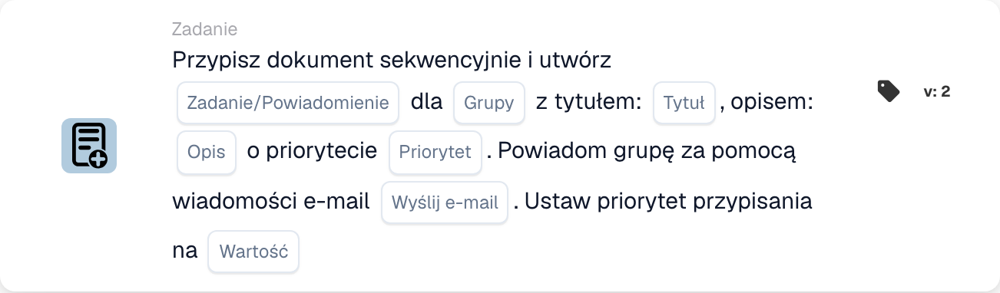

# Przypisz dokument i utwórz zadanie/powiadomienie dla grupy

<figure><figcaption>
Pola karty w pokazanej wersji. Pola nie są jeszcze skonfigurowane.
</figcaption></figure>

## **Cel**

Karta przepływu pracy "**Przypisz dokument i utwórz zadanie/powiadomienie dla grupy**" przypisuje dokument do określonej grupy, tworzy zadanie lub powiadomienie z konfigurowalnymi szczegółami i opcjonalnie wysyła powiadomienie e-mail do grupy. Karta ta obsługuje również przypisywanie numerycznej wartości priorytetu w celu określenia kolejności wykonywania.

## **Komponenty karty**

1. **Nazwa grupy**
   * **Opis:** Określa grupę, która otrzyma zadanie lub powiadomienie.
   * **Szczegóły:** Lista rozwijana do wyboru nazwy grupy, do której zostanie przypisany dokument i zadanie/powiadomienie.
2. **Zadanie/Powiadomienie**
   * **Opis:** Określa typ akcji do utworzenia dla grupy.
   * **Szczegóły:** Lista rozwijana do wyboru "Task" lub "Notification" w zależności od pożądanej akcji.
3. **Tytuł**
   * **Opis:** Zapewnia tytuł zadania lub powiadomienia.
   * **Szczegóły:** Pole do dodania zwięzłego, opisowego tytułu zadania lub powiadomienia.
4. **Opis**
   * **Opis:** Dokładniej opisuje zadanie lub powiadomienie.
   * **Szczegóły:** Pole do podania dodatkowych szczegółów o celu zadania lub treści powiadomienia.
5. **Priorytet**
   * **Opis:** Definiuje poziom pilności zadania lub powiadomienia.
   * **Opcje:**
     * **High:** Wymaga natychmiastowej uwagi.
     * **Średni:** Ważne, ale nie pilne.
     * **Low:** Można obsłużyć później.
6. **Wyślij pocztę**
   * **Opis:** Konfiguruje, czy powiadomienie e-mail jest wysyłane do grupy.
   * **Opcje:**
     * **True:** Wysyła powiadomienie e-mail.
     * **False:** Nie wysyła e-maila.
7. **Wartość**
   * **Opis:** Ustawia numeryczny priorytet dla przypisania dokumentu.
   * **Szczegóły:** Pole do wprowadzenia wartości liczbowej, gdzie niższa liczba oznacza wyższy priorytet.

## **Funkcjonalność**

* **Ocena warunku:**\
  Karta wykonuje swoje akcje tylko wtedy, gdy skonfigurowane warunki przepływu pracy są spełnione.
* **Przypisanie dokumentu i utworzenie zadania/powiadomienia:**\
  Dokument jest przypisywany do grupy określonej w polu "Group Name". Tworzone jest zadanie lub powiadomienie ze skonfigurowanym tytułem, opisem i poziomem priorytetu.
* **Powiadomienie e-mail:**\
  Jeśli "Send Mail" jest ustawione na True, powiadomienie e-mail jest wysyłane do grupy, aby poinformować ją o zadaniu lub powiadomieniu.

## **Konfiguracja**

1. **Zdefiniuj nazwę grupy:**
   * Wprowadź nazwę grupy w polu Group Name.
2. **Wybierz zadanie/powiadomienie:**
   * Wybierz "Task" lub "Notification" z listy rozwijanej Task/Notification.
3. **Ustaw szczegóły zadania/powiadomienia:**
   * Wprowadź Title i Description dla zadania lub powiadomienia.
   * Wybierz Priority z listy rozwijanej (High, Medium lub Low).
4. **Włącz powiadomienie e-mailem:**
   * Skonfiguruj opcję Send Mail na True lub False, w zależności od tego, czy powiadomienie e-mail powinno zostać wysłane.
5. **Przypisz priorytet numeryczny:**
   * Wprowadź wartość liczbową w polu Value, aby określić priorytet przypisania, gdzie niższe wartości mają pierwszeństwo.
6. Zapisz konfigurację karty i aktywuj przepływ pracy.

## **Podsumowanie**

Karta przepływu pracy "Assign Document and Create Task/Notification for Group" zapewnia, że dokumenty są przypisywane do odpowiedniej grupy, jednocześnie tworząc zadania lub powiadomienia z konfigurowalnymi opcjami priorytetu i powiadomień e-mail. Usprawnia to zarządzanie dokumentami i zwiększa efektywność przepływu pracy.

<!-- workflow-card-practical-example-20261021 -->

## Praktyczny przykład

**Kiedy używać:** Utwórz zadanie zespołowe wraz z przydzielaniem dokumentów według priorytetów.

**Konfiguracja:** Wybierz `Demo Finance`, tytuł `Review invoice` oraz zadania i priorytety przydziału.

**Oczekiwany wynik i kontrprzykład:** Sprawdź oddzielnie przypisanie dokumentu grupowego i zadanie/powiadomienie. Samo zadanie nie jest dowodem na to, że dokument został zatwierdzony.

To jest ilustracyjna konfiguracja i oczekiwany wynik. Korzystaj z pól, użytkowników i grup skonfigurowanych w Twojej organizacji testowej; nie jest to twierdzenie, że ten przykład został wykonany.
