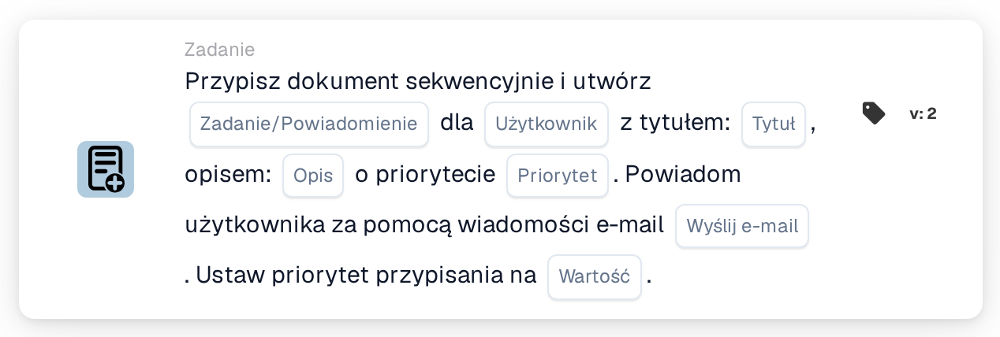

# Przypisz dokument i utwórz zadanie/powiadomienie dla użytkownika

<figure><figcaption>
Wersja 2
</figcaption></figure>

## **Cel**

Karta przepływu pracy "**Przypisz dokument i utwórz zadanie/powiadomienie dla użytkownika**" przypisuje dokument do określonego użytkownika, tworzy zadanie lub powiadomienie z konfigurowalnymi szczegółami i opcjonalnie wysyła powiadomienie e-mail do użytkownika. Karta ta umożliwia również ustawienie numerycznej wartości priorytetu w celu określenia kolejności wykonywania.

## **Komponenty karty**

1. **Użytkownik**
   * **Opis:** Określa użytkownika, który otrzyma zadanie lub powiadomienie.
   * **Szczegóły:** Menu rozwijane do wyboru użytkownika, do którego zostanie przypisany dokument i zadanie/powiadomienie.
2. **Zadanie/Powiadomienie**
   * **Opis:** Określa typ akcji do utworzenia dla użytkownika.
   * **Szczegóły:** Lista rozwijana do wyboru "Task" lub "Notification" w zależności od zamierzonej akcji.
3. **Tytuł**
   * **Opis:** Tytuł zadania lub powiadomienia.
   * **Szczegóły:** Pole do podania zwięzłego, opisowego tytułu zadania lub powiadomienia.
4. **Opis**
   * **Opis:** Dodatkowe szczegóły o zadaniu lub powiadomieniu.
   * **Szczegóły:** Pole do opisania celu zadania lub podania kontekstu powiadomienia.
5. **Priorytet**
   * **Opis:** Definiuje poziom pilności zadania lub powiadomienia.
   * **Opcje:**
     * **High:** Wymaga natychmiastowej uwagi.
     * **Średni:** Ważne, ale nie pilne.
     * **Low:** Można obsłużyć później.
6. **Wyślij pocztę**
   * **Opis:** Konfiguruje, czy powiadomienie e-mail jest wysyłane do użytkownika.
   * **Opcje:**
     * **True:** Wysyła powiadomienie e-mail do użytkownika.
     * **False:** Nie jest wysyłane powiadomienie e-mail.
7. **Wartość**
   * **Opis:** Ustawia numeryczny priorytet dla przypisania dokumentu.
   * **Szczegóły:** Pole do wprowadzenia wartości liczbowej, gdzie niższe liczby oznaczają wyższy priorytet.

## **Funkcjonalność**

* **Ocena warunku:**\
  Karta wykonuje swoje akcje tylko wtedy, gdy skonfigurowane warunki przepływu pracy są spełnione.
* **Przypisanie dokumentu i utworzenie zadania/powiadomienia:**\
  Dokument jest przypisywany do użytkownika określonego w polu "User". Tworzone jest zadanie lub powiadomienie z podanym tytułem, opisem i poziomem priorytetu.
* **Powiadomienie e-mail:**\
  Jeśli "Send Mail" jest ustawione na True, do użytkownika wysyłany jest e-mail informujący go o zadaniu lub powiadomieniu.

## **Konfiguracja**

1. **Wybierz użytkownika:**
   * Wybierz użytkownika z menu rozwijanego User.
2. **Skonfiguruj szczegóły zadania/powiadomienia:**
   * Wybierz "Task" lub "Notification" z listy rozwijanej Task/Notification.
   * Wprowadź Title i Description dla zadania lub powiadomienia.
   * Ustaw Priority, wybierając High, Medium lub Low z listy rozwijanej.
3. **Włącz powiadomienie e-mailem:**
   * Skonfiguruj opcję Send Mail na True lub False, w zależności od tego, czy powiadomienie e-mail powinno zostać wysłane.
4. **Ustaw priorytet numeryczny:**
   * Wprowadź wartość liczbową w polu Value, aby określić priorytet przypisania, gdzie niższe wartości są przetwarzane jako pierwsze.
5. Zapisz konfigurację karty i aktywuj przepływ pracy.

## **Podsumowanie**

Karta przepływu pracy "Assign Document and Create Task/Notification for User" zapewnia, że dokumenty są przypisywane do odpowiedniego użytkownika, jednocześnie tworząc zadania lub powiadomienia ze zdefiniowanymi priorytetami i opcjonalnymi powiadomieniami e-mail. Karta ta pomaga usprawnić delegowanie zadań i zwiększa efektywność przepływu pracy.

<!-- workflow-card-practical-example-20261021 -->

## Praktyczny przykład

**Kiedy używać:** Utwórz zadanie przeglądu użytkownika wraz z przydzieleniem dokumentów według priorytetów.

**Konfiguracja:** Wybierz `Demo Reviewer A`, tytuł zadania `Review invoice`, priorytet zadania i priorytet przydziału.

**Oczekiwany wynik i kontrprzykład:** Sprawdź, czy dla wybranego użytkownika istnieje zarówno przypisanie dokumentu, jak i zadanie/powiadomienie, z zamierzonymi priorytetami.

To jest ilustracyjna konfiguracja i oczekiwany wynik. Korzystaj z pól, użytkowników i grup skonfigurowanych w Twojej organizacji testowej; nie jest to twierdzenie, że ten przykład został wykonany.
