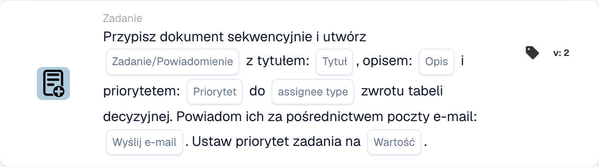

# Przypisz dokument i utwórz zadanie/powiadomienie

<figure><figcaption>
Pola karty w pokazanej wersji. Pola nie są jeszcze skonfigurowane. Niektóre etykiety tej wersji interfejsu nie są jeszcze przetłumaczone lub mają nieprawidłowe tłumaczenie. Objaśnienia na tej stronie używają właściwych terminów; obraz przedstawia rzeczywisty interfejs.
</figcaption></figure>

## **Cel**

Karta przepływu pracy "**Przypisz dokument i utwórz zadanie/powiadomienie na podstawie tabeli decyzyjnej**" przypisuje dokument i tworzy zadanie lub powiadomienie z konfigurowalnymi szczegółami. Osoba przypisana jest określana na podstawie zwrotu tabeli decyzyjnej, a karta umożliwia ustawianie priorytetów i wysyłanie powiadomień e-mail.

## **Komponenty karty**

1. **Typ przypisanego**
   * **Opis:** Określa, czy zwrot tabeli decyzyjnej przypisuje dokument i zadanie/powiadomienie do użytkownika, czy grupy.
   * **Szczegóły:** Pole do skonfigurowania typu osoby przypisanej jako "User" lub "Group" na podstawie wyniku tabeli decyzyjnej.
2. **Zadanie/Powiadomienie**
   * **Opis:** Określa typ akcji do utworzenia dla osoby przypisanej.
   * **Szczegóły:** Lista rozwijana do wyboru "Task" lub "Notification" na podstawie potrzeb przepływu pracy.
3. **Tytuł**
   * **Opis:** Tytuł zadania lub powiadomienia.
   * **Szczegóły:** Pole do podania zwięzłego tytułu identyfikującego zadanie lub powiadomienie.
4. **Opis**
   * **Opis:** Dodatkowe szczegóły o zadaniu lub powiadomieniu.
   * **Szczegóły:** Pole do opisania celu i kontekstu zadania lub powiadomienia.
5. **Priorytet**
   * **Opis:** Definiuje poziom pilności zadania lub powiadomienia.
   * **Opcje:**
     * **High:** Wymaga natychmiastowej uwagi.
     * **Średni:** Ważne, ale nie pilne.
     * **Low:** Można obsłużyć później.
6. **Typ przypisanego**
   * **Opis:** To pole określa typ osoby przypisanej (User lub Group), do której przypisywany jest dokument i zadanie/powiadomienie.
   * **Szczegóły:** Menu rozwijane do wyboru, czy zadanie/powiadomienie jest przypisane do użytkownika, czy grupy na podstawie wyniku tabeli decyzyjnej.
7. **Wyślij pocztę**
   * **Opis:** Konfiguruje, czy powiadomienie e-mail jest wysyłane do osoby przypisanej.
   * **Opcje:**
     * **True:** Wysyła powiadomienie e-mail.
     * **False:** Nie jest wysyłane powiadomienie e-mail.
8. **Wartość**
   * **Opis:** Ustawia numeryczny priorytet dla przypisania dokumentu.
   * **Szczegóły:** Pole do wprowadzenia wartości liczbowej, gdzie niższe liczby oznaczają wyższy priorytet.

## **Funkcjonalność**

* **Ocena warunku:**\
  Karta wykonuje swoje akcje tylko wtedy, gdy warunki przepływu pracy są spełnione.
* **Ocena tabeli decyzyjnej:**\
  Tabela decyzyjna określa, czy dokument i zadanie/powiadomienie są przypisane do użytkownika, czy grupy.
* **Przypisanie dokumentu i utworzenie zadania/powiadomienia:**\
  Dokument jest przypisywany do wyniku tabeli decyzyjnej. Tworzone jest zadanie lub powiadomienie z określonym tytułem, opisem i poziomem priorytetu.
* **Powiadomienie e-mail:**\
  Jeśli "Send Mail" jest ustawione na True, powiadomienie e-mail jest wysyłane do osoby przypisanej.

## **Konfiguracja**

1. **Zdefiniuj typ przypisanego:**
   * Skonfiguruj pole Assignee Type jako "User" lub "Group" na podstawie wyniku tabeli decyzyjnej.
2. **Wybierz zadanie/powiadomienie:**
   * Wybierz "Task" lub "Notification" z listy rozwijanej Task/Notification.
3. **Ustaw szczegóły zadania/powiadomienia:**
   * Wprowadź Title i Description dla zadania lub powiadomienia.
   * Wybierz Priority (High, Medium lub Low) z listy rozwijanej.
4. **Włącz powiadomienie e-mailem:**
   * Ustaw opcję Send Mail na True lub False, w zależności od tego, czy powiadomienie e-mail powinno zostać wysłane.
5. **Ustaw priorytet numeryczny:**
   * Wprowadź wartość liczbową w polu Value, aby określić priorytet przypisania, gdzie niższe liczby są przetwarzane jako pierwsze.
6. Zapisz konfigurację karty i aktywuj przepływ pracy.

## **Podsumowanie**

Karta przepływu pracy "Assign Document and Create Task/Notification Based on Decision Table" zapewnia, że zadania lub powiadomienia są dynamicznie przypisywane do odpowiedniego użytkownika lub grupy na podstawie wyników tabeli decyzyjnej. Karta ta ułatwia efektywne delegowanie zadań, konfigurowalne priorytety i opcjonalne powiadomienia e-mail w celu zwiększenia responsywności przepływu pracy.

<!-- workflow-card-practical-example-20261021 -->

## Praktyczny przykład

**Kiedy używać:** Użyj wyniku z tabeli decyzyjnej, aby przypisać dokument i utworzyć po kolei zadanie przeglądu.

**Konfiguracja:** Wybierz tabelę decyzyjną wersji demonstracyjnej, tytuł zadania `Review invoice`, opis i priorytet. Skonfiguruj format zwrotu przez osobę przypisaną i opcję e-mail wymaganą przez wybraną wersję.

**Oczekiwany wynik i kontrprzykład:** Pasujący zwrócony cesjonariusz otrzymuje udokumentowane przypisanie dokumentu i zadanie/powiadomienie. Sprawdź oba wyniki; powrót pustej tabeli nie jest pomyślnym przypisaniem.

To jest ilustracyjna konfiguracja i oczekiwany wynik. Korzystaj z pól, użytkowników i grup skonfigurowanych w Twojej organizacji testowej; nie jest to twierdzenie, że ten przykład został wykonany.
