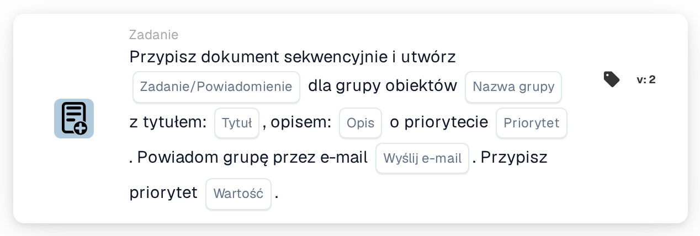

# Przypisz do grupy obiektu i utwórz zadanie/powiadomienie

<figure><figcaption>
Wersja 2
</figcaption></figure>

## Cel:

Ta karta przepływu pracy dodaje grupę odpowiedzialną za obiekt zamówienia zakupu dokumentu do sekwencyjnego przypisania dokumentu i dołącza do tego kroku zadanie lub powiadomienie. Obiekt jest pobierany z zamówień zakupu, z którymi dokument został dopasowany, a grupa jest ustalana na podstawie nazwy, która zawiera zarówno nazwę grupy wprowadzoną na karcie, jak i kod obiektu. Zadanie lub powiadomienie należy do kroku tej grupy w sekwencji.

## Komponenty karty:

1. **Zadanie/Powiadomienie**
   * **Opis:** Określa, czy dla grupy tworzone jest zadanie, czy powiadomienie.
   * **Opcje:**
     * **Zadanie:** Tworzone jest zadanie.
     * **Powiadomienie:** Tworzone jest powiadomienie.
2. **Nazwa grupy**
   * **Opis:** Część nazwy wspólna dla grup obiektów.
   * **Szczegóły:** Tekst porównywany z nazwami grup użytkowników organizacji. Grupa jest zgodna, jeśli jej nazwa zawiera ten tekst oraz kod obiektu zamówienia zakupu. Porównanie nie uwzględnia wielkości liter. Na przykład przy nazwie grupy **Approver** i zamówieniu zakupu dla obiektu **1000** zgodna byłaby grupa o nazwie **Approver 1000**.
3. **Tytuł**
   * **Opis:** Tytuł zadania lub powiadomienia.
   * **Szczegóły:** Krótki tekst identyfikujący zadanie lub powiadomienie.
4. **Opis**
   * **Opis:** Dodatkowe szczegóły dotyczące zadania lub powiadomienia.
   * **Szczegóły:** Tekst opisujący, co powinno zostać zrobione lub dlaczego grupa jest informowana.
5. **Priorytet**
   * **Opis:** Pilność zadania lub powiadomienia.
   * **Opcje:**
     * **duża waga:** Zadanie lub powiadomienie jest tworzone z wysokim priorytetem.
     * **średnia waga:** Zadanie lub powiadomienie jest tworzone ze średnim priorytetem.
     * **niska waga:** Zadanie lub powiadomienie jest tworzone z niskim priorytetem.
6. **Wyślij e-mail**
   * **Opis:** Określa, czy grupa jest dodatkowo informowana o zadaniu e-mailem.
   * **Opcje:**
     * **PRAWDA:** Do grupy wysyłane jest powiadomienie e-mail.
     * **FAŁSZ:** Powiadomienie e-mail nie jest wysyłane.
7. **Wartość**
   * **Opis:** Priorytet grupy w ramach sekwencyjnego przypisania.
   * **Szczegóły:** Liczba całkowita. Niższe liczby mają pierwszeństwo, przy czym 0 oznacza najwyższy priorytet. Jeśli nie wprowadzono wartości lub wprowadzono wartość ujemną, używany jest priorytet 1.

## Funkcjonalność:

* **Ustalanie obiektu:** Karta odczytuje zamówienia zakupu, z którymi dopasowano dokument, i zbiera kod obiektu (lokalizację zamówienia zakupu) każdego z nich.
* **Ustalanie grupy:** Dla każdego kodu obiektu karta wyszukuje grupy użytkowników, których nazwa zawiera zarówno **Nazwa grupy** z karty, jak i kod obiektu. Kody obiektów, dla których nie znaleziono grupy, są wymieniane w dzienniku przepływu pracy.
* **Wykonanie akcji:** Każda zgodna grupa zostaje dodana do sekwencyjnego przypisania z priorytetem z pola **Wartość**, wraz z zadaniem lub powiadomieniem. Samo przypisanie następuje na końcu przebiegu przepływu pracy: jako pierwszy przypisywany jest wpis z najniższym numerem priorytetu i tworzone jest jego zadanie lub powiadomienie. Wszystkie wpisy, łącznie z pierwszym, są zapisywane w dokumencie jako jego prośby o zatwierdzenie, a kolejne kroki sekwencji są z nich pobierane w rosnącej kolejności priorytetu. Jeśli w tym samym przebiegu inna karta przypisała już dokument bezpośrednio, to pierwsze przypisanie sekwencyjne jest pomijane, a jego zadanie lub powiadomienie nie jest tworzone w tym przebiegu.
* **Wartości domyślne:** Jeśli priorytet zadania nie jest ustawiony, używana jest **średnia waga**. Jeśli **Wyślij e-mail** nie jest ustawione, e-mail nie jest wysyłany. Jeśli **Zadanie/Powiadomienie** nie jest ustawione, tworzone jest zadanie, a dziennik przepływu pracy odnotowuje brakujące ustawienie.
* **Brakujące dane:**
  * Jeśli nazwa grupy, tytuł lub opis jest pusty, karta nie jest wykonywana i zgłasza brakujące dane w dzienniku przepływu pracy.
  * Jeśli dokument nie jest dopasowany do zamówienia zakupu, karta zgłasza brakujące dane zamiast dodać grupę.
  * Jeśli żadna grupa nie odpowiada żadnemu z kodów obiektów, żadna grupa nie zostaje dodana, a dziennik przepływu pracy odnotowuje, że nie znaleziono zgodnej grupy.

## Instalacja i konfiguracja:

* Grupy użytkowników powinny mieć takie nazwy, aby każda zawierała wspólną część nazwy oraz kod obiektu, na przykład **Approver 1000**, **Approver 2000**.
* Kartę można dodać z kategorii **Zadanie**. Następnie można skonfigurować typ (**Zadanie** lub **Powiadomienie**), wspólną część nazwy grup, tytuł, opis, priorytet zadania, ustawienie e-mail oraz pozycję w sekwencji (**Wartość**).
* Aby utworzyć łańcuch osób zatwierdzających, można połączyć w przepływie pracy kilka kart sekwencyjnych, każdą z własnym ustawieniem **Wartość**.

## Podsumowanie:

Karta przepływu pracy „Assign to Facility Group and Create a Task/Notification” umieszcza odpowiedzialny zespół obiektu w określonym miejscu sekwencyjnego zatwierdzania i przydziela mu jasne zadanie dla jego kroku. Jedna karta obejmuje wszystkie obiekty, o ile grupy użytkowników stosują spójny schemat nazewnictwa z kodem obiektu w nazwie.
