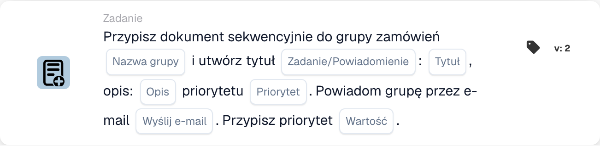

# Przypisz do grupy zaopatrzenia i utwórz zadanie/powiadomienie

<figure><figcaption>
Pola karty w pokazanej wersji. Pola nie są jeszcze skonfigurowane.
</figcaption></figure>

## **Cel**

Karta przepływu pracy "**Przypisz dokument do grupy zaopatrzeniowej i utwórz zadanie/powiadomienie**" przypisuje dokument do określonej grupy zakupowej, tworzy zadanie lub powiadomienie ze zdefiniowanymi szczegółami i opcjonalnie powiadamia grupę za pośrednictwem e-maila. Priorytetyzuje wykonywanie zadań na podstawie konfigurowalnej numerycznej wartości priorytetu.

## **Komponenty karty**

1. **Nazwa grupy**
   * **Opis:** Określa grupę zakupową odpowiedzialną za obsługę dokumentu.
   * **Szczegóły:** Pole, w którym użytkownik może ręcznie wprowadzić nazwę grupy zakupowej.
2. **Zadanie/Powiadomienie**
   * **Opis:** Definiuje, czy dla grupy tworzone jest zadanie, czy powiadomienie.
   * **Szczegóły:** Pole, w którym użytkownik może wybrać między utworzeniem zadania a powiadomienia.
3. **Tytuł**
   * **Opis:** Tytuł zadania lub powiadomienia utworzonego dla grupy.
   * **Szczegóły:** Pole do podania zwięzłego i identyfikowalnego tytułu zadania lub powiadomienia.
4. **Opis**
   * **Opis:** Dalsze szczegóły o zadaniu lub powiadomieniu.
   * **Szczegóły:** Pole do opisania celu zadania oraz podania kontekstu lub instrukcji.
5. **Priorytet**
   * **Opis:** Definiuje poziom pilności zadania lub powiadomienia.
   * **Opcje:**
     * **High:** Zadanie wymaga natychmiastowej uwagi.
     * **Średni:** Zadanie jest ważne, ale nie pilne.
     * **Low:** Zadaniem można się zająć później.
6. **Wyślij pocztę**
   * **Opis:** Konfiguruje, czy powiadomienie e-mail powinno zostać wysłane do grupy.
   * **Opcje:**
     * **True:** Wysyła powiadomienie e-mail do grupy zakupowej.
     * **False:** Nie jest wysyłane powiadomienie e-mail.
7. **Wartość**
   * **Opis:** Ustawia numeryczny priorytet dla wykonywania zadania.
   * **Szczegóły:** Pole do wprowadzenia wartości liczbowej, gdzie niższa liczba reprezentuje wyższy priorytet.

## **Funkcjonalność**

* **Ocena warunku:**\
  Karta wykonuje swoje akcje tylko wtedy, gdy zdefiniowane warunki przepływu pracy są spełnione.
* **Przypisanie grupy i utworzenie zadania/powiadomienia:**\
  Dokument jest przypisywany do określonej grupy zakupowej. Tworzone jest zadanie lub powiadomienie z podanym tytułem, opisem i priorytetem.
* **Powiadomienie e-mail:**\
  Jeśli "Send Mail" jest ustawione na True, grupa otrzymuje e-mail o zadaniu lub powiadomieniu.

## **Konfiguracja**

1. **Zdefiniuj nazwę grupy:**
   * Wprowadź nazwę grupy zakupowej w polu Group Name.
2. **Skonfiguruj szczegóły zadania/powiadomienia:**
   * Określ Title i Description dla zadania lub powiadomienia.
   * Wybierz Priority z menu rozwijanego (High, Medium lub Low).
3. **Włącz powiadomienie e-mailem:**
   * Ustaw "Send Mail" na True lub False na podstawie tego, czy grupa powinna otrzymać e-mail.
4. **Ustaw priorytet numeryczny:**
   * Wprowadź wartość liczbową w polu Value, aby określić priorytet zadania, gdzie niższe wartości są przetwarzane jako pierwsze.
5. Zapisz konfigurację karty i aktywuj przepływ pracy.

## **Podsumowanie**

Karta przepływu pracy "Assign Document to Procurement Group and Create Task/Notification" zapewnia, że dokumenty są kierowane do odpowiedniej grupy z jasnymi instrukcjami zadań i poziomami priorytetu. Umożliwiając opcjonalne powiadomienia e-mail, karta ta poprawia widoczność zadań i zapewnia płynne wykonywanie przepływu pracy.

<!-- workflow-card-practical-example-20261021 -->

## Praktyczny przykład

**Kiedy używać:** Połącz zadanie zaopatrzenia z priorytetem z zadaniem przeglądu.

**Konfiguracja:** Wybierz `Demo Procurement`, tytuł `Review order variance`, priorytet zadania i priorytet przydziału.

**Oczekiwany wynik i kontrprzykład:** Skonfigurowany cel zaopatrzenia otrzymuje udokumentowane przypisanie i zadanie/powiadomienie. W rezultacie sprawdź oba i ich priorytety.

To jest ilustracyjna konfiguracja i oczekiwany wynik. Korzystaj z pól, użytkowników i grup skonfigurowanych w Twojej organizacji testowej; nie jest to twierdzenie, że ten przykład został wykonany.
