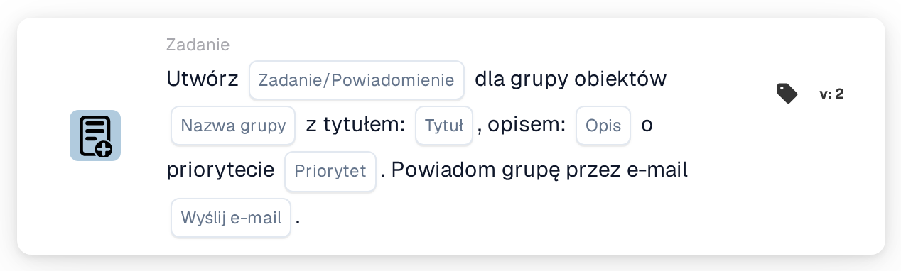

# Utwórz nowe zadanie i przypisz je do grupy obiektu

<figure><figcaption>
Wersja 2
</figcaption></figure>

## Cel:

Ta karta przepływu pracy tworzy zadanie lub powiadomienie dla grupy odpowiedzialnej za obiekt zamówienia zakupu dokumentu. Obiekt nie jest wybierany na karcie: jest pobierany z zamówień zakupu, z którymi dokument został dopasowany. Następnie karta wyszukuje grupę użytkowników, której nazwa zawiera zarówno nazwę grupy wprowadzoną na karcie, jak i kod obiektu, i tworzy zadanie dla tej grupy. Sam dokument nie zostaje ponownie przypisany.

Jeśli karta ma także przypisywać dokument do grupy obiektu w ramach sekwencyjnego przypisania, można użyć karty **Assign to Facility Group and Create a Task/Notification**.

## Komponenty karty:

1. **Zadanie/Powiadomienie**
   * **Opis:** Określa, czy dla grupy tworzone jest zadanie, czy powiadomienie.
   * **Opcje:**
     * **Zadanie:** Tworzone jest zadanie.
     * **Powiadomienie:** Tworzone jest powiadomienie.
2. **Nazwa grupy**
   * **Opis:** Część nazwy wspólna dla grup obiektów.
   * **Szczegóły:** Tekst porównywany z nazwami grup użytkowników organizacji. Grupa jest zgodna, jeśli jej nazwa zawiera ten tekst oraz kod obiektu zamówienia zakupu. Porównanie nie uwzględnia wielkości liter. Na przykład przy nazwie grupy **Warehouse** i zamówieniu zakupu dla obiektu **1000** zgodna byłaby grupa o nazwie **Warehouse 1000**.
3. **Tytuł**
   * **Opis:** Tytuł zadania lub powiadomienia.
   * **Szczegóły:** Krótki tekst identyfikujący zadanie lub powiadomienie.
4. **Opis**
   * **Opis:** Dodatkowe szczegóły dotyczące zadania lub powiadomienia.
   * **Szczegóły:** Tekst opisujący, co powinno zostać zrobione lub dlaczego grupa jest informowana.
5. **Priorytet**
   * **Opis:** Pilność zadania lub powiadomienia.
   * **Opcje:**
     * **duża waga:** Zadanie lub powiadomienie jest tworzone z wysokim priorytetem.
     * **średnia waga:** Zadanie lub powiadomienie jest tworzone ze średnim priorytetem.
     * **niska waga:** Zadanie lub powiadomienie jest tworzone z niskim priorytetem.
6. **Wyślij e-mail**
   * **Opis:** Określa, czy grupa jest dodatkowo informowana o zadaniu e-mailem.
   * **Opcje:**
     * **PRAWDA:** Do grupy wysyłane jest powiadomienie e-mail.
     * **FAŁSZ:** Powiadomienie e-mail nie jest wysyłane.

## Funkcjonalność:

* **Ustalanie obiektu:** Karta odczytuje zamówienia zakupu, z którymi dopasowano dokument, i zbiera kod obiektu (lokalizację zamówienia zakupu) każdego z nich.
* **Ustalanie grupy:** Dla każdego kodu obiektu karta wyszukuje grupy użytkowników, których nazwa zawiera zarówno **Nazwa grupy** z karty, jak i kod obiektu. Kody obiektów, dla których nie znaleziono grupy, są wymieniane w dzienniku przepływu pracy.
* **Tworzenie zadania:** Dla zgodnej grupy tworzone jest zadanie lub powiadomienie z tytułem, opisem i priorytetem z karty, powiązane z dokumentem. Jeśli zgodnych jest kilka grup, zadanie jest tworzone tylko dla jednej z nich; karta nie określa, dla której.
* **Wartości domyślne:** Jeśli priorytet nie jest ustawiony, używana jest **średnia waga**. Jeśli **Wyślij e-mail** nie jest ustawione, e-mail nie jest wysyłany. Jeśli **Zadanie/Powiadomienie** nie jest ustawione, tworzone jest zadanie, a dziennik przepływu pracy odnotowuje brakujące ustawienie.
* **Brakujące dane:**
  * Jeśli nazwa grupy, tytuł lub opis jest pusty, karta nie jest wykonywana i zgłasza brakujące dane w dzienniku przepływu pracy.
  * Jeśli dokument nie jest dopasowany do zamówienia zakupu, karta zgłasza brakujące dane zamiast utworzyć zadanie.
  * Jeśli żadna grupa nie odpowiada żadnemu z kodów obiektów, żadne zadanie nie jest tworzone, a dziennik przepływu pracy odnotowuje, że nie znaleziono zgodnej grupy.

## Instalacja i konfiguracja:

* Grupy użytkowników powinny mieć takie nazwy, aby każda zawierała wspólną część nazwy oraz kod obiektu, na przykład **Warehouse 1000**, **Warehouse 2000**.
* Kartę można dodać z kategorii **Zadanie**. Następnie można skonfigurować typ (**Zadanie** lub **Powiadomienie**), wspólną część nazwy grup, tytuł, opis, priorytet i ustawienie e-mail.

## Podsumowanie:

Karta przepływu pracy „Create a New Task and assign it to Facility Group” włącza do procesu zespół właściwego obiektu, nie zmieniając tego, do kogo przypisany jest dokument. Jedna karta obejmuje wszystkie obiekty, o ile grupy użytkowników stosują spójny schemat nazewnictwa z kodem obiektu w nazwie.
