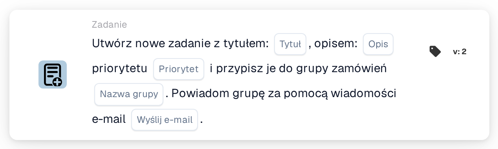
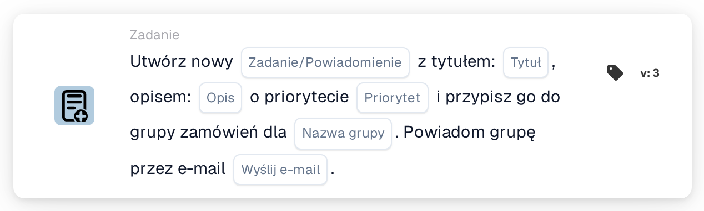

# Utwórz nowe zadanie i przypisz je do grupy zaopatrzenia

<figure><figcaption>
Wersja 2
</figcaption></figure>

<figure><figcaption>
Wersja 3
</figcaption></figure>

## **Cel:**

Karta przepływu pracy **„Utwórz zadanie dla grupy zaopatrzeniowej”** tworzy nowe zadanie dynamicznie przypisane do grupy zakupowej określonej w konfiguracji. Zadanie to może być przypisane z różnymi poziomami priorytetu, a opcjonalne powiadomienie e-mail może zostać wysłane w celu poinformowania grupy o zadaniu. Karta ta zapewnia, że właściwy zespół jest powiadamiany na podstawie warunków przepływu pracy.

## **Komponenty karty:**

1. **Tytuł**
   * **Opis:** Określa tytuł zadania.
   * **Szczegóły:** To pole identyfikuje tworzone zadanie, zapewniając zwięzły tytuł ułatwiający identyfikację.
2. **Opis**
   * **Opis:** Dostarcza dalszych szczegółów o zadaniu.
   * **Szczegóły:** To pole służy do opisania celu zadania oraz wszelkiego niezbędnego kontekstu lub instrukcji.
3. **Priorytet**
   * **Opis:** Definiuje pilność zadania.
   * **Opcje:**
     * **High:** Zadanie wymaga natychmiastowej uwagi.
     * **Średni:** Zadanie jest ważne, ale nie pilne.
     * **Low:** Zadaniem można się zająć później.
4. **Nazwa grupy**
   * **Opis:** Określa grupę zakupową, do której zostanie przypisane zadanie.
   * **Szczegóły:** To pole wyznacza grupę zakupową odpowiedzialną za zadanie. Zapewnia, że zadanie jest kierowane do właściwego zespołu.
5. **Powiadomienie e-mail**
   * **Opis:** Konfiguruje, czy powiadomienie e-mail powinno zostać wysłane do przypisanej grupy zakupowej.
   * **Opcje:**
     * **True:** Wysyła powiadomienie e-mail do grupy zakupowej.
     * **False:** Nie jest wysyłane powiadomienie e-mail.

## **Funkcjonalność:**

* **Ocena warunku:**\
  Karta wykonuje swoją akcję tylko wtedy, gdy zarówno **„Kiedy”**, jak i **„I sekcje”** są prawdziwe.
* **Tworzenie zadania:**\
  Karta tworzy nowe zadanie, przypisując je do grupy zakupowej zdefiniowanej w polu "Group Name". Zadanie to będzie zawierać określony tytuł, opis i poziom priorytetu.
* **Powiadomienie e-mail:**\
  Jeśli opcja powiadomienia e-mail jest ustawiona na true, do grupy zakupowej wysyłany jest e-mail informujący ją o zadaniu.

## **Konfiguracja:**

* **Zdefiniuj szczegóły zadania:**\
  Wprowadź tytuł zadania, opis i poziom priorytetu.
* **Wybierz grupę zaopatrzenia:**\
  Wybierz grupę zakupową, która będzie odpowiedzialna za zadanie.
* **Włącz powiadomienie e-mailem:**\
  Określ, czy powiadomienie e-mail powinno zostać wysłane do grupy po utworzeniu zadania.

## **Podsumowanie:**

Karta przepływu pracy "Create Task for Procurement Group" zapewnia, że zadania są automatycznie przypisywane do odpowiedniej grupy zakupowej ze zdefiniowanymi priorytetami. Karta ta może również powiadamiać grupę za pośrednictwem e-maila, aby zapewnić szybką obsługę zadań, poprawiając efektywność przepływu pracy i zarządzanie zadaniami.

<!-- workflow-card-practical-example-20261021 -->

## Praktyczny przykład

**Kiedy stosować:** Poproś zespół zakupowy o sprawdzenie wyjątku na fakturze.

**Konfiguracja:** Wybierz `Demo Procurement`, tytuł `Review order variance`, opis i priorytet.

**Oczekiwany wynik i kontrprzykład:** Utworzono zadanie dla wybranej grupy zakupowej. Sprawdź przydzielonego zadania i opis; samo utworzenie nie potwierdza, że ​​rozbieżność została rozwiązana.

To jest ilustracyjna konfiguracja i oczekiwany wynik. Korzystaj z pól, użytkowników i grup skonfigurowanych w Twojej organizacji testowej; nie jest to twierdzenie, że ten przykład został wykonany.
