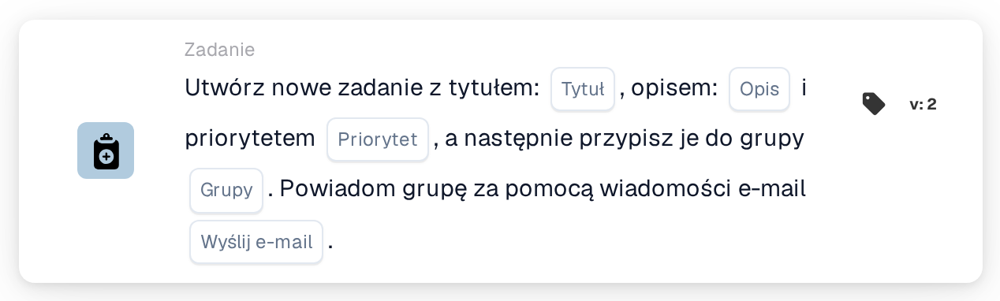
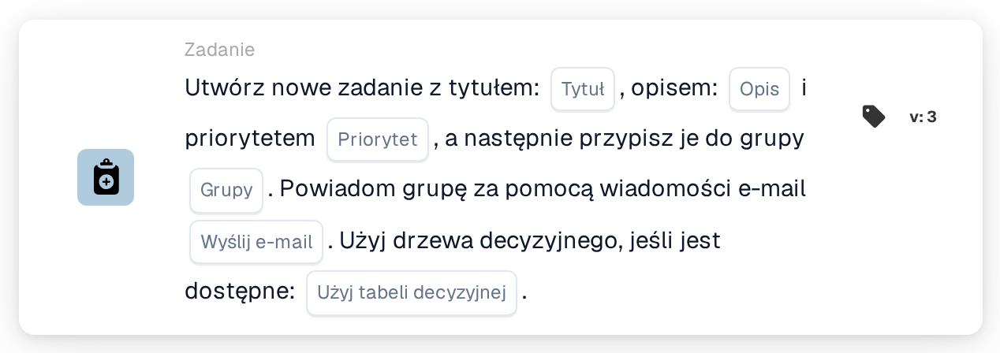
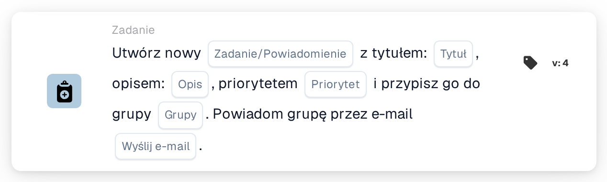

# Utwórz nowe zadanie i przypisz je do grupy

<figure><figcaption>
Wersja 2
</figcaption></figure>

<figure><figcaption>
Wersja 3
</figcaption></figure>

<figure><figcaption>
Wersja 4
</figcaption></figure>

## **Cel:**

Karta przepływu pracy **„Utwórz zadanie grupowe lub powiadomienie”** ułatwia tworzenie zadań lub powiadomień dla określonych grup, zapewniając efektywną komunikację i zarządzanie zadaniami. Rozszerzona o funkcjonalność drzewa decyzyjnego w późniejszych wersjach, dynamicznie określa przypisaną grupę lub metodę, usprawniając operacje.

## **Komponenty karty:**

1. **Tytuł**
   * **Opis**: Określa tytuł zadania lub powiadomienia.
   * **Szczegóły**: Działa jako identyfikator utworzonego zadania lub powiadomienia.
2. **Opis**
   * **Opis**: Opisuje kontekst lub szczegóły zadania lub powiadomienia.
   * **Szczegóły**: Zapewnia jasność co do jego celu.
3. **Priorytet**
   * **Opis**: Ustawia poziom ważności zadania.
   * **Opcje**:
     * **High**: Wymaga natychmiastowego działania.
     * **Średni**: Ważne, ale mniej pilne.
     * **Low**: Można obsłużyć później.
4. **Przypisana grupa**
   * **Opis**: Określa grupę odpowiedzialną za zadanie lub powiadomienie.
   * **Szczegóły**: Wybierana z listy rozwijanej dostępnych grup.
5. **Powiadomienie e-mail**
   * **Opis**: Umożliwia wysłanie e-maila w celu powiadomienia przypisanej grupy.
   * **Opcje**:
     * **True**: Wysyła powiadomienie e-mail.
     * **False**: Nie jest wysyłane powiadomienie e-mail.

## **Dodatkowe komponenty w Version 3 i Version 4**

1. **Decision Tree (tylko Version 3)**
   * **Opis**: Umożliwia użycie drzewa decyzyjnego do dynamicznego tworzenia zadań.
   * **Opcje**:
     * **True**: Aktywuje przetwarzanie drzewa decyzyjnego.
     * **False**: Wyłącza przetwarzanie drzewa decyzyjnego.
2. **Task/Notification Option** **(tylko Version 4)**
   * **Opis**: Umożliwia utworzenie zadania lub powiadomienia.
   * **Opcje**:
     * **Zadanie**: Tworzy zadanie dla wybranej grupy.
     * **Notification**: Wysyła powiadomienie zamiast tworzenia zadania.

## **Funkcjonalność:**

* **Ocena warunku**:\
  Wykonuje akcję karty tylko wtedy, gdy sekcje **„Kiedy”** i **„I sekcje”** są prawdziwe.
* **Tworzenie zadania lub powiadomienia**:
  * Tworzone jest zadanie dla wybranej grupy z określonym tytułem, opisem i priorytetem.
  * W Version 4 karta może utworzyć powiadomienie zamiast zadania.
* **Dynamiczne przypisanie (tylko Version 3)**:\
  Jeśli włączone, drzewo decyzyjne dynamicznie określa grupę docelową.
* **Powiadomienie e-mail**:\
  Wysyła powiadomienie e-mail do grupy, jeśli opcja e-mail jest ustawiona na true.

## **Konfiguracja:**

1. **Zdefiniuj szczegóły zadania lub powiadomienia**: Wprowadź tytuł, opis i priorytet.
2. **Assign to a Group**: Wybierz grupę z listy rozwijanej do przypisania zadania lub powiadomienia.
3. **Włącz powiadomienie e-mailem**: Wskaż, czy grupa powinna zostać powiadomiona za pośrednictwem e-maila.
4. **Użyj drzewa decyzyjnego (tylko wersja 3)**: Włącz drzewo decyzyjne, aby dynamicznie przypisać grupę.
5. **Select Output Type (tylko Version 4)**: Wybierz, czy karta tworzy zadanie, czy powiadomienie.

## **Podsumowanie:**

Karta przepływu pracy **„Utwórz zadanie grupowe lub powiadomienie”** upraszcza zarządzanie zadaniami i powiadomieniami, kierując je bezpośrednio do grup. Jej funkcja dynamicznego przypisywania, włączana przez drzewo decyzyjne, zwiększa elastyczność, podczas gdy powiadomienia e-mail zapewniają terminową komunikację. Wersje 3 i 4 dodają zaawansowaną funkcjonalność, czyniąc ją wszechstronnym narzędziem do efektywnego wykonywania przepływu pracy.

<!-- workflow-card-practical-example-20261021 -->

## Praktyczny przykład

**Kiedy używać:** Daj współdzielonemu zespołowi konkretne zadanie przeglądu.

**Konfiguracja:** Wybierz grupę `Demo Finance`, tytuł `Review invoice`, przydatny opis i priorytet. Wyłącz pocztę e-mail na potrzeby pierwszego testu.

**Oczekiwany wynik i kontrprzykład:** Grupa otrzymuje zadanie. Potwierdź tytuł i osobę przypisaną na liście zadań; Dostarczanie wiadomości e-mail podlega oddzielnej kontroli, jeśli jest włączone.

To jest ilustracyjna konfiguracja i oczekiwany wynik. Korzystaj z pól, użytkowników i grup skonfigurowanych w Twojej organizacji testowej; nie jest to twierdzenie, że ten przykład został wykonany.
