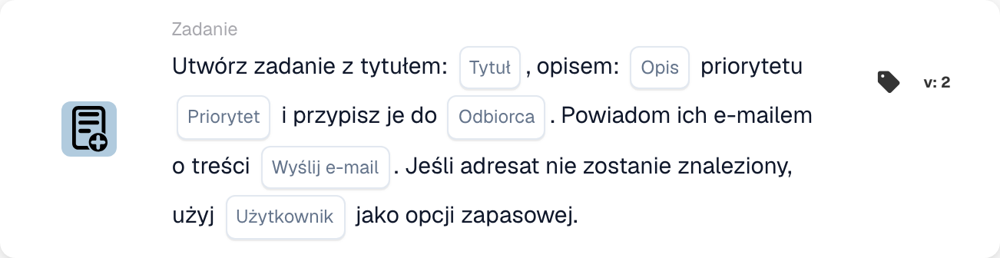

# Utwórz Nowe Zadanie i przypisz je Odbiorcy

<figure><figcaption>
Pola karty w pokazanej wersji. Pola nie są jeszcze skonfigurowane.
</figcaption></figure>

## **Cel:**

Karta przepływu pracy **„Utwórz zadanie z opcją powrotu”** zapewnia efektywne delegowanie zadań poprzez przypisywanie zadań do określonych ról — dyspozytora lub purchasera — przy jednoczesnym zastosowaniu mechanizmu zapasowego, aby zapobiec niepowodzeniom przypisywania zadań. Karta ta poprawia niezawodność i elastyczność przepływu pracy w dynamicznych scenariuszach.

## **Komponenty karty:**

1. **Tytuł**
   * **Opis**: Określa tytuł tworzonego zadania.
   * **Szczegóły**: Zapewnia zwięzły identyfikator zadania.
2. **Opis**
   * **Opis**: Opisuje cel lub kontekst zadania.
   * **Szczegóły**: Wyjaśnia szczegóły zadania.
3. **Priorytet**
   * **Opis**: Ustawia poziom pilności zadania.
   * **Opcje**:
     * **High**: Wymaga natychmiastowej uwagi.
     * **Średni**: Ważne, ale nie pilne.
     * **Low**: Można obsłużyć później.
4. **Przypisana rola**
   * **Opis**: Określa podstawową rolę, do której przypisywane jest zadanie.
   * **Opcje**:
     * **Disponent**: Przypisuje zadanie do disponenta.
     * **Kupujący**: Przypisuje zadanie do purchasera.
5. **Powiadomienie e-mail**
   * **Opis**: Umożliwia powiadomienie przypisanego użytkownika za pośrednictwem e-maila.
   * **Opcje**:
     * **True**: Wysyła powiadomienie e-mail do użytkownika.
     * **False**: Nie jest wysyłane powiadomienie e-mail.
6. **Użytkownik rezerwowy**
   * **Opis**: Zapewnia opcję zapasową dla przypisania zadania, jeśli rola odbiorcy nie zostanie znaleziona.
   * **Szczegóły**: Umożliwia wybór użytkownika z listy rozwijanej w celu zapewnienia delegowania zadania.

## **Funkcjonalność:**

* **Ocena warunku**:\
  Karta wykonuje się tylko wtedy, gdy warunki w sekcjach **„Kiedy”** i **„I sekcje”** są spełnione.
* **Przypisanie zadania**:
  * Zadanie jest przypisywane do wybranej roli (disponent lub purchaser).
  * Jeśli określona rola nie zostanie znaleziona, zadanie jest przypisywane do użytkownika z zapasowej listy rozwijanej.
* **Powiadomienie e-mail**:\
  Wysyła e-mail do przypisanego użytkownika, jeśli powiadomienie e-mail jest włączone.

## **Konfiguracja:**

1. **Określ szczegóły zadania**: Wprowadź tytuł, opis i priorytet zadania.
2. **Wybierz rolę podstawową**: Wybierz rolę, do której zostanie przypisane zadanie (disponent lub purchaser).
3. **Skonfiguruj użytkownika zastępczego**: Wybierz użytkownika zapasowego z listy rozwijanej, aby zapewnić przypisanie zadania, jeśli podstawowa rola nie zostanie znaleziona.
4. **Włącz powiadomienie e-mailem**: Wskaż, czy przypisany użytkownik powinien otrzymać powiadomienie e-mail.

## **Podsumowanie:**

Karta przepływu pracy **„Utwórz zadanie z opcją powrotu”** zapewnia bezproblemowe delegowanie zadań poprzez zintegrowanie mechanizmu zapasowego. Przypisując zadania na podstawie ról i zapewniając alternatywną opcję użytkownika, zwiększa niezawodność i elastyczność w procesach zarządzania zadaniami.

<!-- workflow-card-complete-example-20261021 oc_task -->

### Przykład zadania odbiorcy

**Konfiguracja:** Wprowadź tytuł `Review delivery date`, opis identyfikujący dokument syntetyczny, priorytet, rolę Kupującego i skonfigurowanego użytkownika rezerwowego `DEMO_REVIEWER`. Wyłącz powiadomienia e-mail dla tej przykładowej konfiguracji.

**Oczekiwany wynik i kontrprzykład:** Kiedy nabywca może zostać rozstrzygnięty, nowe zadanie jest przydzielane temu użytkownikowi. Jeśli nie można rozpoznać roli, używana jest skonfigurowana funkcja zastępcza. Zweryfikuj rzeczywistą własność zadania; brak głównego odbiorcy nie jest dowodem na istnienie użytkownika zastępczego ani na to, że utworzono zadanie.

To jest ilustracyjna konfiguracja testu i oczekiwany wynik; nie zostało ono wykonane. Skorzystaj z danych i odbiorców skonfigurowanych w Twojej organizacji testowej.
