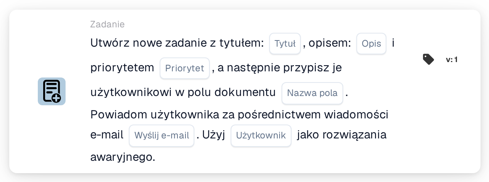
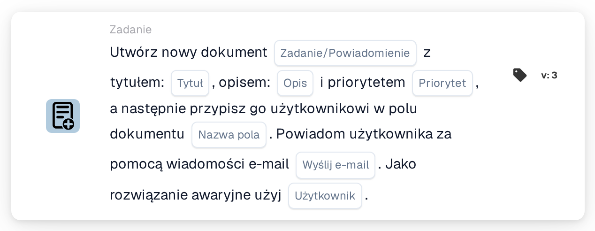

# Utwórz nowe zadanie i przypisz je do użytkownika w polu dokumentu

<figure><figcaption>
Wersja 1
</figcaption></figure>

<figure><figcaption>
Wersja 3
</figcaption></figure>

## **Cel:**

Karta przepływu pracy **„Utwórz zadanie lub powiadomienie oparte na polu”** służy do tworzenia zadań lub powiadomień dynamicznie przypisanych do użytkowników zidentyfikowanych w określonych polach dokumentu. Karta ta zapewnia opcjonalny mechanizm zapasowy, aby zapewnić płynne wykonywanie przepływu pracy nawet wtedy, gdy pole dokumentu nie określa prawidłowego użytkownika.

## **Komponenty karty:**

1. **Tytuł**
   * **Opis**: Określa tytuł zadania lub powiadomienia.
   * **Szczegóły**: Służy do nazwania i identyfikacji tworzonego zadania lub powiadomienia.
2. **Opis**
   * **Opis**: Dostarcza dodatkowych szczegółów o zadaniu lub powiadomieniu.
   * **Szczegóły**: Zapewnia, że odbiorca rozumie cel i kontekst zadania lub powiadomienia.
3. **Priorytet**
   * **Opis**: Definiuje pilność zadania lub powiadomienia.
   * **Opcje**:
     * **High**: Wymaga natychmiastowej uwagi.
     * **Średni**: Ważne, ale mniej pilne.
     * **Low**: Można obsłużyć później.
4. **Nazwa pola**
   * **Opis**: Określa pole dokumentu, które zostanie użyte do przypisania zadania lub powiadomienia.
   * **Szczegóły**: Wybrane pole dynamicznie określi użytkownika, do którego zostanie przypisane zadanie lub powiadomienie. Jeśli pole jest puste lub nieprawidłowe, zadanie lub powiadomienie zostanie przypisane do użytkownika zapasowego wybranego z listy rozwijanej.
5. **Powiadomienie e-mail**
   * **Opis**: Konfiguruje, czy przypisany użytkownik jest powiadamiany za pośrednictwem e-maila.
   * **Opcje**:
     * **True**: Wysyła powiadomienie e-mail do przypisanego użytkownika.
     * **False**: Nie jest wysyłane powiadomienie e-mail.
6. **Użytkownik rezerwowy**
   * **Opis**: Umożliwia wybór użytkownika z listy rozwijanej w celu przypisania zadania lub powiadomienia, gdy w polu dokumentu nie zostanie znaleziony prawidłowy użytkownik.
   * **Szczegóły**: Zapewnia przypisanie zadania lub powiadomienia, nawet jeśli pole dokumentu jest puste lub nieprawidłowe.

## **Dodatkowe komponenty w Version 3:**

1. **Typ powiadomienia**
   * **Opis**: Określa, czy karta tworzy zadanie, czy powiadomienie.
   * **Opcje**:
     * **Zadanie**: Tworzy zadanie przypisane do określonego użytkownika.
     * **Notification**: Wysyła powiadomienie zamiast tworzenia zadania.

## **Funkcjonalność:**

* **Ocena warunku**:\
  Karta wykonuje swoją akcję tylko wtedy, gdy zarówno **„Kiedy”**, jak i **„I sekcje”** są prawdziwe.
* **Tworzenie zadania lub powiadomienia**:
  * Przypisuje zadanie lub powiadomienie do użytkownika zidentyfikowanego w polu dokumentu.
  * W Version 3 umożliwia utworzenie zadania lub powiadomienia.
* **Mechanizm zapasowy**:\
  Jeśli pole dokumentu nie identyfikuje prawidłowego użytkownika, karta przypisuje zadanie lub powiadomienie do użytkownika zapasowego wybranego z listy rozwijanej.
* **Powiadomienie e-mail**:\
  Wysyła powiadomienie e-mail do przypisanego użytkownika, jeśli tak skonfigurowano.

## **Konfiguracja:**

1. **Zdefiniuj szczegóły zadania lub powiadomienia**: Wprowadź tytuł, opis i priorytet.
2. **Wybierz pole dokumentu**: Wybierz pole, które określa użytkownika do przypisania zadania lub powiadomienia.
3. **Włącz powiadomienie e-mailem**: Określ, czy powiadomienie e-mail powinno zostać wysłane do przypisanego użytkownika.
4. **Wybierz opcję Użytkownik zastępczy**: Wybierz użytkownika zapasowego z listy rozwijanej do przypisania, jeśli pole dokumentu nie identyfikuje prawidłowego użytkownika.
5. **Określ typ powiadomienia (wersja 3)**: Wskaż, czy karta tworzy zadanie, czy powiadomienie.

## **Podsumowanie:**

Karta przepływu pracy **„Utwórz zadanie lub powiadomienie oparte na polu”** usprawnia zarządzanie zadaniami i powiadomieniami poprzez dynamiczne przypisywanie obowiązków na podstawie pól dokumentu. Jej mechanizm użytkownika zapasowego i rozszerzone opcje w Version 3 zapewniają elastyczność, gwarantując, że zadania lub powiadomienia są zawsze przypisywane, nawet gdy dane dokumentu są niekompletne.

<!-- workflow-card-practical-example-20261021 -->

## Praktyczny przykład

**Kiedy używać:** Utwórz zadanie przeglądu dla użytkownika wymienionego w danych dokumentu.

**Konfiguracja:** Wybierz `reviewer_name`, użytkownika rezerwowego `Demo Reviewer A`, tytuł `Review invoice` i priorytet.

**Oczekiwany wynik i kontrprzykład:** Rozpoznawalny użytkownik w terenie otrzymuje zadanie. Puste lub nierozwiązane pole wykorzystuje skonfigurowaną opcję rezerwową; przetestuj obie ścieżki.

To jest ilustracyjna konfiguracja i oczekiwany wynik. Korzystaj z pól, użytkowników i grup skonfigurowanych w Twojej organizacji testowej; nie jest to twierdzenie, że ten przykład został wykonany.
