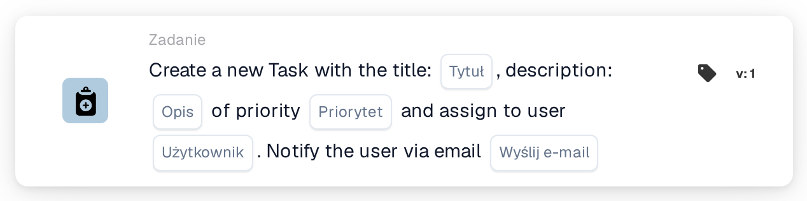
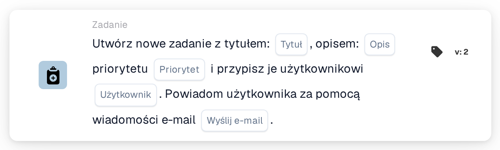
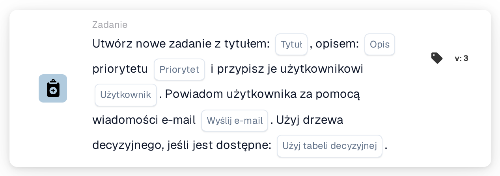
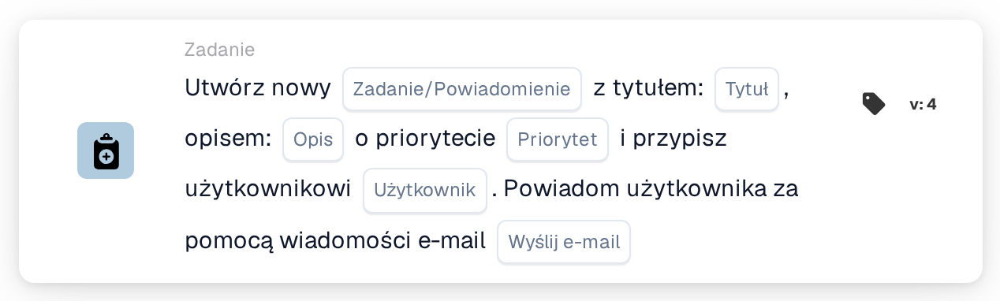

# Utwórz Nowe Zadanie i przypisz je Użytkownikowi

<figure><figcaption>
Wersja 1
</figcaption></figure>

<figure><figcaption>
Wersja 2
</figcaption></figure>

<figure><figcaption>
Wersja 3
</figcaption></figure>

<figure><figcaption>
Wersja 4
</figcaption></figure>

## **Cel**

Karta przepływu pracy **„Utwórz zadanie lub powiadomienie”** usprawnia zarządzanie zadaniami i powiadomieniami w ramach przepływów pracy. W zależności od wersji karta może tworzyć zadania, wysyłać powiadomienia i wykorzystywać dodatkową funkcjonalność, taką jak drzewa decyzyjne, do dynamicznego przetwarzania.

## **Komponenty karty**

1. **Tytuł**
   * **Opis**: Definiuje tytuł tworzonego zadania lub powiadomienia.
   * **Szczegóły**: Tytuł zapewnia jasny i zwięzły identyfikator zadania lub powiadomienia.
2. **Opis**
   * **Opis**: Dostarcza szczegółów o zadaniu lub powiadomieniu.
   * **Szczegóły**: Pomaga wyjaśnić cel lub kontekst zadania lub powiadomienia dla przypisanego użytkownika.
3. **Priorytet**
   * **Opis**: Ustawia poziom pilności zadania.
   * **Opcje**:
     * **High**: Wymaga natychmiastowej uwagi.
     * **Średni**: Ważne, ale nie pilne.
     * **Low**: Można obsłużyć później.
4. **Przypisany użytkownik**
   1. **Opis**: Określa użytkownika, do którego przypisane jest zadanie.
   2. **Szczegóły**: Użytkownicy są wybierani z listy rozwijanej dostępnego personelu.
5. **Powiadomienie e-mail**
   * **Opis**: Określa, czy przypisany użytkownik otrzymuje powiadomienie e-mail.
   * **Opcje**:
     * **True**: Wysyła powiadomienie e-mail do użytkownika.
     * **False**: Nie jest wysyłane powiadomienie e-mail.

## Dodatkowe komponenty **w Version 3 i Version 4**

1. **Decision Tree (tylko Version 3)**
   * **Opis**: Umożliwia użycie drzewa decyzyjnego do dynamicznego tworzenia zadań.
   * **Opcje**:
     * **True**: Aktywuje przetwarzanie drzewa decyzyjnego.
     * **False**: Wyłącza przetwarzanie drzewa decyzyjnego.
2. **Task or Notification (tylko Version 4)**
   * **Opis**: Umożliwia wybór między utworzeniem zadania a powiadomienia.
   * **Opcje**:
     * **Zadanie**: Tworzy zadanie.
     * **Notification**: Tworzy powiadomienie zamiast zadania.

## **Funkcjonalność:**

* **Ocena warunku**:\
  Karta jest wyzwalana tylko wtedy, gdy warunki w sekcjach **„Kiedy”** i **„I sekcje”** są spełnione.
* **Tworzenie zadania lub powiadomienia**:
  * Wersje 2 i 3: Tworzone jest zadanie z określonym tytułem, opisem, priorytetem i przypisanym użytkownikiem.
  * Version 4: Umożliwia utworzenie zadania lub powiadomienia.
* **Dynamiczne przypisanie**:
  * W Version 3 drzewo decyzyjne dynamicznie określa użytkownika, do którego ma zostać przypisane zadanie, na podstawie parametrów przepływu pracy.
* **Powiadomienie e-mail**:\
  Wysyła e-mail do przypisanego użytkownika, jeśli opcja powiadomienia jest włączona.

## **Konfiguracja:**

1. **Wybierz opcję Wersja**: Wybierz wersję karty na podstawie wymaganej funkcjonalności:
   * Version 2: Podstawowe tworzenie zadań z ręcznym przypisaniem użytkownika i powiadomieniami e-mail.
   * Version 3: Zawiera funkcjonalność drzewa decyzyjnego do dynamicznego przypisywania użytkownika.
   * Version 4: Dodaje możliwość utworzenia powiadomienia zamiast zadania.
2. **Wprowadź szczegóły zadania**: Określ tytuł, opis i priorytet zadania lub powiadomienia.
3. **Przypisz użytkownika**:
   * Dla wersji 2 i 4 ręcznie wybierz użytkownika z listy rozwijanej.
   * Dla Version 3 włącz drzewo decyzyjne, aby dynamicznie określić przypisanego użytkownika.
4. **Włącz powiadomienie e-mailem**: Określ, czy przypisany użytkownik powinien otrzymać powiadomienie e-mail.
5. (Dla Version 4) **Wybierz Zadanie lub Powiadomienie**: Wskaż, czy utworzyć zadanie, czy powiadomienie.

## **Podsumowanie:**

Karta przepływu pracy **„Utwórz zadanie lub powiadomienie”** jest wszechstronnym narzędziem do zarządzania zadaniami i powiadomieniami. Wspierając dynamiczne przypisywanie użytkowników za pomocą drzew decyzyjnych i zapewniając opcje tworzenia zadań lub powiadomień, zwiększa elastyczność przepływu pracy i efektywność współpracy.

<!-- workflow-card-practical-example-20261021 -->

## Praktyczny przykład

**Kiedy używać:** Daj jednemu recenzentowi wyraźny element działania.

**Konfiguracja:** Wybierz `Demo Reviewer A`, tytuł `Review invoice`, opis i priorytet.

**Oczekiwany wynik i kontrprzykład:** Wybrany użytkownik otrzymuje nowe zadanie. Potwierdź tytuł zadania i osobę przypisaną; zadanie pozostaje do wykonania przez recenzenta.

To jest ilustracyjna konfiguracja i oczekiwany wynik. Korzystaj z pól, użytkowników i grup skonfigurowanych w Twojej organizacji testowej; nie jest to twierdzenie, że ten przykład został wykonany.
