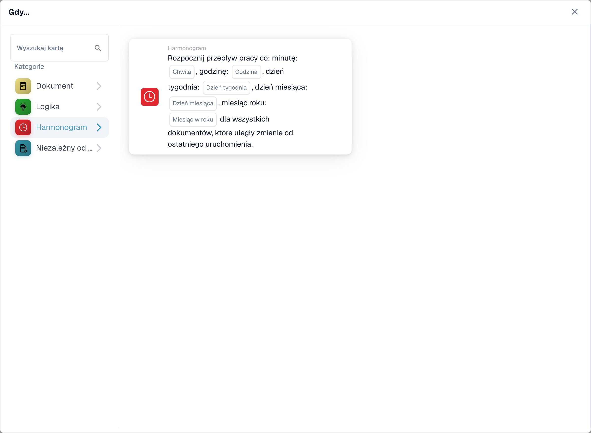
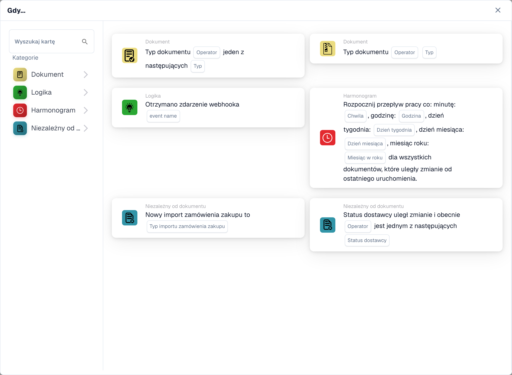
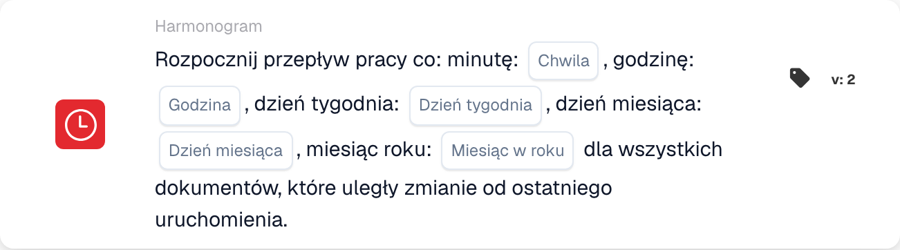

# Gdy

Karty w tej kategorii pokazane w bibliotece **Dodaj kartę** Kreatora przepływu pracy:

<figure><figcaption>
Karty dostępne w wybranej kategorii. Uzupełnij pola przed użyciem. Niektóre etykiety tej wersji interfejsu nie są jeszcze przetłumaczone lub mają nieprawidłowe tłumaczenie. Objaśnienia na tej stronie używają właściwych terminów; obraz przedstawia rzeczywisty interfejs.
</figcaption></figure>

<figure><figcaption>
Karty dostępne w wybranej kategorii. Uzupełnij pola przed użyciem. Niektóre etykiety tej wersji interfejsu nie są jeszcze przetłumaczone lub mają nieprawidłowe tłumaczenie. Objaśnienia na tej stronie używają właściwych terminów; obraz przedstawia rzeczywisty interfejs.
</figcaption></figure>

#### Zrozumienie „kiedy” w konfiguracjach przepływu pracy

**Cel „Kiedy”**

* Sekcja „Kiedy” w konfiguracji przepływu pracy definiuje warunki wyzwalacza, które inicjują określoną akcję przepływu pracy. Warunki te opierają się na określonych kryteriach związanych z atrybutami dokumentów lub działaniami użytkowników w systemie ERP.

**Jak to działa**

* W Twoim interfejsie „Kiedy” wydaje się być punktem wyjścia, w którym użytkownicy mogą wybierać różne karty wyzwalające. Każda karta określa warunki, na jakich zostaną wykonane kolejne akcje (zdefiniowane w sekcji „I”).

**Karty warunków typu dokumentu**

* Karty z ikoną dokumentu widoczną na zrzucie ekranu to odmiany warunków „Typ dokumentu”, które służą do wyzwalania przepływów pracy w oparciu o typ przetwarzanego dokumentu. Oto zestawienie każdego rodzaju pokazanej karty stanu:
  * **Typ dokumentu (Operator) jeden z (Typ)**: Ta karta aktywuje akcję, gdy typ dokumentu odpowiada jednemu z typów określonych na liście. Operator może uwzględnić opcje takie jak „jest” lub „nie jest”, umożliwiając określenie warunków włączających lub wyłączających.
  * **Typ dokumentu (Operator) (Typ)**: Ten prostszy wariant jest wyzwalany w oparciu o warunek typu pojedynczego dokumentu. Zwykle sprawdza, czy typ dokumentu „jest” czy „nie jest” określonym typem, bez możliwości wyboru spośród wielu typów.
  *

**Selerowy rytm**

* Karta z ikoną zegara na zrzucie ekranu to warunek „Seler Beat”, który służy do wyzwalania przepływów pracy na podstawie daty i godziny.

#### Konfigurowanie karty wyzwalającej „Kiedy”.

1. **Wybór typu warunku**: Użytkownicy zaczynają od wybrania typu warunku, który jest odpowiedni dla przepływu pracy, który chcą zautomatyzować. W tym przypadku skupiamy się na typach dokumentów.
2. **Definiowanie operatora**: Użytkownicy muszą wybrać operator logiczny — taki jak „jest” lub „nie” — który stanowi podstawę porównywania rzeczywistych typów dokumentów ze zdefiniowanymi warunkami.
3. **Określanie typów dokumentów**: W zależności od karty użytkownicy mogą wybrać jeden lub wiele typów dokumentów, które uruchomią przepływ pracy podczas przetwarzania dokumentów tego typu.
4. **Finalizacja wyzwalacza**: Po skonfigurowaniu warunku staje się on podstawą do uruchomienia określonych akcji zdefiniowanych w przepływie pracy. Jeżeli dokument spełni ustawiony warunek, zdefiniowane działania zostaną automatycznie zainicjowane.

#### Praktyczne zastosowanie

W praktyce te karty wyzwalające są kluczowe dla automatyzacji procesów takich jak zatwierdzenia, powiadomienia czy wszelkie procedury zależne od rodzaju obsługiwanego dokumentu. Na przykład, jeśli typem dokumentu „jest” „Faktura” i odpowiada on warunkom ustawionym na karcie „Kiedy”, przepływ pracy może automatycznie skierować dokument do przetworzenia płatności.

Taka konfiguracja gwarantuje, że przepływy pracy będą nie tylko wydajne, ale także dostosowane do konkretnych potrzeb operacyjnych organizacji, ograniczając ręczny nadzór i przyspieszając procesy obsługi dokumentów.

Podsumowując, część „Kiedy” konfiguracji przepływu pracy dotyczy ustawienia etapu dla zautomatyzowanych działań w oparciu o określone, wcześniej zdefiniowane warunki. To potężne narzędzie zapewniające, że Twój system ERP dynamicznie reaguje na potrzeby firmy, zwiększając zarówno produktywność, jak i dokładność w zarządzaniu dokumentami.

[Odniesienie do wyzwalacza zmiany zmiennej i zdarzenia webhooka](../cards-overview/logic-cards-guide.md).

<!-- workflow-card-example-celery_beat-20261021 -->

### Zaplanowane przetwarzanie

<figure><figcaption>
Pola karty w pokazanej wersji. Pola nie są jeszcze skonfigurowane. Niektóre etykiety tej wersji interfejsu nie są jeszcze przetłumaczone lub mają nieprawidłowe tłumaczenie. Objaśnienia na tej stronie używają właściwych terminów; obraz przedstawia rzeczywisty interfejs.
</figcaption></figure>

`CELERY_BEAT` · wersja 2

Użyj zaplanowanego wyzwalacza dla dokumentów zmienionych od czasu poprzedniego uruchomienia. Aby uzyskać dzienny harmonogram demonstracyjny, wybierz minutę `0`, godzinę `9` i oferowane wartości na każdy dzień/miesiąc. Sprawdź skonfigurowaną strefę czasową harmonogramu i następne zaplanowane uruchomienie. Ten wyzwalacz nie jest dowodem na to, że niezmienione dokumenty są ponownie przetwarzane.
