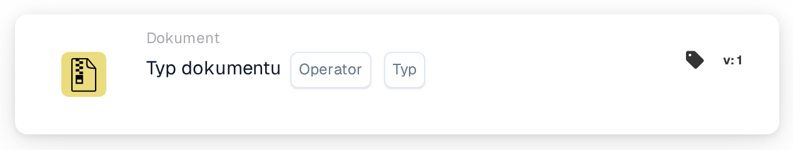

# Operacja typu dokumentu

<figure><figcaption>
Wersja 1
</figcaption></figure>

<figure><figcaption>
Wersja 2
</figcaption></figure>

## **Cel:**

Ta karta przepływu pracy jest specjalnie zaprojektowana do wykonywania predefiniowanych operacji na dokumentach kategoryzowanych według typu. Usprawnia obsługę różnych form dokumentów w systemie ERP, zapewniając, że każdy typ jest przetwarzany zgodnie ze swoimi unikalnymi wymaganiami i politykami organizacyjnymi.

## **Funkcjonalność:**

* **Walidacja typu dokumentu**: Karta sprawdza, czy dokument odpowiada określonemu typowi, co pozwala użytkownikom potwierdzić jego kategoryzację.
* **Operatora**: Użytkownicy mogą ustawić warunki określające typ dokumentu. Dostępne operatory:
  * **Is**: Potwierdza, że dokument odpowiada wskazanemu typowi dokumentu.
  * **Nie jest**: Zapewnia, że dokument nie odpowiada wskazanemu typowi dokumentu.
* **Typy dokumentów**: Obsługiwane typy dokumentów:
  * **Faktura**
  * **Nota debetowa**
  * **Nota kredytowa**
  * **Zamówienie**
  * **Potwierdzenie zamówienia**
  * **Powiadomienie o wysyłce z wyprzedzeniem**

## **Zastosowanie**:

Ta karta jest przydatna dla menedżerów dokumentów i administratorów, którzy muszą zadbać o prawidłową klasyfikację dokumentów w celu usprawnienia ich przetwarzania. Walidacja typów dokumentów zwiększa automatyzację przepływów pracy, umożliwia akcje specyficzne dla dokumentu i utrzymuje porządek w rekordach.

## **Przykładowy scenariusz**:

* Użytkownik przesyła dokument oznaczony jako „Debit Note”. Za pomocą operatora „Is” karta potwierdza, że typ dokumentu rzeczywiście jest „Debit Note”, co pozwala systemowi zastosować odpowiednie reguły przetwarzania i właściwie go skategoryzować.

Dzięki zastosowaniu karty „Document Type” organizacje mogą zautomatyzować klasyfikację dokumentów, zapewnić spójność w obsłudze dokumentów i zwiększyć wydajność przepływów pracy związanych z zarządzaniem dokumentami.
