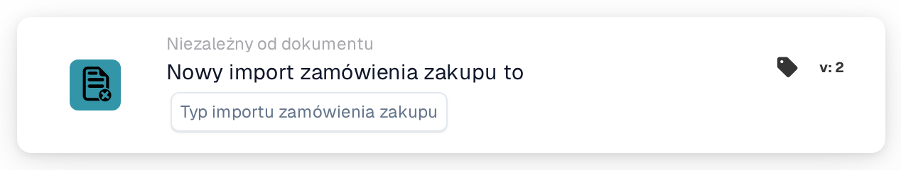

# Import zamówienia zakupu

<figure><figcaption>
Wersja 2
</figcaption></figure>

## Cel:

Ta karta przepływu pracy uruchamia przepływ pracy (wyzwalacz), gdy zamówienie zakupu zostaje zaimportowane do DocBits. Może reagować na nowo utworzone zamówienia zakupu, na aktualizacje istniejących zamówień zakupu lub na oba przypadki. Przepływ pracy działa bez dokumentu, dlatego można go używać do informowania osób lub wywoływania innych systemów za każdym razem, gdy napływają dane zamówień zakupu.

## Komponenty karty:

1. **Typ importu zamówienia zakupu**
   * **Opis:** Określa, jaki rodzaj importu uruchamia przepływ pracy.
   * **Opcje:**
     * **nowe zamówienie zakupu.** Zamówienie zakupu wcześniej nie istniało i zostało utworzone przez import.
     * **aktualizacja istniejącego zamówienia zakupu.** Istniejące zamówienie zakupu zostało zaktualizowane przez import.

     Można wybrać obie opcje.

## Funkcjonalność:

* **Kiedy uruchamiany jest przepływ pracy:** Gdy zamówienie zakupu z systemu ERP jest przetwarzane przez import zamówień zakupu, system zapisuje, czy było ono nowe, czy było aktualizacją. Następnie uruchamia wszystkie włączone przepływy pracy organizacji niezależne od dokumentu (z wyjątkiem przepływów webhook i przepływów zaplanowanych) i przekazuje do nich tę informację wraz z identyfikatorem i numerem zamówienia zakupu. Dzieje się tak tylko wtedy, gdy moduł przepływów pracy jest aktywny dla organizacji i istnieją aktywne przepływy pracy. Zamówienie zakupu, które zostaje pominięte, ponieważ przychodząca wersja nie jest nowsza od zapisanej, nie uruchamia przepływów pracy.
* **Ocena warunku:** Karta sprawdza, czy typ importu przekazany do przepływu pracy jest jednym z typów wybranych na karcie.
* **Wykonanie akcji:**
  * **Warunek prawdziwy:**\
    Jeśli typ importu odpowiada wybranej opcji, przepływ pracy jest kontynuowany z kolejnymi kartami.
  * **Warunek fałszywy:**\
    Jeśli typ importu nie jest zgodny lub przepływ pracy został uruchomiony przez inne zdarzenie niezależne od dokumentu (na przykład zmianę statusu dostawcy), karta nie jest spełniona, a kroki następujące po niej nie są wykonywane.
* **Brakujące dane:** Jeśli na karcie nie wybrano żadnego typu importu, karta nie ocenia warunku. Zgłasza brakujące dane wejściowe (lub błąd) w dzienniku przepływu pracy, a kroki następujące po niej nie są wykonywane.

## Instalacja i konfiguracja:

* Kartę można dodać z grupy **WHEN**, kategoria **Niezależny od dokumentu**. Następnie wybiera się jeden lub oba typy importu, dodaje dalsze warunki i akcje, a przepływ pracy zostaje zapisany i włączony.

## Podsumowanie:

Karta „Purchase order import” pozwala przepływom pracy reagować, gdy tylko dane zamówienia zakupu zostaną utworzone lub zaktualizowane, bez czekania na dokument. Dzięki temu procesy następcze nadążają za zamówieniami zakupu napływającymi z systemu ERP.
