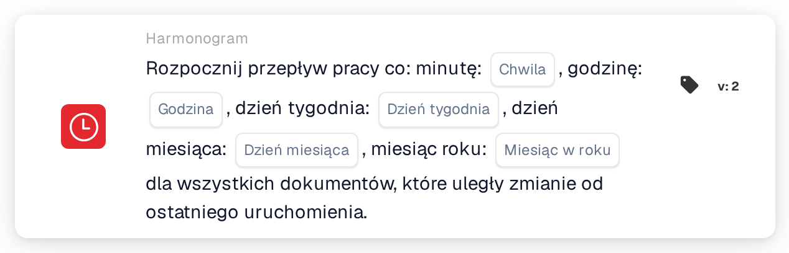

# Zaplanowane uruchomienie przepływu pracy

<figure><figcaption>
Wersja 2
</figcaption></figure>

## Cel:

Ta karta przepływu pracy uruchamia przepływ pracy (wyzwalacz) według harmonogramu czasowego, podobnie jak zadanie cron. O każdej zaplanowanej godzinie przepływ pracy jest wykonywany dla wszystkich dokumentów, które zmieniły się od poprzedniego uruchomienia. Jest to przydatne przy regularnym przetwarzaniu, takim jak nocne kontrole, okresowe przypomnienia lub działania następcze, które nie powinny być uruchamiane natychmiast przy każdej zmianie dokumentu.

## Komponenty karty:

1. **Chwila**
   * **Opis:** Minuta lub minuty godziny, w których uruchamiany jest przepływ pracy.
   * **Szczegóły:** Wartość w stylu cron, na przykład `0`, `30`, `0,30` lub `*/15`. Puste pole oznacza każdą minutę (`*`).
2. **Godzina**
   * **Opis:** Godzina lub godziny dnia, w których uruchamiany jest przepływ pracy.
   * **Szczegóły:** Wartość w stylu cron, na przykład `6` lub `8-18`. Puste pole oznacza każdą godzinę (`*`).
3. **Dzień tygodnia**
   * **Opis:** Dzień lub dni tygodnia, w które uruchamiany jest przepływ pracy.
   * **Szczegóły:** Wartość w stylu cron, na przykład `1-5`. Puste pole oznacza każdy dzień tygodnia (`*`).
4. **Dzień miesiąca**
   * **Opis:** Dzień lub dni miesiąca, w które uruchamiany jest przepływ pracy.
   * **Szczegóły:** Wartość w stylu cron, na przykład `1` lub `1,15`. Puste pole oznacza każdy dzień (`*`).
5. **Miesiąc w roku**
   * **Opis:** Miesiąc lub miesiące, w których uruchamiany jest przepływ pracy.
   * **Szczegóły:** Wartość w stylu cron, na przykład `1` lub `1-6`. Puste pole oznacza każdy miesiąc (`*`).

## Funkcjonalność:

* **Strefa czasowa:** Wszystkie godziny są podawane w UTC, strefie czasowej serwerów DocBits. Na przykład 6:00 UTC to 8:00 czasu środkowoeuropejskiego letniego.
* **Kiedy uruchamiany jest przepływ pracy:** Po zapisaniu i włączeniu przepływu pracy na podstawie pięciu pól tworzony jest wpis harmonogramu. Jeśli przepływ pracy zostanie wyłączony lub usunięty, wpis harmonogramu jest usuwany. O każdej zaplanowanej godzinie system:
  * wyszukuje dokumenty organizacji, które od ostatniego uruchomienia przepływu pracy zostały zmodyfikowane, zapisane lub zmieniły status,
  * uruchamia przepływ pracy oddzielnie dla każdego z tych dokumentów w tle oraz
  * zapamiętuje czas tego uruchomienia jako punkt początkowy dla następnego.

  Dokumenty, które osiągnęły limit wykonań przepływu pracy, są pomijane. Jeśli przepływ pracy zostanie wyłączony w trakcie przetwarzania dokumentów, pozostałe dokumenty nie są już przetwarzane.
* **Ocena warunku:** Karta sprawdza, czy przepływ pracy został uruchomiony przez harmonogram.
* **Wykonanie akcji:**
  * **Warunek prawdziwy:**\
    Gdy przepływ pracy zostaje uruchomiony przez harmonogram, karta jest spełniona i przepływ pracy jest kontynuowany z kolejnymi kartami.
  * **Warunek fałszywy:**\
    Gdy przepływ pracy zostaje uruchomiony w inny sposób, na przykład przez wyzwalacz dokumentu, webhook lub zmianę zmiennej, karta nie jest spełniona, a kroki następujące po niej nie są wykonywane.
* **Tylko jeden harmonogram na przepływ pracy:** Jeśli w Advanced Workflow Builder przepływ pracy zawiera kilka kart harmonogramu, do harmonogramu używana jest tylko pierwsza z nich.
* **Zapisywanie:** Jeśli podczas zapisywania nie można zaktualizować wpisu harmonogramu, przepływ pracy i tak zostaje zapisany, a wyświetlane jest ostrzeżenie. Ponowne zapisanie przepływu pracy ponawia próbę aktualizacji.

## Instalacja i konfiguracja:

* Kartę można dodać z grupy **WHEN**, kategoria **Harmonogram**. Następnie wypełnia się pola czasu; pola pozostawione puste oznaczają „każdy”. Na przykład minuta `0`, godzina `6`, dzień tygodnia `1-5` i pozostałe pola puste uruchamiają przepływ pracy o 6:00 UTC w dni robocze. Następnie dodaje się dalsze warunki i akcje, a przepływ pracy zostaje zapisany i włączony.

## Podsumowanie:

Karta „Scheduled workflow start” uruchamia przepływy pracy o stałych porach zamiast przy każdym zdarzeniu. Ponieważ każde uruchomienie obejmuje tylko dokumenty, które zmieniły się od poprzedniego uruchomienia, regularne przetwarzanie koncentruje się na nowej pracy.
