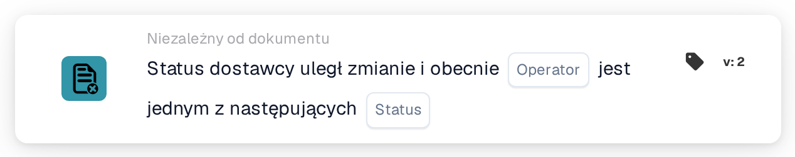

# Zmiana statusu dostawcy

<figure><figcaption>
Wersja 2
</figcaption></figure>

## Cel:

Ta karta przepływu pracy uruchamia przepływ pracy (wyzwalacz), gdy zmienia się status dostawcy, na przykład gdy dostawca zostaje zatwierdzony lub odrzucony. Przepływ pracy działa bez dokumentu, dlatego można go używać do powiadamiania osób lub uruchamiania kolejnych kroków w procesie wdrażania dostawców.

## Komponenty karty:

1. **Operator**
   * **Opis:** Określa, czy nowy status dostawcy powinien być jednym z wybranych statusów, czy żadnym z nich.
   * **Opcje:**
     * **Jest:** Warunek jest prawdziwy, jeśli nowy status jest jednym z wybranych statusów.
     * **Nie jest:** Warunek jest prawdziwy, jeśli przepływ pracy został uruchomiony przez zmianę statusu dostawcy, a nowy status nie jest jednym z wybranych statusów.
2. **Status**
   * **Opis:** Statusy dostawcy, z którymi porównywany jest nowy status.
   * **Opcje:** Jeden lub kilka spośród:
     * **Zatwierdzony**
     * **Oczekujące na zatwierdzenie AP**
     * **Oczekujące na zatwierdzenie**
     * **Oczekująca rejestracja**
     * **Odrzucony**

## Funkcjonalność:

* **Kiedy uruchamiany jest przepływ pracy:** Zmiana statusu dostawcy w zarządzaniu dostawcami uruchamia wszystkie włączone przepływy pracy organizacji niezależne od dokumentu (z wyjątkiem przepływów webhook i przepływów zaplanowanych) i przekazuje do nich nowy status. Dzieje się tak na przykład wtedy, gdy zapraszany jest nowy dostawca (status oczekującej rejestracji), gdy dostawca zostaje przesłany do zatwierdzenia, zatwierdzony lub odrzucony albo gdy dane dostawcy zostają zapisane z innym statusem. Status powinien być jednym ze statusów dostawców skonfigurowanych dla organizacji; w przeciwnym razie żaden przepływ pracy nie jest uruchamiany. Przepływy pracy są uruchamiane tylko wtedy, gdy moduł przepływów pracy jest aktywny dla organizacji i istnieją aktywne przepływy pracy.
* **Ocena warunku:** Karta porównuje status przekazany do przepływu pracy ze statusami wybranymi na karcie.
* **Wykonanie akcji:**
  * **Warunek prawdziwy:**\
    Przy **Jest** nowy status jest jednym z wybranych statusów. Przy **Nie jest** przepływ pracy został uruchomiony przez zmianę statusu dostawcy, a nowy status nie jest jednym z wybranych statusów. Przepływ pracy jest kontynuowany z kolejnymi kartami.
  * **Warunek fałszywy:**\
    Jeśli warunek nie jest spełniony, karta nie jest spełniona, a kroki następujące po niej nie są wykonywane.
* **Inne zdarzenia niezależne od dokumentu:** Import zamówienia zakupu również uruchamia wszystkie przepływy pracy niezależne od dokumentu, w tym przepływy pracy z tą kartą. Takie uruchomienie nie spełnia karty przy żadnym z operatorów, dlatego kolejne kroki są wykonywane tylko przy zmianach statusu dostawcy.
* **Brakujące dane:** Jeśli na karcie nie wybrano żadnego statusu, karta nie ocenia warunku. Zgłasza brakujące dane wejściowe (lub błąd) w dzienniku przepływu pracy, a kroki następujące po niej nie są wykonywane.
* **Nieprawidłowy operator:** Jeśli operator nie jest ani **Jest**, ani **Nie jest**, karta zgłasza w dzienniku przepływu pracy błąd konfiguracji karty.

## Instalacja i konfiguracja:

* Kartę można dodać z grupy **WHEN**, kategoria **Niezależny od dokumentu**. Następnie wybiera się operator oraz jeden lub kilka statusów, dodaje dalsze warunki i akcje, a przepływ pracy zostaje zapisany i włączony.

## Podsumowanie:

Karta „Supplier status changed” łączy zarządzanie dostawcami z przepływami pracy. Zatwierdzenia, odrzucenia i inne zmiany statusu mogą bezpośrednio wyzwalać powiadomienia i kolejne kroki, dzięki czemu wdrażanie dostawców nie zależy od ręcznych kontroli.
