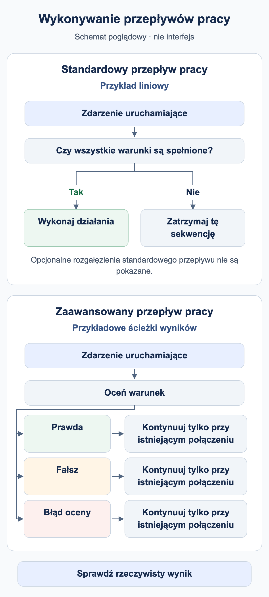

# Kiedy uruchamia się mój workflow?

Workflow wymaga powodu uruchomienia i pasujących warunków. **Typ dokumentu to Faktura** wybiera dokumenty; nie oznacza to, że każda zmiana faktury automatycznie rozpocznie kolejne wykonanie.

<figure><figcaption>Przykłady poglądowe: liniowa sekwencja standardowa wykonuje działania tylko po spełnieniu warunków; w przeciwnym razie ta sekwencja się zatrzymuje. Zaawansowany węzeł warunku może korzystać z osobno skonfigurowanych ścieżek wyników. Ścieżka jest kontynuowana tylko wtedy, gdy istnieje połączenie. Pominięto opcjonalne rozgałęzienia standardowe; nie jest to zrzut interfejsu DocBits.</figcaption></figure>

## Od zdarzenia do działania

1. Sprawdź organizację, uprawnienia i moduł Workflow, a w razie potrzeby także dostęp Advanced.
2. Określ powód: przetwarzanie dokumentu, jawne wywołanie ręczne lub obsługiwany wyzwalacz zdarzenia. Używaj tylko wyzwalaczy rzeczywiście dostępnych w katalogu danej wersji.
3. W Standard Workflow muszą być spełnione When i wszystkie warunki And. Fałszywy warunek zatrzymuje tę liniową sekwencję kart.
4. W Advanced Workflow ścieżkę wyznaczają wejście i połączone wyjścia wyników. Fałszywy warunek And może kontynuować przez pomarańczowe wyjście; czerwone obsługuje błąd oceny.
5. Sprawdź wynik we właściwym miejscu: odpowiedzi testowej, zapisanym wykonaniu, dokumencie lub systemie odbiorcy.

**Start** jest wejściem ręcznym. Pakiet używa When dla Faktury oraz dokładnego numeru szkoleniowego, aby spełnić wymagania obecnego interfejsu. Zaimportuj go jako nieaktywny i testuj ręcznie. Udany test ręczny nie potwierdza automatycznego uruchamiania przez zdarzenia dokumentu.

## Zapis, test i aktywacja

| Stan | Znaczenie |
| --- | --- |
| Lokalny szkic | Kopia w przeglądarce nie zastępuje zapisu na serwerze. |
| Zapisany | Konfiguracja istnieje. Aktywację sprawdź osobno: zapis nowej reguły może już ją włączyć. |
| Test Advanced | Ocenia bieżący graf, również niezapisane zmiany. Działania na dokumentach są symulowane. |
| Aktywny | Reguła może zostać uwzględniona przy właściwym zdarzeniu. To zdarzenie przetestuj osobno. |

Test Manager i okno testu Advanced to różne powierzchnie wykonania. Samo porównanie statusu nie potwierdza przypisania, powiadomienia ani odbioru eksportu. Przed użyciem prawdziwych dokumentów sprawdź skutki wybranej metody testowania.

## Wiele workflow i powtórzenia

Niższe wartości **kolejności wykonywania** są realizowane wcześniej. Na przykład workflow 100 przygotowuje pole, a 200 je sprawdza. Stosuj różne wartości i potwierdź faktycznie odczytane dane w nowym wykonaniu. Położenie karty Advanced na płótnie nie wyznacza kolejności.

**Change Status to → Trigger Workflows** może zainicjować kolejne wykonanie. **Run Workflow** wywołuje wybrany workflow. Oba mechanizmy wymagają świadomych warunków; żaden nie gwarantuje jednokrotnego wykonania. Ogranicz zadania i eksport przez stan procesu biznesowego i jawnie przetestuj drugie uruchomienie. Sam znacznik zakończenia nie chroni ogólnie przed równoczesnym podwójnym przetwarzaniem.

Przejdź do [przykładu Advanced](advanced-workflow-case-study.md), [pakietu szkoleniowego](workflow-training-kit.md) i [diagnostyki](workflow-troubleshooting.md).

## WF-01: Ćwiczenie i odbiór

Zapisz zdarzenie, filtr, aktywność i wersję. Sprawdź dwa wykonania oraz kolejność 100/200 z rzeczywiście odczytanym polem. Oddziel oczekiwane żądanie od zaobserwowanego wykonania.

[Ścieżka nauki](workflow-learning-path.md)
