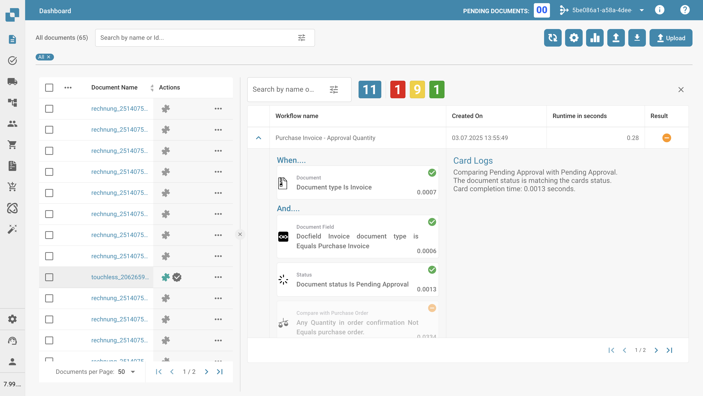

# Dzienniki Przepływu

## Film

Film o wyszukiwaniu to wersja testowa z rzeczywistymi ekranami DocBits. Film o diagnostyce nadal korzysta ze schematów oznaczonych jako ilustracje.
### Znajdź właściwe wykonanie


Wersja testowa: rzeczywiste ekrany DocBits z akcjami dokumentu, przepływem dokumentów, czasami kroków, pustymi logami oraz filtrami statusu i daty. Dokument nie ma zapisanego wykonania Advanced Workflow. Ta wersja nie obejmuje jeszcze wierszy wykonań, stronicowania ani diagnostyki węzłów.




[Otwórz film](https://docbits-videos.fra1.cdn.digitaloceanspaces.com/settings-assistant/advanced_workflow_logs_search/v3/pl.mp4) · [Napisy (WebVTT)](https://docbits-videos.fra1.cdn.digitaloceanspaces.com/settings-assistant/advanced_workflow_logs_search/v3/pl.vtt) · 1:58

Transkrypcja

**Zacznij od dokumentu**

Na pulpicie dokumentów otwórz menu akcji i wybierz Przepływ dokumentów. Rzeczywista historia pokazuje import i OCR. Otwórz krok, aby sprawdzić czas oczekiwania i przetwarzania. Te kroki są odrębne od węzłów Advanced Workflow.

**Odczytaj rzeczywiste liczniki**

Tutaj widzisz logi workflow tego samego dokumentu. Niebieski oznacza liczbę wszystkich wykonań, czerwony błędy, żółty niespełnione warunki, a zielony sukcesy. Ten dokument demonstracyjny nie ma zapisanych wykonań. Dlatego wszystkie cztery liczniki pokazują zero.

**Sprawdź kolumny wykonań**

Tabela zawiera nazwę workflow, czas utworzenia, czas trwania i wynik. Rozróżniaj powtarzające się wykonania na podstawie znacznika czasu. W tej wersji testowej nie ma wiersza do otwarcia. Pusta lista sama w sobie nie dowodzi błędu wykonania.

**Otwórz filtry statusu**

Ikona filtrów otwiera rzeczywiste menu. Wybierz sortowanie według nazwy lub czasu utworzenia, rosnąco albo malejąco. Status oferuje sukces, niespełniony warunek i błąd. Na ekranie widzisz rzeczywisty interfejs DocBits.

**Wybierz daty i wyczyść filtry**

Wybierz okres za pomocą daty rozpoczęcia i zakończenia lub kalendarza. Format to rok, miesiąc i dzień. Przycisk zastosowania pobiera wyniki. Wyczyść filtry resetuje wybór. Wyszukiwanie wyczyść oddzielnie. W tej wersji nazwy miesięcy w kalendarzu pozostają angielskie.

**Podgląd: nadal brakuje zapisanego wykonania**

Ta wersja testowa pozwala sprawdzić dostęp do dokumentu, szczegóły przetwarzania i elementy sterujące logami. Nadal brakuje zapisanego wykonania Advanced Workflow, aby pokazać rzeczywiste wiersze, stronicowanie, ścieżki i komunikaty węzłów. Film nie symuluje tych wyników.

### Śledź węzły i diagnozuj



[Napisy (WebVTT)](https://docbits-videos.fra1.cdn.digitaloceanspaces.com/settings-assistant/advanced_workflow_logs_diagnosis/v2/pl.vtt) · 1:45

Transkrypcja

**Rozwiń wykonanie**

Rozwiń wiersz workflow. Wykonanie zaawansowane pokazuje graf po lewej i komunikaty po prawej; standardowe pokazuje sekwencję kart. Dane opisują tamto wykonanie i mogą różnić się od bieżącego edytora.

**Wybierz węzeł**

Przesuń lub powiększ graf i kliknij węzeł. Card Logs pokazuje komunikaty. Wait ALL i Wait ANY także mogą zawierać komunikaty węzła. Odczytuj je wraz z wybranym węzłem i znacznikiem czasu wykonania.

**Rozróżnij wyniki**

Zielony oznacza sukces, pomarańczowy fałszywy warunek, czerwony błąd, szary pominięcie. Pominięty węzeł nie wykonał się. Przed zmianą sprawdź, czy wybrano inną gałąź albo zabrakło wymaganego wejścia do bramki.

**Znajdź pierwszą rozbieżność**

Śledź rzeczywistą ścieżkę od wejścia. Dla fałszywego warunku kwoty sprawdź pomarańczowy. Przy błędzie odczytaj komunikat i sprawdź czerwony. Obsługa błędu może się udać, choć całe wykonanie nadal zgłasza pierwotny błąd.

**Sprawdź łączenie gałęzi**

Dla Wait ALL sprawdź każde źródło i połączony wynik. Dla ANY lub OR znajdź pasujące źródło. Dwa wyjścia jednego węzła nie są niezależnymi akceptacjami. Pomarańczowy wynik warunku może być zamierzony.

**Popraw i sprawdź**

Zapisz nazwę workflow, odwołanie dokumentu, czas, węzeł i dokładny komunikat. Popraw konfigurację lub dane i przetestuj powtarzalny scenariusz. Zapisz i sprawdź aktywację. Porównaj nowe wykonanie ze starym; wcześniejsze dzienniki opisują wcześniejsze zachowanie.

## **Przegląd**

**Dzienniki Przepływu** pozwalają użytkownikom analizować, które przepływy pracy zostały wykonane dla dokumentu, zrozumieć wyniki wykonania i zagłębić się w szczegóły na poziomie warunków w celu debugowania lub walidacji.

## **Dostęp do Dzienników Przepływu**

Aby uzyskać dostęp do dzienników przepływu:

1. Przejdź do **Pulpitu**.
2. Kliknij menu **Akcje** (ikona trzech kropek) obok wybranego dokumentu.
3. Wybierz **Dzienniki Przepływu** z menu.
   * <mark style="color:red;">**Uwaga**</mark>**:** Funkcja workflow musi być włączona, aby uzyskać dostęp do tej opcji.
4.  Pojawi się **panel boczny** pokazujący podsumowanie wykonanych przepływów pracy.

    

## **Składniki Panelu Dzienników Przepływu**

#### **1. Liczniki Podsumowania Przepływu**

Znajdują się na górze panelu dzienników:

* **Niebieski**: Całkowita liczba wykonanych przepływów pracy.
* **Czerwony**: Przepływy pracy zakończone **błędami**.
* **Żółty**: Przepływy pracy, które nie zostały **zakończone** z powodu niezgodności warunków.
* **Zielony**: Pomyślnie **wykonane** przepływy pracy.

#### **2. Tabela Wykonania Przepływu**

Każdy wiersz w tabeli reprezentuje jedno wykonanie przepływu pracy i zawiera:

* **Nazwę Przepływu Pracy**
* **Znacznik Czasowy** (Utworzono)
* **Czas Wykonania** (w sekundach)
* **Ikona Wyniku**:
  * Zielony znak zaznaczenia: Przepływ pracy został pomyślnie wykonany.
  * Czerwony krzyżyk: Przepływ pracy został wykonany z błędem.
  * Pomarańczowy myślnik: Wykonanie zostało zatrzymane z powodu niespełnienia warunku

Kliknięcie **strzałki** po lewej stronie każdego wiersza rozwija **widok szczegółów przepływu pracy**.

<figure><figcaption></figcaption></figure>

### **Widok Szczegółów Przepływu Pracy**

Kliknięcie konkretnego wiersza przepływu pracy otwiera jego **szczegółowy dziennik wykonania**, pokazujący:

#### **Ocena Warunków**

* Blok **Kiedy...**: Warunek początkowy.
* Blok(i) **I...**: Dodatkowe warunki.
* Blok(i) **Wtedy...**: Akcje wykonywane, gdy wszystkie warunki są spełnione.

Każda linia warunku pokazuje:

* **Zielone zaznaczenie**: Warunek został spełniony.
* **Pomarańczowy myślnik**: Warunek nie został spełniony.
* **Czerwony krzyżyk**: Warunek nie powiódł się **z powodu błędu**

### **Ważna Informacja o Zachowaniu**

Jeśli warunek w przepływie pracy **nie jest spełniony**, system **zatrzymuje ocenianie kolejnych kart przepływu pracy** w ramach tego przepływu. To zachowanie zapobiega niepotrzebnemu przetwarzaniu. Jako wskaźnik wizualny, karta, która **nie spełniła warunku**, jest pokazana na **szaro**, a wszystkie **następne karty** w tym samym przepływie również będą wyświetlane na **szaro**, co oznacza, że nie zostały **wykonane**.
