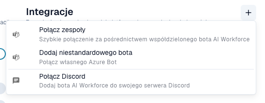
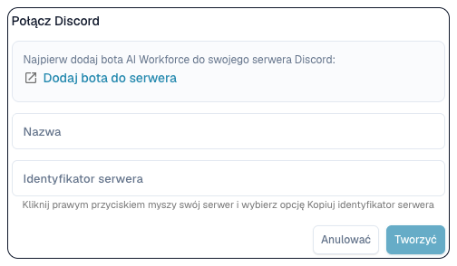

# Łączenie AI Workforce z Teams i Discord

Potrzebujesz aktywnej subskrypcji AI Workforce, uprawnień do połączeń i dostępu do właściwej dzierżawy Teams lub serwera Discord. Najpierw uzgodnij z administratorem wyświetlone wymagania subskrypcji.

<figure><figcaption>
W sekcji Integracje przycisk + otwiera opcje połączenia z Teams, dodania własnego bota lub połączenia z Discord. Nazwa istniejącego połączenia jest ukryta. W obecnym interfejsie opcja Microsoft Teams jest błędnie przetłumaczona jako „Połącz zespoły”.
</figcaption></figure>

## Microsoft Teams

1. Otwórz **AI Workforce → Ustawienia → Integracje**.
2. Wybierz **+ → Połącz Teams**. DocBits generuje kod i pokazuje pozostałą ważność.
3. Wykonaj instrukcję przy kodzie we właściwym środowisku Teams. Zachowaj poufność i zakończ powiązanie przed wygaśnięciem.
4. Poczekaj na potwierdzenie. Sprawdź nazwę i tryb wspólnego lub niestandardowego bota na liście.
5. Aktywuj nieaktywne połączenie, jeśli ma odbierać pracę. Zapisane i aktywne to różne stany.
6. Wyślij nieszkodliwy test z właściwego kontekstu Teams. Sprawdź misję, źródło i organizację w DocBits oraz wymagane zgody człowieka w skrzynce odbiorczej.

Dla bota firmowego wybierz opcję niestandardową i wpisz nazwę, ID dzierżawy, ID aplikacji oraz jej sekret. Sekrety przechowuj w formularzu poświadczeń, poza promptami i zrzutami.

## Discord

<figure><figcaption>
Formularz połączenia z Discord przed wysłaniem. Identyfikator serwera wskazuje serwer Discord (Guild ID); nie utworzono żadnego połączenia.
</figcaption></figure>

1. W **Integracje → +** wybierz Discord.
2. Jeśli jest taka opcja, dodaj bota do właściwego serwera z uprawnionym administratorem.
3. Podaj rozpoznawalną nazwę i poprawny **Guild ID**. Oznacza serwer, nie kanał.
4. Utwórz połączenie, sprawdź je i aktywuj w razie potrzeby.
5. Wyślij nieszkodliwy test i sprawdź powstałą misję, źródło oraz organizację.

## Diagnostyka

Po wygaśnięciu kodu Teams wygeneruj nowy i wykonaj aktualną instrukcję. Jeśli praca nie wpływa, sprawdź aktywację, dzierżawę/serwer, dostęp bota i błędy. Samo połączenie nie potwierdza zakończenia misji.

Zobacz [AI Workforce](ai_workforce/README.md) dla misji, uprawnień i zgód. Połączenia czatu są niezależne od importu email i logowania Microsoft.
