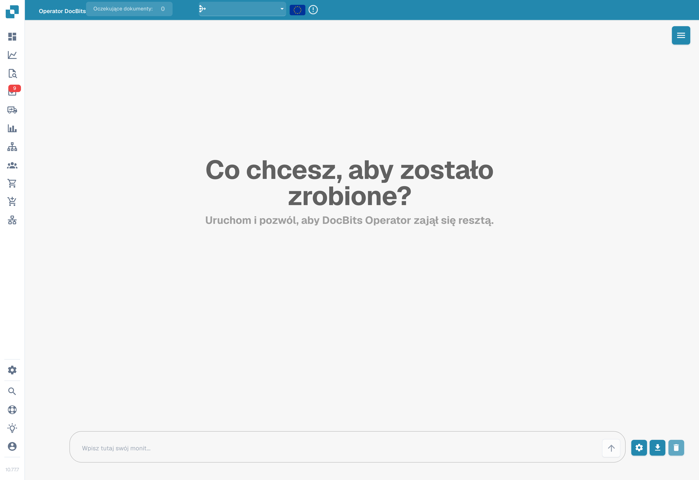
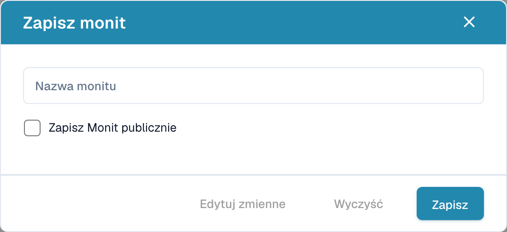

# Operator DocBits

DocBits Operator wykonuje zadania na podstawie poleceń użytkownika. Polecenie opisuje kolejne kroki, a zmienne pozwalają uzupełnić dane potrzebne do danego uruchomienia.

## Włączenie i dostęp

1. Otwórz **Ustawienia**, a następnie **Moduł → Integracja dokumentów**.
2. Przewiń do ustawienia **DocBits Operator** i włącz tę funkcję, jeśli masz odpowiednie uprawnienia.
3. Otwórz **Operator DocBits** z głównej nawigacji aplikacji.

<figure><figcaption>
Moduły integracji dokumentów: skrypty, skanowanie, kody kreskowe i niestandardowe dane podstawowe. W przedstawionej wersji etykieta wyboru kodów kreskowych „Select” pozostaje angielska.
</figcaption></figure>

## Wpisywanie polecenia

Wpisz instrukcję w polu na dole ekranu. Opisz oczekiwany wynik i kolejne czynności. Zmienne w treści zapisuje się w nawiasach klamrowych, na przykład `{invoice_number}` lub `{url}`. Ich nazwy i wartości uzupełnia się w oknie zmiennych, otwieranym przyciskiem z kołem zębatym.

<figure><figcaption>
Polski interfejs Operatora DocBits z pustym polem polecenia. Nie uruchomiono zadania.
</figcaption></figure>

Przycisk ze strzałką rozpoczyna wykonanie polecenia. Ikona pobierania otwiera okno zapisywania polecenia, a kosz służy do czyszczenia rozmowy. Samo otwarcie okna zapisu nie zapisuje szablonu.

Więcej przykładów znajdziesz w [przewodniku pisania poleceń](prompt-writing-guide.md).

## Zapisywanie polecenia

W oknie zapisu podaj **nazwę polecenia**. Opcja **Zapisz Monit publicznie** określa udostępnienie szablonu. Przygotowując szablon do udostępnienia, używaj nazw zmiennych w treści; wartości potrzebne do konkretnego zadania uzupełniaj przed jego uruchomieniem.

<figure><figcaption>
Polskie okno zapisu polecenia. Nie wpisano danych i nie kliknięto przycisku Zapisz; przycisk Wyczyść w przedstawionej wersji zamyka okno.
</figcaption></figure>

Przycisk **Edytuj zmienne** otwiera definicje zmiennych. Przycisk **Zapisz** zapisuje szablon. Aby zamknąć okno bez zapisywania, użyj krzyżyka w jego prawym górnym rogu. W przedstawionej wersji również przycisk **Wyczyść** zamyka to okno; jego podpis nie opisuje poprawnie tej czynności.

## Lista zapisanych poleceń

Menu w prawym górnym rogu otwiera panel zapisanych poleceń. Lista zawiera oddzielne sekcje poleceń organizacji i poleceń publicznych oraz wyszukiwanie po nazwie.

Przy poleceniach organizacji znajdują się ikony uruchamiania, edycji i usuwania. W sekcji publicznej przycisk ze strzałką uruchamia wybrany szablon. Przed uruchomieniem uzupełnij wartości jego zmiennych.

## Sterowanie wykonaniem

Podczas wykonywania polecenia dostępne są funkcje wstrzymania, wznowienia, anulowania oraz przejęcia kontroli. Wstrzymanie pozwala zatrzymać dalsze kroki i sprawdzić bieżący stan. Wznowienie kontynuuje pracę, a anulowanie kończy uruchomienie. Przejęcie kontroli umożliwia ręczną interakcję z widokiem przeglądarki.

<figure><figcaption>
Przykład ikon wznowienia i zatrzymania wykonania.
</figcaption></figure>

## Widok szczegółowy

Przycisk rozwijania otwiera szczegółowy widok wykonania. Można w nim śledzić kolejne działania, bieżący krok i komunikaty operatora oraz korzystać z funkcji sterowania wykonaniem.

<figure><figcaption>
Ikona rozwijania widoku szczegółowego.
</figcaption></figure>
