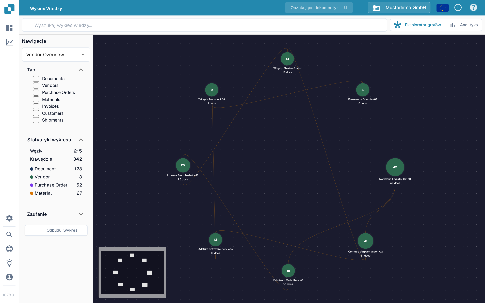

# Eksplorator grafów wiedzy

Eksplorator grafów wiedzy (Knowledge Graph Explorer) pomaga zobaczyć powiązania między dostawcami, dokumentami, zamówieniami zakupu i innymi rekordami. Użyj go, gdy chcesz prześledzić relację lub sprawdzić, ile połączonych elementów jest dostępnych. Poniższy przykład przedstawia graf w polskojęzycznej organizacji testowej Sandboxa.

<figure><figcaption>
Graf przykładu pokazuje połączonych dostawców. Wyszukaj element lub odbuduj graf, aby zobaczyć własne powiązania.
</figcaption></figure>

## Pierwsze kroki

1. Otwórz **Eksplorator grafów** w DocBits. Sprawdź, czy organizacja widoczna u góry to ta, którą chcesz przejrzeć.
2. Jeśli na środku ekranu widnieje komunikat **Search for a node or compute the graph to get started**, wybierz **Odbuduj wykres** i poczekaj na zakończenie komunikatu o postępie. Przygotowuje to dane grafu; może to chwilę potrwać. Jeśli organizacja nie ma jeszcze pasujących relacji, liczniki **Węzły** i **Krawędzie** mogą pozostać na zerze.
3. Wpisz nazwę lub inne szukane wyrażenie w polu **Search knowledge graph** i naciśnij Enter lub wybierz ikonę wyszukiwania. Gdy pojawi się kilka wyników, wybierz ten, którego potrzebujesz. Pojedynczy wynik otwiera jego graf bezpośrednio.
4. Wybierz węzeł, aby zobaczyć jego szczegóły. Zamknij panel szczegółów przyciskiem **X**, gdy chcesz wrócić do grafu.

## Wybierz, co widzisz

| Element sterowania                 | Do czego służy                                                                                                                                                                                                             |
| ---------------------------------- | -------------------------------------------------------------------------------------------------------------------------------------------------------------------------------------------------------------------------- |
| **Nawigacja**                      | Przełączaj między widokami: **Vendor Overview** (połączeni dostawcy), **Vendor Intelligence** (tabela dostawców), **Document Journey** (etapy i warianty przetwarzania dokumentów) oraz **Anomalies** (nietypowe relacje). |
| **Typ**                            | Wybierz rodzaje elementów, na których chcesz się skupić, np. Documents, Vendors, Purchase Orders czy Invoices. Wybrane typy ograniczają również wyniki wyszukiwania.                                                       |
| **Statystyki wykresu**             | Pokazuje liczbę węzłów (elementów) i krawędzi (połączeń) aktualnie dostępnych w grafie. W razie potrzeby tę sekcję można rozwinąć lub zwinąć.                                                                              |
| **Zaufanie**                       | Otwórz tę sekcję, aby ustawić minimalne zaufanie do relacji przy rozwijaniu węzła. Wyższa wartość zawęża wyświetlane połączenia.                                                                                           |
| **Odbuduj wykres**                 | Uruchamia nowe obliczanie grafu. Poczekaj na zakończenie postępu, zanim ponownie wyszukasz.                                                                                                                                |
| **Eksplorator grafów / Analityka** | Przełączaj między interaktywnym grafem a wykresami podsumowującymi. Analityka pokazuje liczby i wykresy, gdy dane grafu istnieją; pusty graf pozostawia również pustą Analitykę.                                           |

Jeśli musisz rozstrzygnąć różnicę między fakturą a zamówieniem, przejdź do ekranu [Dopasowanie zamówienia zakupu](../end-user-and-partner-section/end-user-section/purchase-order-matching/). Aby zobaczyć szersze wskaźniki poza grafem, zobacz [Panel Analityczny](../administration-and-setup/analytics-dashboard.md).
