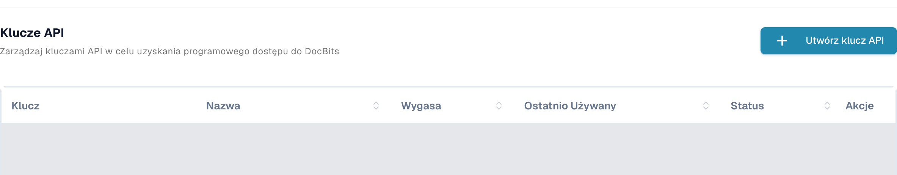
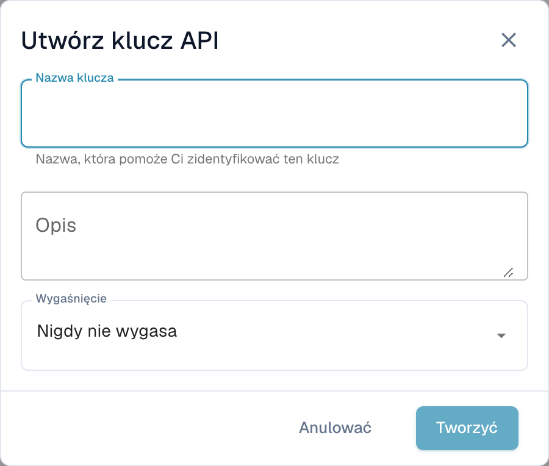

# Postman dla DocBits

Postman umożliwia wysyłanie żądań HTTP do API DocBits. Zacznij od żądania tylko do odczytu w środowisku, do którego masz uprawnienia. Używaj osobnych środowisk Postman do testów i produkcji, a dane dostępowe przechowuj w prywatnych zmiennych lub magazynie sekretów.

## Konfiguracja

### API DocBits

Otwórz dokumentację API właściwego środowiska, na przykład [API Sandbox](https://sandbox.api.docbits.com/docs) lub [produkcyjnego API](https://api.docbits.com/docs). Korzystaj z aktualnych ścieżek operacji i podanej tam wartości **Servers**. Względną ścieżkę serwera dodaje się do adresu źródłowego API.

W [sprawdzonej tutaj dokumentacji Dev](https://eu.dev.api.docbits.com/docs) ścieżka ta ma wartość `/dev-api`. Pełny bazowy adres URL to zatem `https://eu.dev.api.docbits.com/dev-api`. Inne środowiska mogą używać innej ścieżki serwera.

Specyfikacja API wymienia odrębne schematy nagłówków:

| Nagłówek | Zastosowanie |
| --- | --- |
| `X-ORG-ID` | Identyfikuje organizację docelową, jeśli operacja tego wymaga. |
| `Authorization` | Zawiera wartość autoryzacji wymaganą przez dany mechanizm uwierzytelniania. |
| `X-API-KEY` | Zawiera klucz API dla operacji korzystających z tego schematu. |

Tych nagłówków nie można stosować zamiennie. Globalne okno **Authorize** pokazuje dostępne schematy; nie każda operacja wymaga wszystkich nagłówków. Sprawdź parametry i informacje o autoryzacji konkretnej operacji.

O właściwe dane dostępowe poproś administratora. Uprawnieni użytkownicy znajdą zarządzanie kluczami w **Integracja i SSO → Klucze API** w ustawieniach DocBits. Lista pokazuje prefiks klucza, nazwę, termin wygaśnięcia, ostatnie użycie i stan. Istniejące wiersze są zasłonięte na zrzucie.

<figure><figcaption><p>Rzeczywisty widok Dev w języku polskim: Klucze API, przycisk Utwórz klucz API i kolumny Klucz, Nazwa, Wygasa, Ostatnio Używany, Status i Akcje; istniejące wiersze są zasłonięte.</p></figcaption></figure>

**Utwórz klucz API**, nad listą, otwiera najpierw pusty formularz z polami **Nazwa klucza**, **Opis** i **Wygaśnięcie**. Dopiero wysłanie formularza tworzy klucz. Pokazany formularz zamknięto przyciskiem **Anulować**, bez wysyłania. Nie utworzono, nie wyświetlono, nie skopiowano ani nie unieważniono żadnego klucza. Twórz klucze wyłącznie w ramach swoich uprawnień i zgodnie z zasadami organizacji.

<figure><figcaption><p>Pusty polski formularz Utwórz klucz API z polami Nazwa klucza, Opis i Wygaśnięcie oraz przyciskami Anulować i Tworzyć; Tworzyć jest wyłączony, dopóki nazwa pozostaje pusta.</p></figcaption></figure>

### Tworzenie nowej przestrzeni roboczej w Postman

Otwórz Postman i użyj przestrzeni roboczej o widoczności odpowiedniej dla organizacji. Utwórz środowisko ze zmienną `base_url`. Jej wartością jest pełny bazowy adres URL wraz ze ścieżką serwera. Wybierz to środowisko przed wysłaniem żądania. [Przewodnik Postman po środowiskach](https://learning.postman.com/docs/use/send-requests/variables/managing-environments/) wyjaśnia wybieranie i używanie zmiennych.

Utwórz żądanie lub dodaj je do kolekcji. Poniższe nazwy elementów sterujących Postman są technicznymi etykietami aplikacji; powyższe obrazy pokazują zarządzanie kluczami DocBits w języku polskim.

## Przykład metody "GET"

Wybierz **GET** i adres URL `{{base_url}}/version`. W **Authorization** wybierz **No Auth**, a następnie **Send**. Sprawdzone żądanie Dev tylko do odczytu miało postać:

```http
GET https://eu.dev.api.docbits.com/dev-api/version
```

Endpoint zwrócił HTTP 200 bez klucza API. Sprawdza dostępność API i zwraca informacje o wersji. Nie potwierdza dostępu do dokumentów ani użytkowników organizacji. Sprawdź status i treść odpowiedzi; w razie błędu najpierw sprawdź wybrane środowisko, adres źródłowy API i ścieżkę serwera.

Dla operacji korzystającej z klucza API wybierz w Postman **Authorization → API Key**. W **Key** wpisz `X-API-KEY`, w **Value** użyj prywatnego sekretu, a w **Add to** wybierz **Header**. Dodaj `X-ORG-ID` w **Headers**, jeśli operacja tego wymaga. Zobacz oficjalne instrukcje [autoryzacji kluczem API](https://learning.postman.com/docs/use/send-requests/authorization/authorization-types/#api-key) i [sekretów Vault](https://learning.postman.com/docs/use/postman-vault/use-vault-secrets/).

## Przykład metody "POST"

**POST** może tworzyć dane lub uruchamiać przetwarzanie. Skopiuj metodę, ścieżkę, wymagane parametry i schemat treści żądania z aktualnej specyfikacji API. Wykonuj takie żądania wyłącznie w ramach konkretnego, autoryzowanego zadania. Poprawne pobranie wersji nie dowodzi, że żądanie zapisu zakończy się powodzeniem.

### Prześlij dokument

Przed przesłaniem dokumentu sprawdź aktualnie udokumentowaną operację. Jeśli wymaga danych formularza multipart, wybierz ten typ treści i użyj wskazanych nazw pól oraz typów plików. Nie wywnioskuj ich ze zrzutu starszej wersji API. Na potrzeby tego przewodnika nie przesłano żadnego dokumentu.

## Przykład metody "DELETE"

**DELETE** może trwale usuwać dane. Sprawdź konkretną operację, identyfikator celu i wymagane uprawnienia. Nie wykonano tutaj żadnego usunięcia ani nie przedstawiono go jako zakończonego pomyślnym testem.

## Przykład metody "PUT"

**PUT** może zmieniać istniejące dane. Korzystaj wyłącznie z parametrów i schematu treści aktualnej operacji oraz potwierdź zakres zleconej zmiany. Nie wykonano tutaj żadnej zmiany.

## Zmiana adresu e-mail użytkownika

Ustal ścieżkę i wymagane pola na podstawie aktualnej specyfikacji API i przed wykonaniem poddaj zmianę użytkownika weryfikacji merytorycznej. Ten przewodnik nie używa rzeczywistych danych użytkowników ani organizacji i nie potwierdza pomyślnej zmiany adresu e-mail.

Sprawdzono aktualną specyfikację API Dev, pobranie wersji bez uwierzytelniania oraz rzeczywiste polskie widoki DocBits zarządzania kluczami i pustego formularza. Do sprawdzenia widoków użyto autoryzowanego konta testowego i odczytów metadanych interfejsu. Nie wykonano tworzenia kluczy, przesyłania dokumentów, tworzenia użytkowników, zmian ani usunięć. Nie testowano biznesowych operacji API na dokumentach ani rekordach użytkowników. Nie przetestowano żadnego żądania w samej aplikacji Postman.
