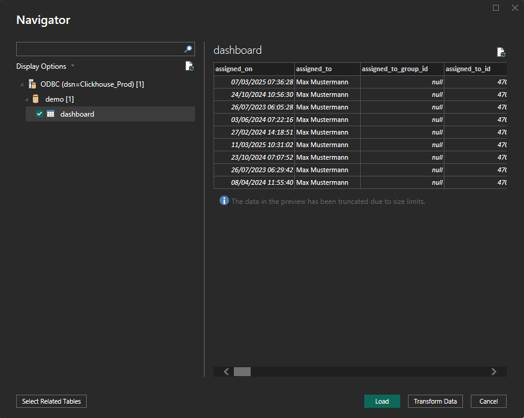

# Połączenie przez ClickHouse

Ten przewodnik pokazuje, jak połączyć **ClickHouse** z **Power BI Desktop** za pomocą **sterownika ODBC**. Obejmuje instalację sterownika, konfigurację ODBC, integrację z Power BI i skonfigurowanie odświeżania danych.




#### 1. Zainstaluj sterownik ODBC ClickHouse

* Pobierz najnowszy **sterownik ODBC ClickHouse** z:
  * [ClickHouse GitHub - clickhouse-odbc](https://github.com/ClickHouse/clickhouse-odbc)
* Uruchom instalator i postępuj zgodnie z kreatorem instalacji.

#### 2. Skonfiguruj źródło danych ODBC

* Otwórz **ODBC Data Source Administrator (64-bit)** z Panelu sterowania lub przez wyszukiwarkę systemu Windows.
* Przejdź na kartę **System DSN** i kliknij **Add**.
* Wybierz z listy **ClickHouse ODBC Driver** i kliknij **Finish**.
*   Wypełnij wymagane pola. Potrzebne informacje znajdziesz w:

    **DocBits** → **Ustawienia** → **Przetwarzanie dokumentów** → **Moduł** → **AI Panel kontrolny** → **ClickHouse Dostęp bezpośredni**

    <figure><figcaption></figcaption></figure>

    **Wymagane pola:**

    * **Name**: Nazwa połączenia (np. `ClickHouse_Prod`)
    * **Description**: Krótki opis dla Twojej wiadomości (opcjonalnie)
    * **Host**: Skopiuj wartość hosta z DocBits
    * **Port**: Skopiuj wartość portu z DocBits
    * **Database**: Skopiuj nazwę bazy danych z DocBits
    * **Username**: Skopiuj nazwę użytkownika z DocBits
    * **Password**: Skopiuj hasło z DocBits

#### 3. Połącz ClickHouse z Power BI

* Otwórz **Power BI Desktop**.
*   Wybierz **Get Data** → **ODBC** → **Connect**.\

    <figure><figcaption></figcaption></figure>
*   Z listy DSN wybierz skonfigurowane źródło (np. `ClickHouse_Prod`).\

    <figure><figcaption></figcaption></figure>
* Kliknij **OK**. Jeśli zostaniesz o to poproszony, ponownie wprowadź dane uwierzytelniające.

#### 4. Wczytaj i przekształć dane

* W panelu **Navigator** przeglądaj i zaznacz tabele lub widoki do zaimportowania.
* Wybierz:
  * **Load**: aby zaimportować bezpośrednio
  *   **Transform Data**: aby otworzyć Power Query i ukształtować dane\

      <figure><figcaption></figcaption></figure>

#### 5. Zwizualizuj swoje dane

* Użyj obszaru raportu do budowania wizualizacji.
* Przeciągaj pola, dodawaj fragmentatory (slicers), wybieraj typy wykresów i w razie potrzeby używaj wyrażeń **DAX**.
* &#x20;Skorzystaj z **Power Query Editor**, aby wyczyścić lub przestawić dane ClickHouse przed zbudowaniem wizualizacji.
* Dokumentacja PowerBI:  [https://learn.microsoft.com/en-us/power-bi/](https://learn.microsoft.com/en-us/power-bi/)

#### 6. Włącz zaplanowane odświeżanie (opcjonalnie)

Odświeżanie według harmonogramu zależy od licencji lub pojemności obszaru roboczego, łącznika i trybu połączenia. Dla tego połączenia ODBC skonfiguruj osiągalną bramę z odpowiednim sterownikiem, nazwą DSN i poświadczeniami. Sprawdź aktualne wymagania w oficjalnej dokumentacji.

* Aby raporty były zsynchronizowane z ClickHouse:
* Opublikuj plik `.pbix` w **Power BI Service**.
* Zainstaluj **Power BI Gateway** (tryb Standard) na maszynie z dostępem sieciowym do ClickHouse.
* W Power BI Service:
  * Przejdź do swojego zestawu danych → **Settings** → **Scheduled Refresh**
  * Przypisz swój DSN i podaj dane uwierzytelniające
* Więcej informacji [tutaj](https://learn.microsoft.com/en-us/power-bi/connect-data/service-gateway-deployment-guidance).&#x20;

#### 7. Przykładowe pulpity i widoki danych&#x20;

<figure><figcaption></figcaption></figure> <figure><figcaption></figcaption></figure> <figure><figcaption></figcaption></figure> <figure><figcaption></figcaption></figure>

[Oficjalna dokumentacja — ODBC](https://learn.microsoft.com/en-us/power-query/connectors/odbc)

[Oficjalna dokumentacja — psqlODBC](https://odbc.postgresql.org/docs/config-opt.html)

[Oficjalna dokumentacja — Power BI](https://learn.microsoft.com/en-us/power-bi/connect-data/refresh-scheduled-refresh)
