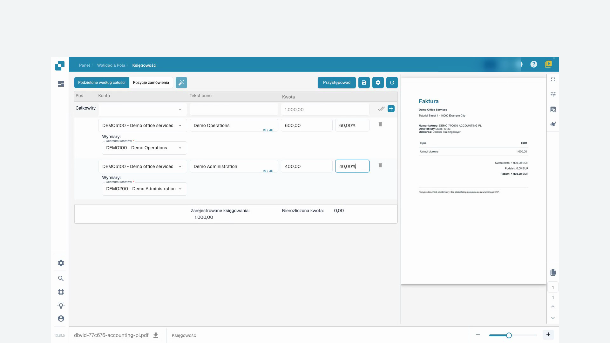
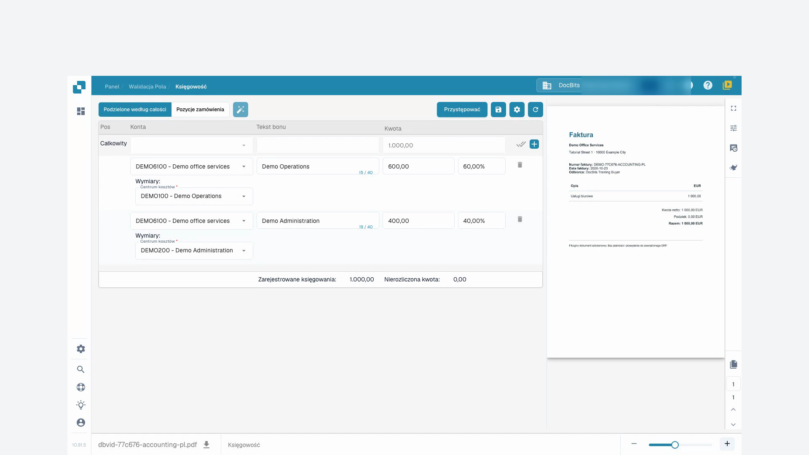

# Księgowanie faktur kosztowych i sprzedaży pośredniej

## Wprowadzenie

Witamy w module Księgowanie faktur kosztowych i sprzedaży pośredniej! Ten moduł został zaprojektowany, aby pomóc Ci efektywnie zarządzać i uzgadniać transakcje finansowe w Twoim systemie ERP. Dzięki funkcjom takim jak automatyczne wyodrębnianie danych, dopasowywanie dokumentów i szczegółowe śledzenie, możesz zapewnić, że Twoje zapisy finansowe są dokładne i aktualne.

<figure><figcaption></figcaption></figure>

## Pierwsze kroki

Aby rozpocząć korzystanie z modułu księgowego, upewnij się, że masz odpowiednie uprawnienia ustawione przez administratora systemu. Będziesz potrzebować dostępu do modułów księgowości kosztów i księgowości sprzedaży w systemie ERP.

## Wymagania systemowe

* Dostęp do modułów księgowości kosztów i księgowości sprzedaży w systemie ERP.
* Odpowiednie uprawnienia użytkownika do przeglądania i przetwarzania dokumentów finansowych.

## Kluczowe funkcje

1. **Automatyczne wyodrębnianie danych**: Automatycznie wyodrębnia i interpretuje dane z faktur cyfrowych i innych dokumentów.
2. **Porównanie danych**: Porównuje wyodrębnione dane z faktur z istniejącymi danymi zamówień zakupu.
3. **Weryfikacja dopasowania**: Weryfikuje dopasowania na podstawie zdefiniowanych reguł i tolerancji.
4. **Raportowanie rozbieżności**: Identyfikuje i raportuje wszelkie rozbieżności między fakturami a zamówieniami zakupu.
5. **Ścieżka audytu**: Utrzymuje log wszystkich działań dla zgodności i przeglądu.
6. **Szkolenie dokumentów**: Szkolenie systemu w rozpoznawaniu nowych dokumentów z minimalnym wysiłkiem, zazwyczaj tylko raz.
7. **Podział kwot**: Podział kwot według działów dla szczegółowego śledzenia finansowego.
8. **Definicja konta księgowego**: Zespół APS (System Księgowości i Zakupów) może zdefiniować konto księgowe po wyodrębnieniu danych.

## Interfejs użytkownika

Interfejs modułu księgowego zazwyczaj zawiera następujące komponenty:

* **Pulpit nawigacyjny**: Przegląd statusu faktur i sprzedaży oraz ostatnich aktywności.
* **Narzędzia wyszukiwania i filtrowania**: Możliwości wyszukiwania i filtrowania faktur i zapisów sprzedaży.
* **Dopasowane rekordy**: Sekcja wyświetlająca pomyślnie dopasowane rekordy.
* **Rozbieżności**: Sekcja pokazująca rekordy z rozbieżnościami wymagającymi przeglądu lub działania.
* **Raporty**: Dostęp do szczegółowych raportów i opcji eksportu.

## Przewodnik krok po kroku po module księgowym

### 1. Dostęp do modułu księgowego

Przejdź do modułu księgowego z głównego menu systemu ERP.

### 2. Import lub dostęp do faktur

* **Automatyczny import**: Jeśli Twój system jest skonfigurowany do automatycznego przechwytywania danych, faktury będą automatycznie importowane do systemu.
* **Ręczne przesyłanie**: W razie potrzeby ręcznie przesyłaj pliki faktur do systemu za pomocą udostępnionego interfejsu.

### 3. Przegląd automatycznie dopasowanych faktur

* Przeglądaj faktury, które zostały automatycznie dopasowane do zamówień zakupu.
* Zweryfikuj szczegóły dopasowania, w tym numery pozycji, ilości i ceny.

### 4. Obsługa rozbieżności

* Uzyskaj dostęp do sekcji Rozbieżności, aby przeglądać faktury, które nie mogły zostać automatycznie dopasowane.
* Ręcznie dostosuj ilości lub ceny w razie potrzeby lub oznacz fakturę do dalszego przeglądu.

### 5. Ręczne dopasowanie

Dla faktur, które nie zostały automatycznie dopasowane:

* Użyj narzędzi wyszukiwania i filtrowania, aby znaleźć odpowiednie zamówienie zakupu.
* Ręcznie zweryfikuj i dopasuj fakturę do zamówienia zakupu.

### 6. Szkolenie systemu

* Dla nowych typów dokumentów, przeszkol system, aby je rozpoznawał, dostarczając próbkę.
* Zazwyczaj wystarczy przeszkolenie systemu raz, aby dokładnie rozpoznawał podobne dokumenty w przyszłości.

### 7. Rejestrowanie księgowań

* Przejdź do zakładki "Pozycje" aby przeglądać i rejestrować księgowania dla każdej faktury.
* Przypisz kwoty do odpowiednich kont, centrów kosztów i wymiarów specyficznych dla Infor LN/M3.

**Przykład: Księgowanie faktury kosztowej**

1. **Wybierz pozycję**: Wybierz pozycję dla faktury kosztowej.
2. **Przypisz konto**: Przypisz odpowiednie konto, takie jak "71200 - Koszty nieoperacyjne".
3. **Ustaw wymiary**: Ustaw dodatkowe wymiary, takie jak centrum kosztów, grupa produktów i projekt.
4. **Podziel kwotę**: W razie potrzeby podziel kwotę według działów dla bardziej szczegółowego śledzenia.
5. **Wprowadź kwotę**: Wprowadź kwotę dla pozycji.

### 8. Definiowanie kont księgowych

* Po wyodrębnieniu danych, zespół APS może zdefiniować konta księgowe.
* Zapewnia to, że każda transakcja jest zapisana na właściwym koncie dla dokładnego raportowania finansowego.

### 9. Generowanie raportów

* Uzyskaj dostęp do sekcji "Raporty", aby generować szczegółowe raporty dotyczące transakcji finansowych.
* Użyj opcji eksportu, aby zapisać raporty do dalszej analizy lub archiwizacji.

### Przykład użycia

1. **Przesyłanie dokumentów**: Użytkownicy mogą przesyłać różne dokumenty (faktury, noty dostawcze itp.) do systemu.
2. **Automatyczne dopasowanie**: System automatycznie dopasowuje przesłane dokumenty do istniejących zamówień zakupu.
3. **Przegląd dopasowań**: Użytkownicy mogą przeglądać dopasowania, weryfikować szczegóły i widzieć wskaźniki statusu.
4. **Rozwiązywanie rozbieżności**: Wszelkie niedopasowania lub rozbieżności są wyróżniane, aby użytkownik mógł je ręcznie przeglądać i korygować.
5. **Eksport danych**: Dopasowane dane mogą być eksportowane do dalszego przetwarzania lub archiwizacji.

## Instrukcja wideo: Podział faktury kosztowej

Postać i głos są syntetyczne. Nagranie pokazuje rzeczywisty interfejs testowy DocBits z syntetycznymi fakturami szkoleniowymi.


Podział faktury kosztowej


[Oglądaj z napisami i rozdziałami](https://docbits-videos.fra1.cdn.digitaloceanspaces.com/settings-assistant/cost-invoice-accounting-customer/v2/pl.html)

Niektóre etykiety produktu mogą pozostać w innym języku. Zachowano techniczne identyfikatory pól.

W nagranym interfejsie kolumna « Tekst bonu » zawiera opis dekretacji. « Zarejestrowane księgowania » oznacza tutaj sumę przypisanych kwot, a « Nierozliczona kwota » resztę do przypisania. Nazwy kont i miejsc powstawania kosztów demonstracyjnych są skonfigurowanymi wartościami. Ten podział nie potwierdza płatności ani księgowania w systemie ERP.

Najpierw sprawdzam naszą oryginalną fakturę szkoleniową. Dostawca, numer faktury i kwota muszą zgadzać się z dokumentem. W tym przykładzie jest to tysiąc euro bez podatku. Faktura nie zawiera zamówienia zakupu.

Otwieram dekretację i pracuję z podziałem według kwoty całkowitej. Dostępne konta księgi głównej i miejsca powstawania kosztów zostały wcześniej skonfigurowane przez naszego administratora. Wybieram tylko wartości, które mają sens biznesowy dla tej faktury.

Za pomocą funkcji podziału tworzę dwa wiersze podrzędne. DocBits zaczyna tutaj od równego podziału. W naszym przykładzie podział to sześćdziesiąt i czterdzieści procent. Pierwotna kwota faktury nadal wynosi tysiąc euro.

Dla obu wierszy podrzędnych wybieram przygotowane konto księgi głównej dla usług biurowych. Pierwszy wiersz należy do operacyjnego miejsca powstawania kosztów, drugi do administracji. Miejsce powstawania kosztów jest w tym przykładzie polem obowiązkowym. Dodaję również zrozumiały tekst księgowania.

W pierwszym wierszu wpisuję sześćdziesiąt procent i zatwierdzam klawiszem Enter. Czekam, aż kwota pokaże sześćset euro. Następnie zatwierdzam czterdzieści procent w drugim wierszu i czekam na czterysta euro. W ten sposób sprawdzam każde przeliczenie przed przejściem dalej.

Teraz sprawdzam razem obie kwoty, konta księgi głównej i miejsca powstawania kosztów. Sześćset plus czterysta daje tysiąc euro. Zarejestrowana suma również musi wynosić tysiąc euro, a pozostałe saldo musi wynosić zero. Wyjaśniam wszelkie różnice w sumach przed zapisaniem.

<figure><figcaption>
Miejsca powstawania kosztów ze sprawdzoną sumą 1000 euro
</figcaption></figure>

Zapisuję dekretację i czekam na potwierdzenie. Następnie ponownie ładuję fakturę. Oba miejsca powstawania kosztów, wartości procentowe i kwoty nadal tam są. Po ponownym załadowaniu sprawdzam również sumę i pozostałe saldo.

<figure><figcaption>
Dekretacja zapisana i sprawdzona po ponownym otwarciu
</figcaption></figure>
