# Tabela AI

**Wyodrębniona tabela AI** to tabela pozycji, którą DocBits odczytuje za pomocą AI, gdy dostawca nie ma wytrenowanych reguł tabeli. Pojawia się na ekranie walidacji pod polami nagłówka. Ta strona opisuje wszystkie elementy sterowania wokół niej: jak poprawić błędną kolumnę, jak przekazać AI instrukcje, jak przetestować zmianę, zanim ją zachowasz, jak sprawdzić, co zrobiła AI, co Asystent może, a czego nie może dla Ciebie zrobić oraz kto co może zapisywać.

## Kiedy otrzymujesz tabelę AI

* Administrator włączył opcję **Ekstrakcja tabeli AI** (Ustawienia → Przetwarzanie dokumentów → Klasyfikacja i ekstrakcja, patrz [Ustawienia dla administratorów](./#ustawienia-dla-administratorow)). Jeśli jest wyłączona, w obszarze tabeli wyświetla się komunikat _Tutaj wyświetli się tabela AI. Włącz w …_.
* Dostawca **nie ma zapisanych reguł**. Gdy tylko ktoś wytrenuje tabelę dostawcy i zapisze reguły, zapisane reguły zastępują tabelę AI dla tego dostawcy. Wiersze pojawiają się wtedy w zakładce **Wyodrębniona tabela**, a zakładka **Wyodrębniona tabela AI** jest wyszarzona z podpowiedzią _Tabela AI wyłączona: używana jest niestandardowo wytrenowana tabela._
* Wyjątek: kolumny oznaczone jako **Użyj AI** w ustawieniach kolumn tabeli wypełnia AI nawet u dostawców z zapisanymi regułami, patrz [Użyj AI dla pojedynczych kolumn](./#uzyj-ai-dla-pojedynczych-kolumn).

Poziom AI odczytujący tabelę (Fast, Full, Nexus) jest ustawiany dla organizacji i można go nadpisać dla dostawcy, patrz Model AI specyficzny dla dostawcy.

## Tabela AI w skrócie

<figure>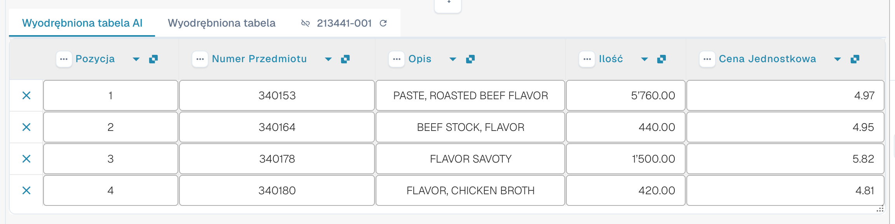<figcaption>
Dwie zakładki, tabela Wyodrębniona tabela AI i nagłówki jej kolumn.
</figcaption></figure>

* **Zakładki.** _Wyodrębniona tabela AI_ to to, co odczytała AI. _Wyodrębniona tabela_ to klasyczna tabela z wytrenowanych reguł. Zakładka AI otwiera się domyślnie, gdy dokument ma tabelę AI.
* **Nagłówek kolumny.** Każda kolumna pokazuje swoją nazwę, mały symbol **pochodzenia** (najedź na niego kursorem: _AI · mapowanie_, _AI · synonim_ itd. informują, jak AI dopasowała kolumnę), menu **trzech kropek** oraz, dla kolumny zmapowanej, **przycisk z nazwą**, którym możesz zmienić, jaką kolumną ma być.
* **Przyciski wierszy.** **x** na początku wiersza usuwa ten wiersz. Kliknij wiersz prawym przyciskiem myszy, aby wybrać _Wybierz jako koszt dodatkowy_ / _Usuń jako dodatkowy koszt_.
* **Pasek narzędzi w stopce.** Ikony na dole ekranu dodają lub ukrywają kolumny i wiersze, patrz [Pasek narzędzi w stopce](./#pasek-narzedzi-w-stopce).
* **Karta Instrukcje dla sztucznej inteligencji** pod tabelą: prompt, dodatkowe kolumny, **Zmiana testu**, **Stosować**, **Zapisz jako szkolenie**, **Usuwać**, **Eksport**, patrz [Podaj instrukcje dla AI](./#podaj-instrukcje-dla-ai).


Elementy sterowania kolumnami działają tylko wtedy, gdy możesz edytować dokument. Jeśli są wyszarzone, dokument jest tylko do odczytu lub zablokowany w innej sesji. Gdy czerwony baner informuje, że dokument jest zablokowany przez Twojego użytkownika w innej sesji, przycisk **Odblokować** przejmuje blokadę.


## Zmiana kolumny

### Wybierz właściwą kolumnę (ponowne mapowanie)

Użyj tej funkcji, gdy wartość znajduje się w złej kolumnie, na przykład kwota netto jest w kolumnie _Całkowita kwota_ albo _Ilość_ jest pusta, chociaż faktura ją zawiera.

1. Kliknij **nazwę kolumny** w nagłówku.
2. Wybierz skonfigurowaną kolumnę tabeli, do której wartości naprawdę należą.

<figure>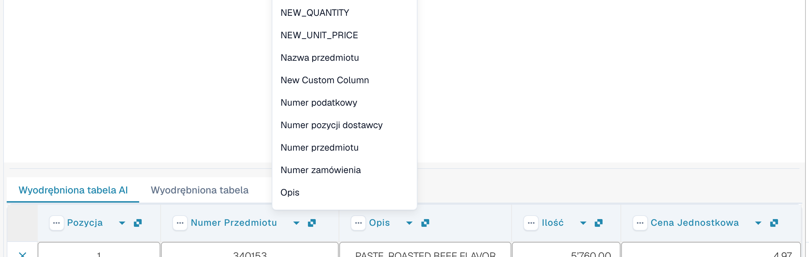<figcaption>
Kliknij nazwę kolumny i wybierz kolumnę, którą ma być. Lista pokazuje każdą skonfigurowaną kolumnę tabeli.
</figcaption></figure>

DocBits od razu formatuje tabelę na nowo, tylko dla tego dokumentu. Jeśli wybrana kolumna jest już używana przez inną kolumnę, okno dialogowe _Zmapować "…"?_ ostrzega, że tamta kolumna stanie się niezmapowana. Potwierdź, aby kontynuować; tamta kolumna pokazuje wtedy ikonę błędu _Wybierz kolumnę do mapowania z listy rozwijanej_, abyś mógł wybrać kolumnę także dla niej.

### Menu trzech kropek

<figure>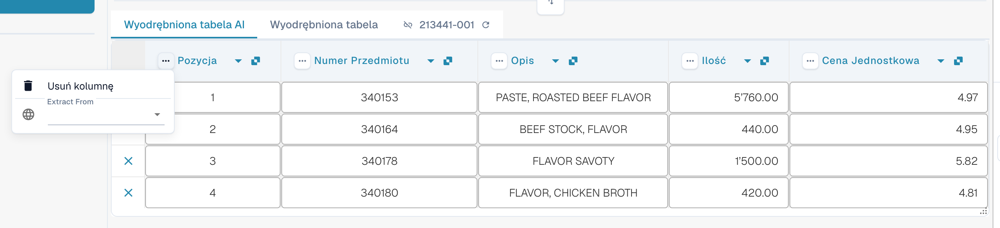<figcaption>
Menu trzech kropek kolumny.
</figcaption></figure>

| Pozycja                | Co robi                                                                                                                                                                                                                          |
| ---------------------- | -------------------------------------------------------------------------------------------------------------------------------------------------------------------------------------------------------------------------------- |
| **Usuń kolumnę**       | Ukrywa kolumnę. Potwierdzenie informuje: _Zmiany zostaną odrzucone_; wybierz **Zrobione**. Tabela jest odbudowywana bez tej kolumny. Aby przywrócić ukryte kolumny, użyj **Przywróć kolumnę tabeli** na pasku narzędzi w stopce. |
| **Wyłącz kolumnę**     | Dla kolumny dodanej przez Ciebie: ukrywa ją bez ponownego uruchamiania AI.                                                                                                                                                       |
| **Formatowanie kwoty** | Tylko dla kolumn z kwotami. Wybierz, jak odczytywać liczby (separatory dziesiętny i tysięcy). **Auto** pozwala DocBits zdecydować.                                                                                               |
| **Extract From**       | Informuje AI, że wartość ma pochodzić z wiersza **Above** (powyżej) lub **Below** (poniżej) etykiety kolumny. Pozostaw puste, jeśli wartość znajduje się w zwykłym miejscu.                                                      |

### Pasek narzędzi w stopce

<figure>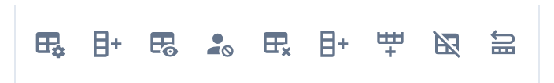<figcaption>
Ikony tabeli w stopce ekranu walidacji, od lewej do prawej.
</figcaption></figure>

| Ikona (podpowiedź)                                            | Co robi                                                                                                                                                                                                                     |
| ------------------------------------------------------------- | --------------------------------------------------------------------------------------------------------------------------------------------------------------------------------------------------------------------------- |
| **Przejdź do widoku ekstrakcji tabeli**                       | Otwiera klasyczne szkolenie tabeli. Jeśli dokument ma tabelę AI, DocBits ostrzega: _Tabela jest już wyodrębniona przez AI. Czy chcesz trenować ręcznie? W przyszłości tabela AI nie będzie wyodrębniana dla tego dostawcy_. |
| **Dodaj puste kolumny mapowane**                              | Otwiera **Ustawienia kolumn**, aby dodać skonfigurowane kolumny, których AI nie wypełniła, i wpisać wartości ręcznie.                                                                                                       |
| **Pokaż kolumny niemapowane** / **Ukryj kolumny niemapowane** | Pokazuje lub ukrywa kolumny zwrócone przez AI, które nie są zmapowane na skonfigurowaną kolumnę. Domyślnie są ukryte. Zmienia to tylko widok tego dokumentu.                                                                |
| **Ekstrakcja tabeli bloków dla tego dostawcy**                | Wyłącza ekstrakcję tabeli dla dostawcy.                                                                                                                                                                                     |
| **Usuń tabelę**                                               | Czyści tabelę w edytorze.                                                                                                                                                                                                   |
| **Dodaj nową kolumnę tabeli**                                 | Dodaje własną kolumnę. Tylko dla administratorów.                                                                                                                                                                           |
| **Dodaj nowy wiersz tabeli**                                  | Dodaje pusty wiersz.                                                                                                                                                                                                        |
| **Ignoruj walidację tabeli**                                  | Ignoruje walidację tabeli dla tego dokumentu.                                                                                                                                                                               |
| **Przywróć kolumnę tabeli**                                   | Przywraca każdą usuniętą kolumnę.                                                                                                                                                                                           |

<figure>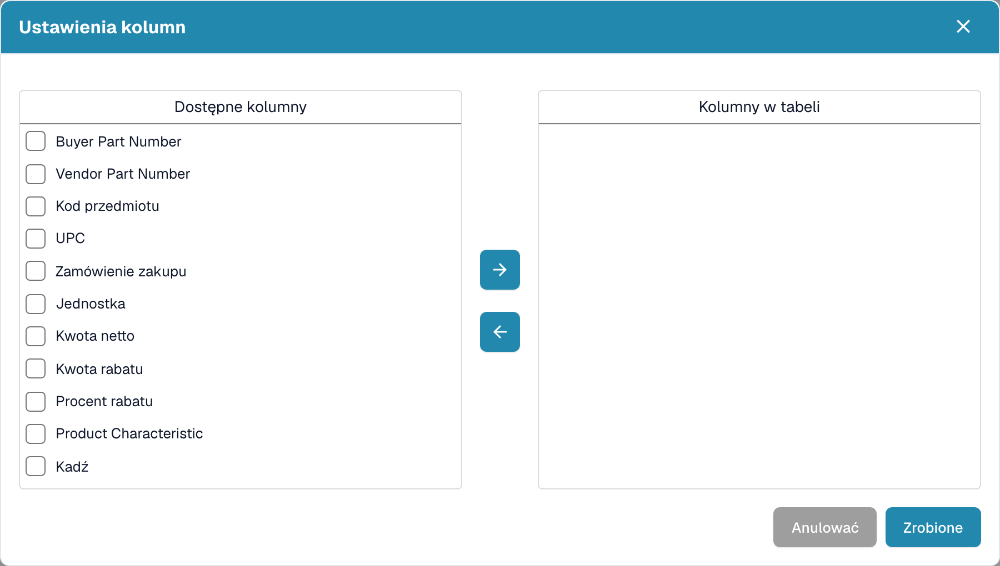<figcaption>
Ustawienia kolumn: przenieś kolumny z listy <em>Dostępne kolumny</em> do <em>Kolumny w tabeli</em> za pomocą przycisków strzałek, a następnie wybierz <strong>Zrobione</strong>.
</figcaption></figure>

## Podaj instrukcje dla AI

Pod tabelą karta **Instrukcje dla sztucznej inteligencji** mówi AI, co ma zrobić inaczej. Ma dwa pola i cztery przyciski, z których będziesz korzystać cały czas.

<figure>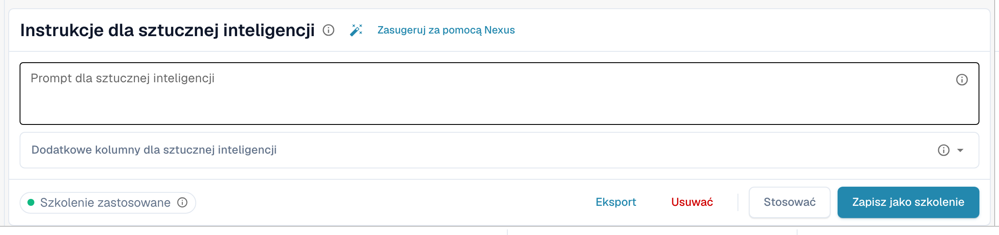<figcaption>
Karta Instrukcje dla sztucznej inteligencji.
</figcaption></figure>

* **Prompt dla sztucznej inteligencji.** Napisz po jednej instrukcji w wierszu, zwykłym językiem. Wpisz **@**, aby wstawić nazwę kolumny, dzięki czemu AI dokładnie wie, o którą kolumnę chodzi.
* **Dodatkowe kolumny dla sztucznej inteligencji.** Wybierz kolumny, które AI ma zwrócić oprócz zwykłych.
* **Status szkolenia.** Chip pokazuje **Szkolenie zastosowane**, gdy w ostatnim uruchomieniu użyto zapisanego szkolenia, albo informację, że żadne szkolenie nie zostało zastosowane.

<figure>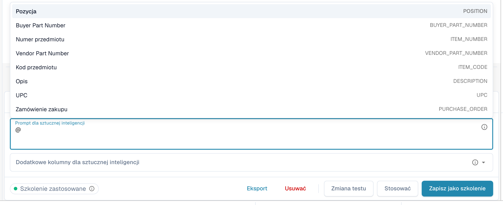<figcaption>
Wpisz <strong>@</strong> w prompcie, aby wybrać kolumnę. Gdy tylko coś się zmieni, obok przycisku <strong>Stosować</strong> pojawia się <strong>Zmiana testu</strong>.
</figcaption></figure>


Zmieniony prompt sprawia, że AI odczytuje tabelę ponownie i może zmienić każdą kolumnę, nie tylko tę, o którą Ci chodziło. Sprawdź potem całą tabelę.


### Zasugeruj za pomocą Nexus

Nie wiesz, co napisać? Kliknij **Zasugeruj za pomocą Nexus**. DocBits analizuje ekstrakcję tego dokumentu i proponuje instrukcje lub dodatkowe kolumny. Nic nie jest stosowane, dopóki nie klikniesz **Wstaw** (dodaje wiersz do promptu) lub **Dodaj kolumnę**.

<figure>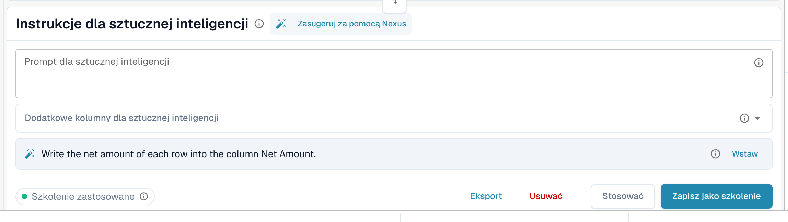<figcaption>
Sugestia z Nexus. <strong>Wstaw</strong> kopiuje ją do promptu.
</figcaption></figure>

Jeśli Twoja organizacja wyłączyła doradcę AI, DocBits informuje o tym zamiast składać sugestie.

### Test, zastosowanie, zapis: co robi każdy przycisk

| Przycisk                                               | Co się dzieje                                                                                                                                                                                                | Zapisane dla kolejnych dokumentów? |
| ------------------------------------------------------ | ------------------------------------------------------------------------------------------------------------------------------------------------------------------------------------------------------------ | ---------------------------------- |
| **Zmiana testu**                                       | Uruchamia Twoją zmianę i pokazuje porównanie. **Nic nie jest zapisywane**, ani w dokumencie, ani jako reguła.                                                                                                | Nie                                |
| **Stosować**                                           | Odczytuje tabelę ponownie z Twoimi zmianami i umieszcza wynik w tym dokumencie w edytorze. Staje się trwały dopiero po zapisaniu dokumentu.                                                                  | Nie                                |
| **Zapisz jako szkolenie** (podpowiedź _Zapisz zasady_) | Zapisuje prompt, dodatkowe kolumny, mapowanie kolumn, ukryte kolumny, formaty kwot i ustawienia **Extract From** dla tego układu dostawcy. Kolejne dokumenty o tym układzie są odczytywane w ten sam sposób. | Tak                                |
| **Usuwać** (podpowiedź _Usuń zasady_)                  | Usuwa zapisane reguły tabeli tego układu dostawcy, bez dodatkowego potwierdzenia, i ponownie uruchamia AI bez nich. Usuwa także klasyczne szkolenie tabeli zapisane dla tego samego układu.                  | Usuwa je                           |
| **Eksport**                                            | Pobiera tabelę jako plik CSV.                                                                                                                                                                                | Nie                                |


Zmiany mapowania nagłówków, **Usuń kolumnę**, **Formatowanie kwoty**, **Extract From** i **Przywróć kolumnę tabeli** działają jak **Stosować**: od razu odbudowują tabelę dla tego dokumentu i są zapisywane razem z dokumentem, a nie jako reguła. Tylko **Zapisz jako szkolenie** uczy DocBits na potrzeby kolejnych dokumentów.


Jeśli dokument ma już pozycje dopasowane do zamówienia zakupu, Stosować i zapis ostrzegają, że **możesz utracić połączenia z zamówieniem**. Wybierz **Zrobione**, aby kontynuować, i dopasuj ponownie później.

<figure>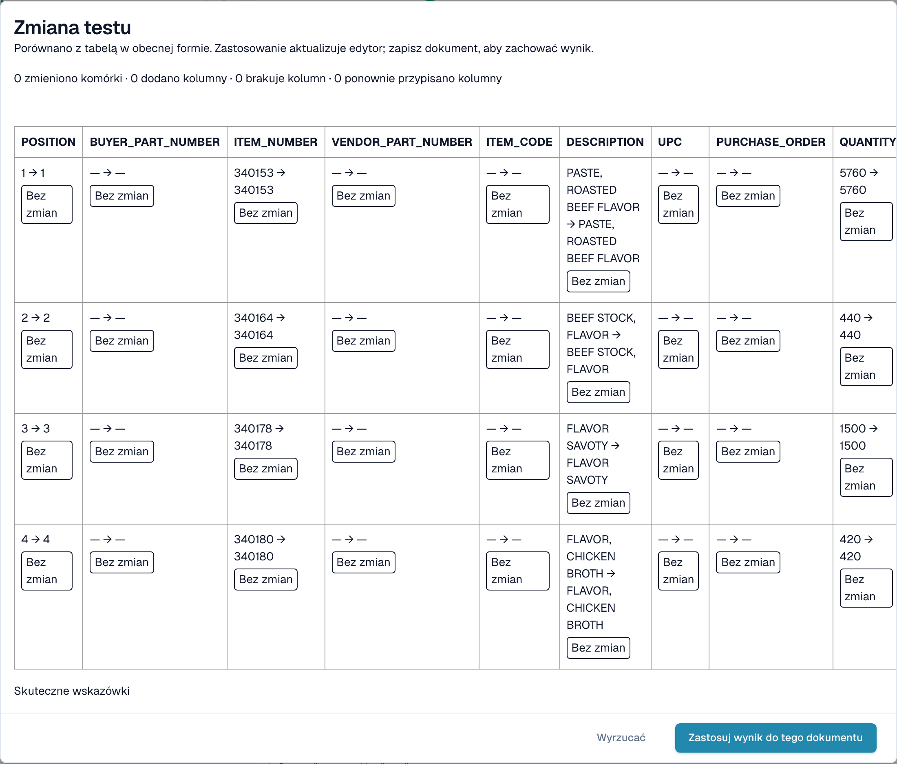<figcaption>
Okno <strong>Zmiana testu</strong> porównuje nowy wynik z tabelą, którą widzisz teraz.
</figcaption></figure>

Okno **Zmiana testu** zlicza, co by się zmieniło: zmienione komórki, dodane kolumny, brakujące kolumny i ponownie przypisane kolumny. Każda komórka jest oznaczona jako **W dodatku**, **Zmieniono**, **Zaginiony**, **Ponownie przypisany** lub **Bez zmian**. Na dole okno wymienia dowody dla uruchomienia: _Skuteczne wskazówki_, _Wybrane szkolenie_, _Polityka kolumnowa_ i _Użyto nadpisań żądań_. Wybierz **Zastosuj wynik do tego dokumentu**, aby go przejąć (a następnie zapisz dokument), albo **Wyrzucać**, aby go odrzucić. Jeśli po teście zmienisz prompt, wynik jest oznaczany jako nieaktualny i musisz przetestować ponownie.

Po **Zapisz jako szkolenie** DocBits informuje, że szkolenie zostanie użyte przy następnym ponownym przetwarzaniu; bieżące uruchomienie jeszcze go nie użyło. Sprawdź przy następnym dokumencie dostawcy, czy chip pokazuje **Szkolenie zastosowane**.

## Sprawdź, co zrobiła AI

Cztery przyciski pod tabelą wyjaśniają ekstrakcję.

<figure>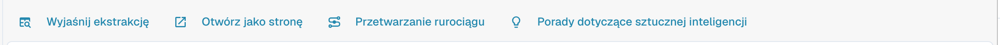<figcaption>
Przyciski wyjaśnień.
</figcaption></figure>

* **Wyjaśnij ekstrakcję** otwiera okno _Jak tabela AI doszła do swoich wartości_: dokument, ekstrakcja AI (poziom, liczba surowych kolumn i wierszy), mapowanie do Twojej struktury oraz wynik dla każdej kolumny wraz z pochodzeniem każdej kolumny.
* **Otwórz jako stronę** pokazuje to samo wyjaśnienie we własnym oknie.
* **Przetwarzanie rurociągu** wylicza etapy przetwarzania dokumentu i miejsce, w którym się zatrzymał.
* **Porady dotyczące sztucznej inteligencji** pytają Nexus, jak poprawić ekstrakcję, i wymieniają konkretne zalecenia, na przykład _Enable structured output_ lub _Add an instruction tag → Net Amount_. To tylko porada; decydujesz Ty.

<figure>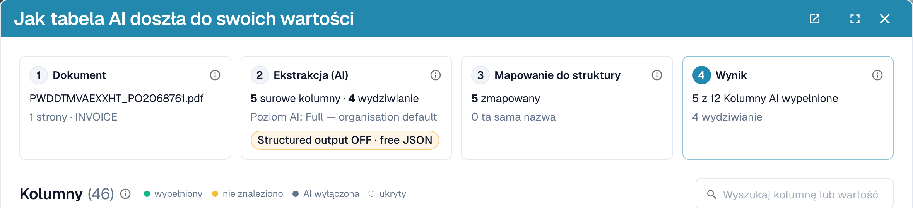<figcaption>
Wyjaśnij ekstrakcję: cztery kroki od dokumentu do wyniku.
</figcaption></figure>

<figure>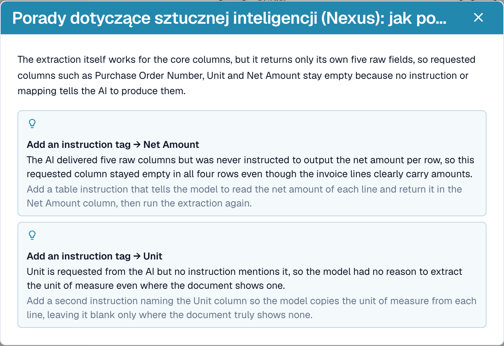<figcaption>
Porady dotyczące sztucznej inteligencji proponują kolejne kroki.
</figcaption></figure>

<figure>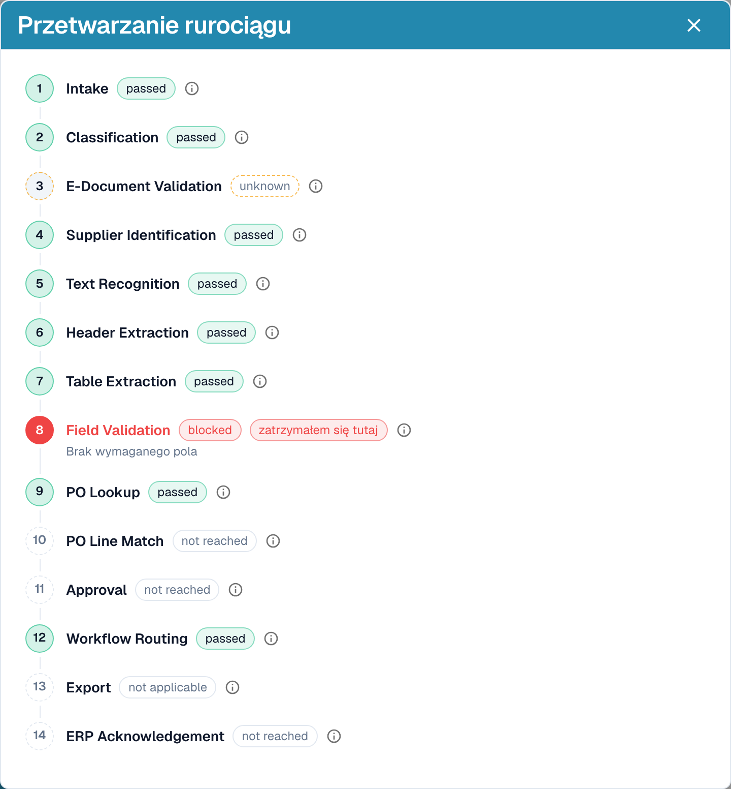<figcaption>
Przetwarzanie rurociągu pokazuje, gdzie dokument się zatrzymał, tutaj na walidacji pól.
</figcaption></figure>

Te wyjaśnienia należą do modułu **Panel analityczny**. Bez licencji na moduł lub gdy Twoja rola nie ma dostępu do zakładki Analityka, DocBits informuje, o co poprosić administratora (aktywować moduł w Ustawienia → Moduły albo przyznać zakładkę Twojej roli w Ustawienia → Role).

## Praktyczne przykłady

| Sytuacja                                                                                  | Co zrobić                                                                                                                                                                                                                                                                                       |
| ----------------------------------------------------------------------------------------- | ----------------------------------------------------------------------------------------------------------------------------------------------------------------------------------------------------------------------------------------------------------------------------------------------- |
| Wartość jest w złej kolumnie, na przykład _Cena Jednostkowa_ znajduje się w _Kwota netto_ | Kliknij nazwę kolumny i zmapuj ją na właściwą kolumnę. Następnie **Zapisz jako szkolenie**, jeśli dostawca zawsze drukuje to w ten sposób.                                                                                                                                                      |
| Kolumna pozostaje pusta w każdym wierszu, na przykład _Kwota rabatu_                      | Dodaj kolumnę w polu **Dodatkowe kolumny dla sztucznej inteligencji** albo napisz instrukcję z sformułowaniem użytym na fakturze, na przykład _Wypełnij kolumnę Kwota rabatu na podstawie kolumny o nazwie „Rabatt” na fakturze._ Sprawdź za pomocą **Zmiana testu**, a następnie **Stosować**. |
| AI nie wie, co zrobić (nic w prompcie)                                                    | Kliknij **Zasugeruj za pomocą Nexus** i wstaw to, co pasuje.                                                                                                                                                                                                                                    |
| Cenę trzeba podzielić lub zaokrąglić                                                      | Zapisz regułę w prompcie, na przykład _Cena jednostkowa to kwota netto podzielona przez ilość_.                                                                                                                                                                                                 |
| Kwoty są odczytywane z błędnymi separatorami (1.234,50 zamiast 1,234.50)                  | Otwórz menu trzech kropek kolumny, wybierz **Formatowanie kwoty** i wskaż właściwy format.                                                                                                                                                                                                      |
| Etykieta znajduje się pod wartością                                                       | Menu trzech kropek → **Extract From** → **Below**.                                                                                                                                                                                                                                              |
| Kolumna nie jest potrzebna dla tego dostawcy                                              | Menu trzech kropek → **Usuń kolumnę**. **Zapisz jako szkolenie** zachowuje ją jako ukrytą dla dostawcy.                                                                                                                                                                                         |
| Wiersz jest błędny lub go brakuje                                                         | Usuń go przyciskiem **x** albo dodaj wiersz za pomocą **Dodaj nowy wiersz tabeli** i wpisz wartości.                                                                                                                                                                                            |
| Te same poprawki są potrzebne raz za razem                                                | Użyj **Zapisz jako szkolenie**, aby kolejne dokumenty tego dostawcy były poprawne. Przy złożonych układach zamiast tego [wytrenuj tabelę](../../../administration-and-setup/setup/document-training/training-line-fields-table-training/).                                                      |


Nie każdy zawinięty wiersz opisu da się naprawić instrukcją. Jeśli wiersze jednej pozycji są rozbite na kilka wierszy, edytuj wiersze lub użyj klasycznego szkolenia tabeli.


## Asystent a tabela AI

Kliknij **Asystent** (ikona lampy obok Zapisz na ekranie walidacji), aby zadawać pytania dotyczące dokumentu.

<figure>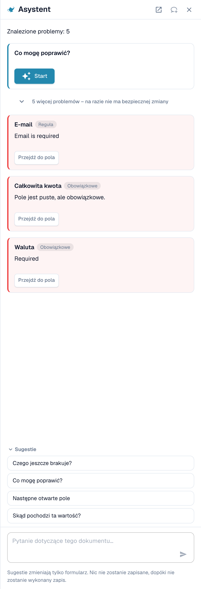<figcaption>
Asystent wylicza otwarte problemy i podpowiada pytania.
</figcaption></figure>

**Co Asystent robi dla tabel.** Może przenieść Cię do komórki tabeli, a jeśli możesz edytować dokument, ustawić wartość komórki tabeli lub dodać wiersz tabeli. Działa to zarówno w Wyodrębnionej tabeli AI, jak i w Wyodrębnionej tabeli. Odpowiada też na pytania takie jak _Czego jeszcze brakuje?_ i _Co mogę poprawić?_.

<figure>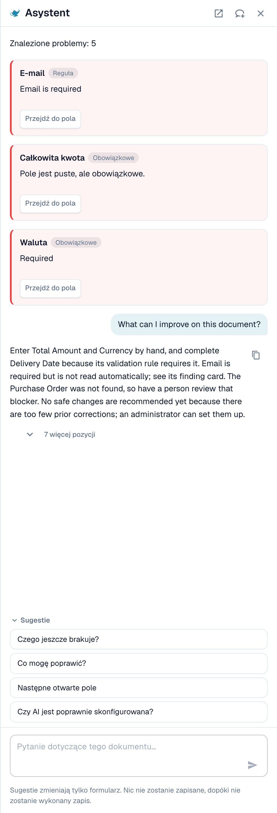<figcaption>
Zapytaj <em>Co mogę poprawić?</em>, aby otrzymać krótką listę tego, co poprawić w następnej kolejności.
</figcaption></figure>

**Czego nie robi.** Asystent **nie** zmienia instrukcji AI, dodatkowych kolumn, mapowania kolumn ani szkolenia. Użyj do tego karty **Instrukcje dla sztucznej inteligencji** (**Zasugeruj za pomocą Nexus**, **Zmiana testu**, **Stosować**, **Zapisz jako szkolenie**). Administratorzy mogą zapytać _Czy AI jest poprawnie skonfigurowana?_, aby zobaczyć porady dotyczące ustawień, na przykład w sprawie łączenia odczytu tabeli przez AI z zapisanymi regułami tabeli.

### Zaproponuj regułę administratorowi

Wiele problemów wynika z **pola**, a nie z tabeli: adresu e-mail, który jest zawsze wymagany, ale pusty, daty w złym formacie, identyfikatora dostawcy, który wymaga wyszukiwania. W takich przypadkach każdy, kto może otworzyć dokument, może wysłać propozycję przez Asystenta:

1. Zapytaj _Co mogę poprawić?_ lub otwórz kartę ustalenia w Asystencie.
2. Jeśli jesteś administratorem, karta oferuje **Stosować**. Jeśli nie, wyświetla _An administrator can review this proposal._ i przycisk **Suggest improvement**. Kliknij go.
3. DocBits pokazuje _Your suggestion was sent to the administrators._ Jeśli ktoś wysłał już taką samą sugestię, Twoje zgłoszenie jest doliczane do niej zamiast tworzyć drugą.
4. Karta pokazuje następnie **Requested**, później **Implemented** lub **Declined** (z uzasadnieniem, jeśli administrator je podał).

Propozycja może być **regułą transformacji**, **regułą walidacji** lub **wyszukiwaniem (lookup)**. Wysyłasz ją z dokumentu, a serwer sam buduje szkic reguły na podstawie znalezionego problemu, więc nie musisz niczego pisać. Liczba sugestii jest ograniczona do 20 na użytkownika na godzinę.


W ten sposób nie możesz zaproponować **instrukcji tabeli AI, mapowania kolumn ani szkolenia**. Jeśli tabela wymaga poprawki, popraw ją w dokumencie i poinformuj administratora albo poproś administratora o **Zapisz jako szkolenie** na dokumencie tego dostawcy. Administratorzy mogą zapisywać reguły; patrz [Kto co może](./#kto-co-moze).


**Co widzi administrator.** Administratorzy otrzymują powiadomienie w postaci zadania i e-maila. Otwierają **Inteligencja bezdotykowa** i znajdują propozycję w sekcji **Otwarte ulepszenia** (zakładka _Otwarte_, historia w _Historia_). Kliknięcie otwiera panel _Improvement suggestion_ z przykładowymi dokumentami i podglądem. Administrator może **Approve** lub **Reject**. Przy zatwierdzaniu opcja **Switch on right away** decyduje, czy nowa reguła jest od razu aktywna; bez niej reguła jest tworzona jako nieaktywna, a administrator włącza ją na liście reguł. Odrzucenie wymaga podania powodu i opcjonalnej notatki dla zgłaszających. Zobacz [Touchless Intelligence](../../../administration-and-setup/analytics-dashboard/touchless-intelligence/).

<figure>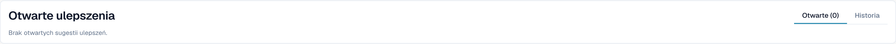<figcaption>
Administratorzy znajdują propozycje w sekcji <strong>Otwarte ulepszenia</strong>.
</figcaption></figure>

## Kto co może

| Akcja                                                                                                                                 | Kto                                                                                                                                                                                                                                 |
| ------------------------------------------------------------------------------------------------------------------------------------- | ----------------------------------------------------------------------------------------------------------------------------------------------------------------------------------------------------------------------------------- |
| Ponowne mapowanie kolumny, **Usuń kolumnę**, **Formatowanie kwoty**, **Extract From**, **Zmiana testu**, **Stosować**, edycja wierszy | Każdy, kto może edytować dokument                                                                                                                                                                                                   |
| **Zapisz jako szkolenie**                                                                                                             | Każdy, kto może edytować, chyba że włączone jest ustawienie organizacji **Zapisz zasady ekstrakcji (tylko administrator)**. Wtedy reguły mogą zapisywać tylko administratorzy organizacji; pozostali otrzymują komunikat o błędzie. |
| **Dodaj nową kolumnę tabeli**                                                                                                         | Administratorzy                                                                                                                                                                                                                     |
| Zaproponowanie reguły przez Asystenta                                                                                                 | Każdy, kto może otworzyć dokument                                                                                                                                                                                                   |
| Zatwierdzenie lub odrzucenie sugestii                                                                                                 | Administratorzy                                                                                                                                                                                                                     |
| **Wyjaśnij ekstrakcję**, **Porady dotyczące sztucznej inteligencji**                                                                  | Użytkownicy, których rola ma dostęp do modułu Panel analityczny                                                                                                                                                                     |

## Ustawienia dla administratorów

Otwórz **Ustawienia → Przetwarzanie dokumentów → Typy dokumentów → Klasyfikacja i ekstrakcja**, zakładka **Ogólny**, sekcja **Ekstrakcja**.

<figure>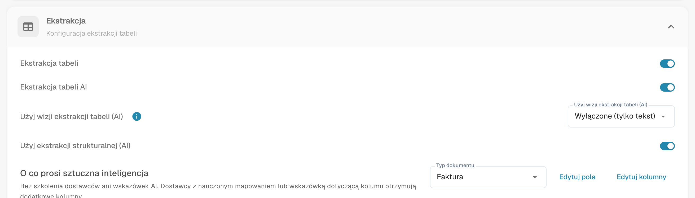<figcaption>
Przełączniki decydujące o tym, czy tabela AI istnieje.
</figcaption></figure>

* **Ekstrakcja tabeli** włącza klasyczną tabelę.
* **Ekstrakcja tabeli AI** włącza lub wyłącza tabelę AI dla organizacji.
* **Użyj ekstrakcji strukturalnej (AI)**: AI zwraca tabelę w stałej strukturze, która mapuje się bezpośrednio na skonfigurowane kolumny, zamiast kopiować nagłówki dostawcy. Nazwy kolumn zawsze odpowiadają wtedy Twojej konfiguracji; kolumna, którą dostawca drukuje, ale której nie skonfigurowano, nie jest wyodrębniana.
* **Zapisz zasady ekstrakcji (tylko administrator)**: po włączeniu tylko administratorzy organizacji mogą zapisywać i eksportować reguły ekstrakcji.

<figure>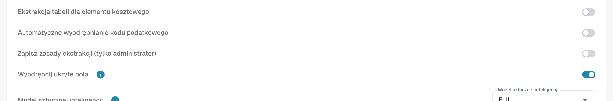<figcaption>
<strong>Zapisz zasady ekstrakcji (tylko administrator)</strong> decyduje, kto może używać <strong>Zapisz jako szkolenie</strong>.
</figcaption></figure>

### Użyj AI dla pojedynczych kolumn

Każda kolumna tabeli ma flagę **Użyj AI** (Ustawienia → Ustawienia globalne → Typy dokumentów → [Kolumny tabeli](../../../administration-and-setup/settings/global-settings/document-types/table-columns/)). Przy włączonej fladze AI wypełnia tę kolumnę nawet wtedy, gdy dostawca ma zapisane reguły; pozostałe kolumny nadal pochodzą z reguł. Typowe zastosowanie: kolumna opisu tekstowego, którą wytrenowane reguły przechwytują źle.

AI zgaduje wtedy tę kolumnę na podstawie całego wiersza. Jeśli konsekwentnie wstawia tam niewłaściwą wartość, na przykład sumę pozycji do kolumny _Opłaty_, wyłącz **Użyj AI** dla tej kolumny albo dodaj instrukcję, która mówi AI, czym jest ta kolumna.

## Powiązane strony

* [Tagowanie tabeli AI](ai-table-tags.md)
* [Szkolenie Pól Linii/Szkolenie Tabeli](../../../administration-and-setup/setup/document-training/training-line-fields-table-training/)
* [Touchless Intelligence](../../../administration-and-setup/analytics-dashboard/touchless-intelligence/)
