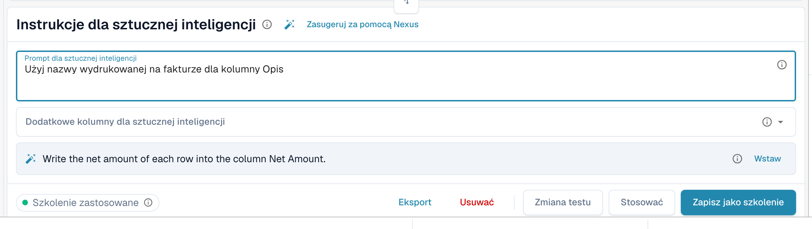

# Tagowanie tabeli AI i instrukcje

Tagi to sposób, w jaki mówisz AI, co ma zrobić z tabelą. W karcie **Instrukcje dla sztucznej inteligencji** pod tabelą AI (patrz [Tabela AI](README.md)) podajesz dwa rodzaje tagów:

| Rodzaj | Gdzie go wpisujesz | Co AI z nim robi |
| --- | --- | --- |
| **Instrukcja** | **Prompt dla sztucznej inteligencji**, jedna instrukcja w wierszu | Stosuje ją podczas odczytu tabeli, na przykład jak obliczać lub jakiego sformułowania użyć. |
| **Kolumna** | **Dodatkowe kolumny dla sztucznej inteligencji** | Musi zwrócić tę kolumnę oprócz zwykłych, nawet jeśli dokument nie oznacza jej wyraźnie. |

Oba rodzaje są zapisywane razem jako tagi AI dostawcy, gdy wybierzesz **Zapisz jako szkolenie**.

<figure><figcaption>
Jedna instrukcja w wierszu w polu <strong>Prompt dla sztucznej inteligencji</strong>.
</figcaption></figure>

## Dodawanie tagów krok po kroku

1. Otwórz dokument na ekranie walidacji i pozostań w zakładce **Wyodrębniona tabela AI**.
2. W polu **Prompt dla sztucznej inteligencji** napisz, co AI ma zrobić, po jednej instrukcji w wierszu. Wpisz **@**, aby wstawić kolumnę z Twojej konfiguracji.
3. Albo otwórz **Dodatkowe kolumny dla sztucznej inteligencji** i wybierz kolumny, które AI musi zwrócić.
4. Nie wiesz, co napisać? Kliknij **Zasugeruj za pomocą Nexus** i użyj **Wstaw** lub **Dodaj kolumnę** przy sugestii.
5. Kliknij **Zmiana testu**, aby porównać wynik z bieżącą tabelą. Nic nie jest jeszcze zapisywane.
6. Wynik jest dobry? Kliknij **Stosować** (albo **Zastosuj wynik do tego dokumentu** w oknie testu), aby umieścić wynik w tym dokumencie.
7. Jeśli potrzebuje tego każdy dokument tego dostawcy, kliknij **Zapisz jako szkolenie**. **Usuwać** usuwa zapisane tagi i reguły układu dostawcy.


Każdy wiersz w polu **Prompt dla sztucznej inteligencji** jest instrukcją, nawet pojedyncze słowo (DocBits dodaje kropkę, aby AI nie pomyliła go z nazwą kolumny). Kolumny należą do pola **Dodatkowe kolumny dla sztucznej inteligencji**.


## Pisanie dobrych instrukcji

* **Podaj kolumnę i sformułowanie z dokumentu.** *Wypełnij kolumnę Kwota rabatu na podstawie kolumny o nazwie „Rabatt”.* działa lepiej niż *znajdź rabat*.
* **Jedna rzecz na wiersz.** Krótkie wiersze łatwiej testować i usuwać.
* **Opisuj obliczenia prosto.** *Cena jednostkowa to kwota netto podzielona przez ilość.*
* **Powiedz, czego nie ruszać.** *Zignoruj wiersze z kosztami wysyłki na dole tabeli.*
* **Sprawdź całą tabelę.** Zmieniony prompt ponownie uruchamia AI i może zmienić każdą kolumnę.
* **Nie powtarzaj tego, co już wiadomo.** Tag kolumny, który powiela inny tag lub jest równy polu nagłówka, jest ignorowany.

## Przykłady

| Problem | Tag |
| --- | --- |
| Kolumna rabatu pozostaje pusta | Dodatkowa kolumna **Kwota rabatu** oraz instrukcja *Wypełnij kolumnę Kwota rabatu na podstawie kolumny o nazwie „Rabatt”.* |
| Ilość i jednostka są w jednej komórce | *Wpisz liczbę do kolumny Ilość, a jednostkę miary do kolumny Jednostka.* |
| Cena jednostkowa nie jest wydrukowana | *Cena jednostkowa to kwota netto podzielona przez ilość.* |
| Daty muszą być w formacie ISO | *Zapisz wszystkie daty w formacie RRRR-MM-DD.* |
| Kwoty w obcej walucie | *Zaokrąglij wszystkie kwoty do dwóch miejsc po przecinku.* |

Kolumny, które możesz wybrać, to kolumny tabeli skonfigurowane dla typu dokumentu, patrz [Kolumny tabeli](../../../administration-and-setup/settings/global-settings/document-types/table-columns/README.md).

## Przed zapisem

* Najpierw **Zmiana testu**. Nigdy niczego nie zapisuje.
* **Zapisz jako szkolenie** dotyczy układu dostawcy, więc kolejne dokumenty są odczytywane z Twoimi tagami. Sprawdź przy następnym dokumencie, czy chip pokazuje **Szkolenie zastosowane**.
* Jeśli włączone jest **Zapisz zasady ekstrakcji (tylko administrator)**, poproś o zapis administratora organizacji.
* Tagi zmieniają sposób, w jaki AI odczytuje tabelę. Dla stabilnych pozycji kolumn powtarzalnego układu [wytrenuj tabelę](../../../administration-and-setup/setup/document-training/training-line-fields-table-training/README.md).
