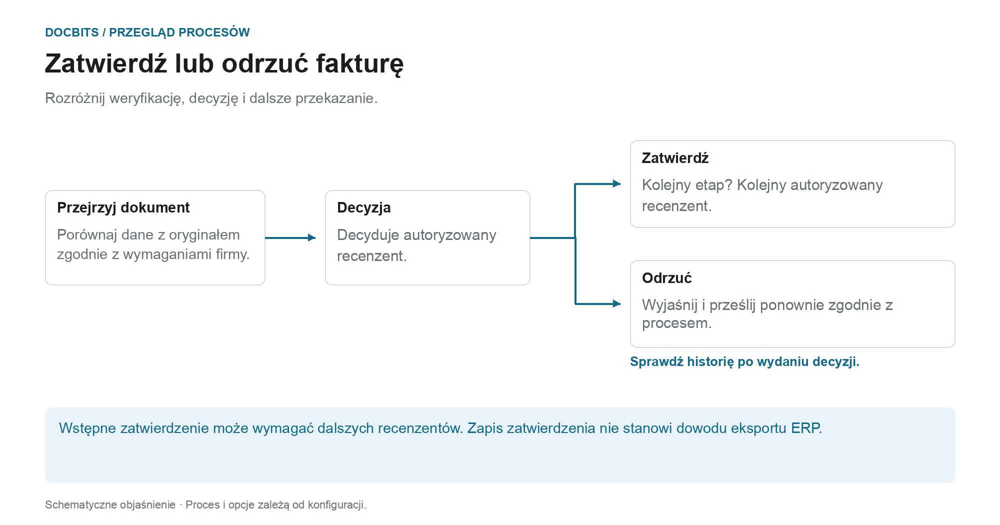
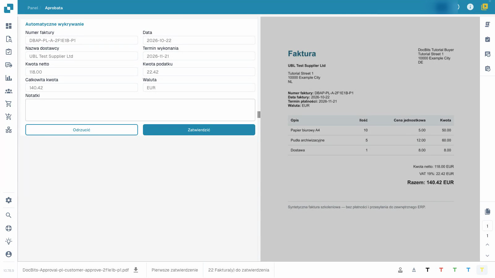
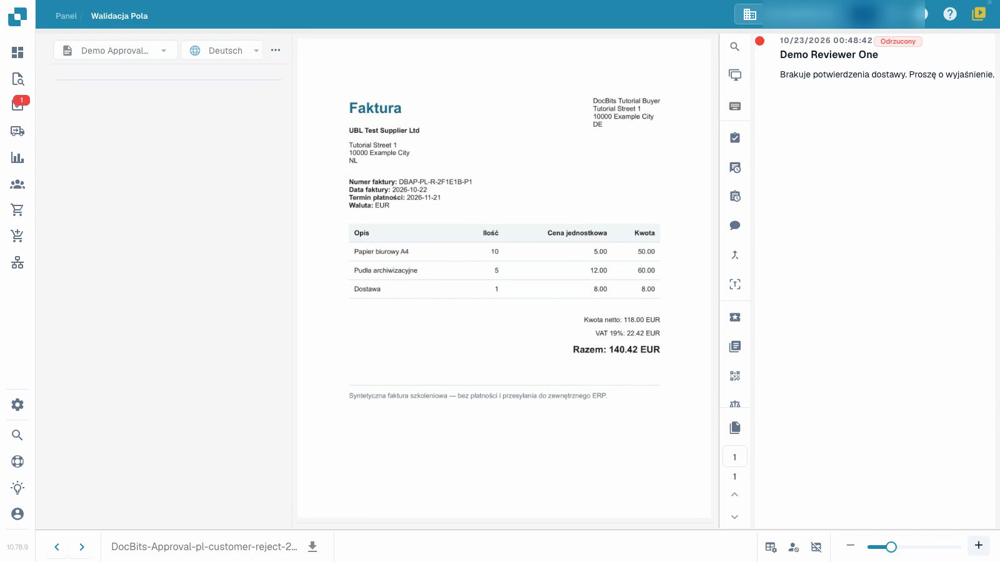

# Zatwierdź lub odrzuć fakturę

## Co następuje po decyzji o zatwierdzeniu działalności gospodarczej

<figure><figcaption>
Rozróżnij weryfikację, decyzję i dalsze przekazanie. Schemat ma charakter schematyczny; aktywne ustawienia Twojej organizacji określają rzeczywiste zachowanie.
</figcaption></figure>

Walidacja techniczna sprawdza dane dokumentu; zatwierdzenie rejestruje decyzję biznesową autoryzowanego recenzenta. Nawet technicznie ważna faktura może nadal wymagać jednego lub większej liczby zatwierdzeń.

1. **Sprawdź odpowiedzialność:** Otwórz przypisaną fakturę i sprawdź, na jaki poziom zatwierdzenia możesz zdecydować.
2. **Przejrzyj fakturę:** porównaj wartości nagłówka, pozycje i podatek z oryginalnym dokumentem i wymaganiami firmy.
3. **Decyzja dotycząca dokumentu:** Zatwierdź prawidłową fakturę lub odrzuć ją z konkretnego powodu. Poczekaj na odpowiedź, a następnie sprawdź historię zatwierdzeń.
4. **Określ kolejny krok:** Jeśli skonfigurowane są dodatkowe etapy zatwierdzania, faktura oczekuje na ich decyzję. Po odrzuceniu, wyjaśnieniu, poprawieniu i ponownym przesłaniu postępuj zgodnie ze skonfigurowanym procesem. Oddzielny proces eksportu sprawdza, czy dane dotarły do ​​systemu docelowego.

### Trzy stwierdzenia, które nie oznaczają tego samego

| oświadczenie | Czego nie dowodzi automatycznie |
| --- | --- |
| **Dane zostały zweryfikowane.** | Czy autoryzowany recenzent biznesowy go zatwierdził. |
| **Zatwierdzony przez recenzenta.** | Czy wszystkie wymagane etapy zatwierdzania zostały zakończone. |
| **Zatwierdzenia zostały zakończone.** | Fakt, że faktura została już wyeksportowana lub zaksięgowana w ERP. |

Użyj [Zadania dokumentujące](tasks.md) do przetwarzania przydzielonych prac, a [Stan dokumentu](dashboard/document-status.md) do klasyfikowania bieżącego statusu.

Film pokazuje zatwierdzanie z perspektywy osoby sprawdzającej.


Zatwierdź lub odrzuć fakturę


[Obejrzyj wideo z napisami](https://docbits-videos.fra1.cdn.digitaloceanspaces.com/settings-assistant/invoice-approval-customer/v1/pl.html)

Pokazano rzeczywistą aplikację; sformułowanie opcji może zależeć od wdrożonej wersji.

Użyj zatwierdzenia, aby zapisać swoją decyzję merytoryczną dotyczącą faktury, która została już zwalidowana. Potrzebujesz dostępu do dokumentu i uprawnień do jego obecnego etapu zatwierdzania. Wideo wykorzystuje zwykłe konto osoby sprawdzającej.

## Sprawdź i podejmij decyzję

1. Otwórz przypisaną do Ciebie fakturę i sprawdź obecny etap zatwierdzania.
2. Porównaj numer faktury, dostawcę, daty i sumę z oryginałem. Przejrzyj również pozycje i podatek. Walidacja techniczna nie zastępuje Twojego oceny merytorycznej.
3. Zapisz jasną notatkę z kontroli. Zatwierdź poprawną fakturę lub odrzuć ją z konkretnym powodem, gdy wymaga wyjaśnienia. Poczekaj na zakończenie operacji.
4. Otwórz ponownie dokument i sprawdź jego historię zatwierdzeń. Sprawdź, czy osoba sprawdzająca, czas, decyzja i pełna notatka zostały zapisane zgodnie z zamiarem.

<figure><figcaption>
Wypełniony formularz faktury w porównaniu z oryginałem.
</figcaption></figure>

<figure><figcaption>
Zapisane odrzucenie z powodem.
</figcaption></figure>

## Sprawdź następny etap

Gdy skonfigurowane jest drugie zatwierdzenie, Twoje pierwsze zatwierdzenie pozostawia fakturę w oczekiwaniu na inną uprawnioną osobę sprawdzającą. Nie jest jeszcze w pełni zatwierdzona. Odrzucenie wymaga wyjaśnienia merytorycznego; korekta i ponowne przesłanie następują zgodnie ze skonfigurowanym procesem.

Wpis w historii zatwierdzeń nie dowodzi, że dane dotarły do systemu ERP. W tym odizolowanym przykładzie kanał pobierania nie ma zewnętrznego celu ERP. Status techniczny `pending_data_fetch`, gdy jest wyświetlany, oznacza, że dokument oczekuje na pobranie danych.

## Powiązane strony

- [Ekran walidacji](validation-screen/README.md)
- [Zadania dotyczące dokumentów](tasks.md)
