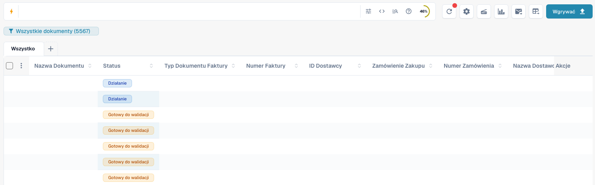
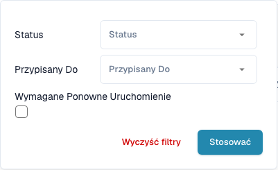
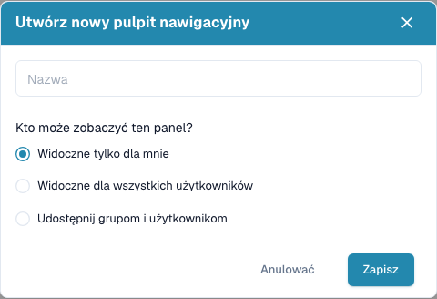

# Pulpit

Pulpit to codzienna lista pracy w DocBits. Znajdziesz tu zaimportowane dokumenty, sprawdzisz ich status, otworzysz je do walidacji i zorganizujesz pracę zespołu.


Dostępne funkcje zależą od uprawnień, statusu dokumentu i modułów włączonych w organizacji. Niektóre opisane przyciski mogą być niewidoczne. W węższych oknach na komputerze dodatkowe działania znajdują się w menu **Więcej**.


<figure><figcaption>
Aktualny pulpit: wyszukiwanie, narzędzia, zapisane widoki, typy dokumentów i tabela. Wartości dokumentów ukryto w celu ochrony danych.
</figcaption></figure>

## Wyszukiwanie dokumentów bez modułu pełnotekstowego i z nim

Film zaczyna się przy biurku fikcyjnej klientki w Warszawie. Następnie prawdziwy polski interfejs DocBits zajmuje cały ekran. Pierwszy przykład pokazuje wyszukiwanie po nazwie bez modułu pełnotekstowego: wpisz fragment nazwy pliku, naciśnij Enter i sprawdź wynik. Drugi pokazuje, jak uwzględnić treść dokumentów po włączeniu modułu pełnotekstowego.



[Otwórz film z polskim głosem](https://docbits-videos.fra1.cdn.digitaloceanspaces.com/settings-assistant/dashboard-search-customer/v1/pl.mp4) · [Polskie napisy (VTT)](https://docbits-videos.fra1.cdn.digitaloceanspaces.com/settings-assistant/dashboard-search-customer/v1/pl.vtt) · [Polska transkrypcja](https://docbits-videos.fra1.cdn.digitaloceanspaces.com/settings-assistant/dashboard-search-customer/v1/pl.txt)

Klientka i biuro zostały wygenerowane przez AI. Czynności i wyniki wyszukiwania pochodzą z rzeczywistych nagrań na koncie testowym DocBits.

## Pełna prezentacja pulpitu

Fikcyjna klientka z Warszawy pokazuje wyszukiwanie z operatorem AND, filtry statusu, pomoc wyszukiwania, ustawienia kolumn, statystyki i odświeżanie. Polski interfejs nagrano w DocBits z syntetycznymi danymi testowymi. Postać i głos wygenerowano za pomocą AI.



[Otwórz odtwarzacz z napisami](https://docbits-videos.fra1.cdn.digitaloceanspaces.com/settings-assistant/dashboard-tour-preview-customer/v3/pl.html) · [Polskie napisy (VTT)](https://docbits-videos.fra1.cdn.digitaloceanspaces.com/settings-assistant/dashboard-tour-preview-customer/v3/pl.vtt) · [Transkrypcja](https://docbits-videos.fra1.cdn.digitaloceanspaces.com/settings-assistant/dashboard-tour-preview-customer/v3/pl.txt)

## Rozpoczęcie codziennej pracy

1. Sprawdź aktywną organizację i ewentualnie podorganizację.
2. Wybierz typ dokumentu lub pozostaw **Wszystko**.
3. Wyszukaj i przefiltruj potrzebne dokumenty.
4. Sprawdź **Status** i **Przypisany Do**, a następnie otwórz wiersz dokumentu.
5. Odśwież listę po przetwarzaniu lub imporcie dokumentów.

## Wyszukiwanie i filtrowanie dokumentów

Wpisz nazwę dokumentu, numer faktury lub inną wartość biznesową i naciśnij **Enter**. Ikona filtra w wyszukiwarce pozwala wybrać status, osobę przypisaną i dokumenty wymagające ponownego uruchomienia. Zatwierdź przyciskiem **Stosować**. Usuń pojedyncze filtry albo wyczyść filtry, gdy nie możesz znaleźć dokumentu. Karty typów dokumentów i zapisane widoki również zawężają listę.

Pasek wyszukiwania udostępnia filtry strukturalne, widok bezpośredniego zapytania oraz pomoc dotyczącą pól i składni. Korzystaj z nazw pól i przykładów podanych w pomocy. Techniczne nazwy pól nie zmieniają się wraz z językiem. Funkcje zaawansowane zależą od włączonych możliwości wyszukiwania.

Przy włączonym wyszukiwaniu pełnotekstowym menu treści określa sposób szukania zwykłego tekstu: tryb automatyczny najpierw przeszukuje pola biznesowe, a przy braku wyników treść dokumentów; uwzględnianie treści dodaje trafienia z dokumentów; tryb tylko pól pomija treść. Wskaźnik oznacza wyniki pochodzące z treści. Znak `+` po liczbie wyników oznacza ograniczone okno wyników. Doprecyzuj wtedy wyszukiwanie.

Jeśli widoczny jest osobny wybór dat, wybierz gotowy lub własny okres importu. Przy wyszukiwaniu pełnotekstowym jest ukryty; użyj wtedy dostępnych pól daty w pasku wyszukiwania.

<figure><figcaption>
Filtruj według statusu, przypisanej osoby i konieczności ponownego uruchomienia.
</figcaption></figure>

## Odczytywanie i porządkowanie tabeli

Każdy wiersz przedstawia dokument. Zależnie od konfiguracji kolumn zobaczysz nazwę, status, typ, dane faktury, dostawcę, przypisaną osobę, daty i kwoty. Kliknij nagłówek kolumny obsługującej sortowanie, aby zmienić kolejność. Przewijaj poziomo, aby zobaczyć kolejne kolumny. Użyj nawigacji stron i liczby dokumentów na stronę, aby przeglądać wyniki.

Jeśli grupowanie jest dostępne, wybierz pole nad tabelą. Dla pól daty wybierz dzień, tydzień lub miesiąc. Otwórz grupę, aby zobaczyć jej dokumenty, albo usuń grupowanie, aby wrócić do zwykłej listy.

Przycisk **+** obok kart typów dokumentów pokazuje dodatkowe typy. Zmieniaj kolejność kart przez przeciąganie. Usunięcie karty zmienia tylko widok i nie usuwa dokumentów.

Otwórz koło zębate i ustawienia kolumn. Przenoś kolumny między listą ukrytych i widocznych oraz przeciągaj widoczne kolumny, aby je uporządkować. Możesz także dodać pola typu dokumentu. Zobacz [Zmiana kolumn dokumentu](change-document-columns.md).

<figure><figcaption>
W ustawieniach kolumn wybierzesz i uporządkujesz informacje widoczne w tabeli.
</figcaption></figure>

## Statusy i działania na dokumentach

Statusy przetwarzania wskazują etapy takie jak OCR, klasyfikacja i eksport. **Gotowy do walidacji** oznacza możliwość sprawdzenia dokumentu. Statusy zatwierdzania wskazują oczekiwanie na akceptację. **Eksportowano** oznacza zakończenie eksportu dokumentu. Kliknij status **Błąd**, aby zobaczyć dostępne szczegóły.

Jeśli dostępne są czasy przetwarzania, najedź na status, aby zobaczyć etapy i czas ich trwania. Dokumenty z możliwymi duplikatami mają ikonę duplikatu; otwórz ją, aby porównać powiązane dokumenty.

Otwórz wiersz, aby pracować na ekranie walidacji. Menu działań zawiera dozwolone operacje: przypisanie, pobieranie, historię i ponowne uruchomienie przetwarzania. Warianty pobierania zależą od dokumentu i mogą uwzględniać adnotacje lub formaty faktur elektronicznych.

Zaznacz kilka dokumentów i otwórz menu w nagłówku tabeli, aby wykonać dozwolone działania zbiorcze: przypisanie, scalanie, ponowne uruchomienie, ponowny eksport lub usuwanie. Sprawdź zaznaczenie i każde potwierdzenie. Te działania mogą zmieniać dokumenty; zapisanie widoku zmienia tylko wygląd listy pracy.

## Zapisywanie osobistego pulpitu

Otwórz niebieski przycisk widoku pod wyszukiwarką i utwórz nowy pulpit. Nadaj nazwę i wybierz widoczność prywatną, dla wszystkich albo dla określonych grup i użytkowników. Zapisz filtry, sortowanie i kolumny dla powtarzalnych zadań.

Zapisane widoki wybierzesz z tego samego menu. Zapisuj późniejsze zmiany, gdy widok należy do Ciebie i został zmodyfikowany. Nie możesz nadpisać widoku udostępnionego przez inną osobę: utwórz własny. Udostępnienie widoku nie zwiększa dostępu do dokumentów. Zobacz [Osobiste pulpity](personal-dashboards.md).

<figure><figcaption>
Utwórz pulpit z nazwą i wybierz osoby, które mogą go zobaczyć.
</figcaption></figure>

## Przesyłanie dokumentów i korzystanie z narzędzi

Wybierz **Wgrywać**, przeciągnij pliki do okna albo wybierz je z komputera i rozpocznij przesyłanie. Jeśli opcja klasyfikacji jest dostępna, możesz jawnie wskazać typ dokumentu. W przeciwnym razie DocBits klasyfikuje pliki automatycznie.

Pozostałe narzędzia odświeżają listę, otwierają ustawienia zaawansowane, uruchamiają skaner, pokazują statystyki statusów, uruchamiają skonfigurowany import poczty lub zlecają eksport CSV/Excel. Skanowanie i eksport wymagają odpowiedniej konfiguracji. Eksport tabeli jest inną operacją niż eksport dokumentu do ERP. Zapisz zmiany kolumn osobistego pulpitu przed eksportem, ponieważ eksport korzysta z zapisanej konfiguracji. Zobacz [Narzędzia pulpitu](dashboard-tools.md).

<figure><figcaption>
Prześlij pliki i w razie potrzeby wybierz typ dokumentu przed importem.
</figcaption></figure>

## Gdy brakuje dokumentu lub funkcji

Najpierw sprawdź organizację, aktywny widok, typ dokumentu, szukany tekst i filtry. Odśwież listę i sprawdź kolejne strony wyników. Jeśli funkcja nadal jest niedostępna, poproś administratora o sprawdzenie uprawnień i modułów.

**Ctrl/Cmd + K** otwiera globalne szybkie wyszukiwanie; **Ctrl/Cmd + Q** odświeża pulpit; **Ctrl/Cmd + H** otwiera pomoc. Menu koła zębatego zawiera listę skrótów. Widoczny czasem licznik oczekujących dokumentów całej organizacji jest wskaźnikiem administracyjnym, a nie osobistym licznikiem zadań.

Używaj Ctrl w Windows/Linux i Cmd w macOS. Skróty przeglądarki lub systemu mogą mieć pierwszeństwo.
