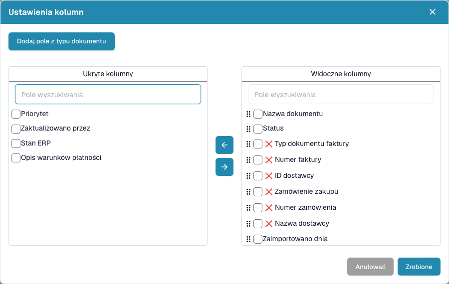

# Zmiana kolumn dokumentu

1. Wybierz koło zębate **Ustawienia zaawansowane** po prawej stronie paska wyszukiwania pulpitu.
2. Wybierz przycisk **Ustawienia kolumn** w menu.
3. Wyszukaj kolumny na liście ukrytych lub widocznych. Zaznacz je i przenieś strzałkami.
4. Przeciągaj uchwyty widocznych kolumn, aby ustawić kolejność.
5. W razie potrzeby dodaj pola, wybierając typ dokumentu i wymagane pola.
6. Wybierz **Zrobione**, aby zastosować konfigurację.

We własnym zapisanym pulpicie zapisz również zmiany przed eksportem tabeli. Eksportowane kolumny pochodzą z zapisanego widoku. Zamknij lub anuluj okno, aby wyjść bez zmian. Dostępne kolumny zależą od typu dokumentu i konfiguracji organizacji.

<figure><figcaption>
W ustawieniach kolumn wybierzesz i uporządkujesz informacje widoczne w tabeli.
</figcaption></figure>
