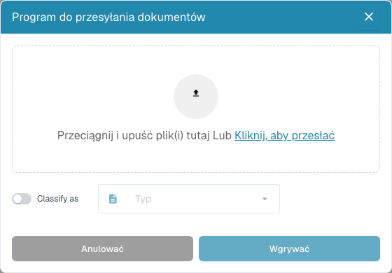

# Narzędzia pulpitu

Narzędzia znajdują się obok wyszukiwarki. Najedź na ikonę, aby zobaczyć jej opis. W węższych oknach na komputerze otwórz **Więcej**.

| Narzędzie | Zastosowanie |
| --- | --- |
| Odśwież | Wczytaj listę i statusy ponownie. Wskaźnik zmian informuje o dostępności nowszych danych. |
| Ustawienia zaawansowane (koło zębate) | Otwórz ustawienia kolumn, skróty i dziennik importu poczty. Ustawienia organizacji wymagają uprawnień administratora. |
| Skanuj dokument | Otwórz okno, jeśli skanowanie jest aktywne i dostępny jest zgodny skaner. Wybierz urządzenie i ustawienia przed rozpoczęciem. |
| Analiza | Pokaż statystyki statusów i wybierz kategorię, aby ograniczyć listę. |
| Rozpocznij import poczty | Uruchom import według istniejącej konfiguracji skrzynki. To działanie nie konfiguruje skrzynki. |
| Eksportuj tabelę | Zleć CSV lub Excel, jeśli opcja jest aktywna. Najpierw zapisz zmiany kolumn widoku osobistego: eksport odczytuje zapisaną konfigurację. |
| Wgrywać | Wybierz lub przeciągnij pliki, opcjonalnie wskaż typ dokumentu i rozpocznij przesyłanie. |

<figure><figcaption>
Prześlij pliki i w razie potrzeby wybierz typ dokumentu przed importem.
</figcaption></figure>

Dziennik pozwala sprawdzać importy poczty. Filtruj według tematu lub nadawcy i przeglądaj dostępne informacje. Potwierdzenie zlecenia eksportu tabeli oznacza wysłanie zadania, a nie wyeksportowanie dokumentu do ERP.

Wyszukiwanie, działania i widoki opisuje [przewodnik po pulpicie](README.md).
