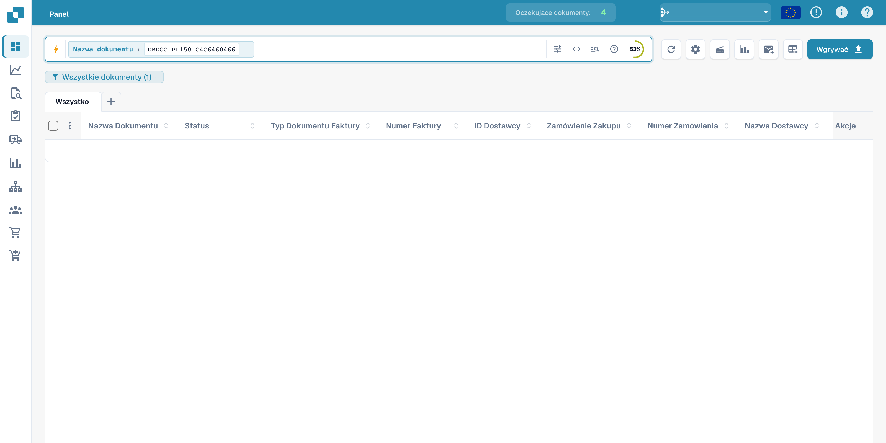
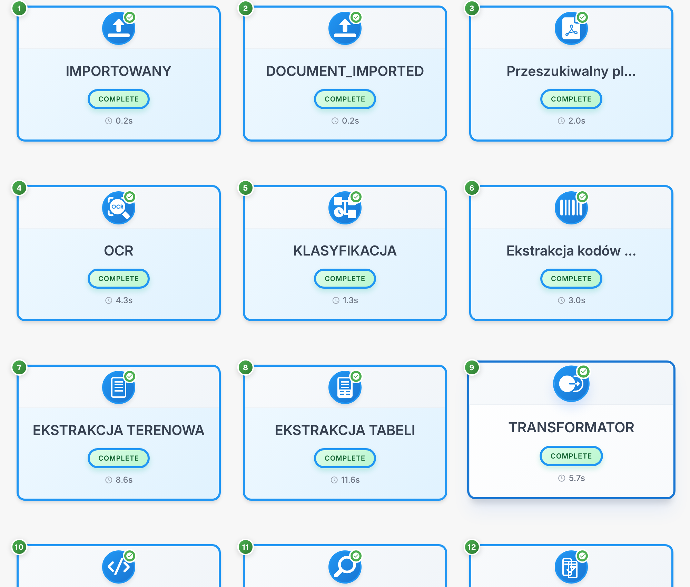

# Przepływ dokumentu

Przepływ dokumentu pokazuje kolejność, status i czas etapów przetwarzania. Przykład wykorzystuje fikcyjną fakturę.

## Otwieranie przepływu

Znajdź dokument w panelu. Wartości dokumentu są ukryte.

<figure><figcaption>
Wyszukiwanie fikcyjnego dokumentu w panelu; wartości są ukryte.
</figcaption></figure>

Otwórz walidację pól i menu opcji na prawym pasku narzędzi, aby wyświetlić przepływ dokumentu.

<figure><figcaption>
Menu walidacji służące do otwarcia przepływu dokumentu.
</figcaption></figure>

## Odczytywanie etapów

Każda karta przedstawia etap, na przykład import, OCR, klasyfikację lub ekstrakcję pól. Kieruj się numeracją.

<figure><figcaption>
Etapy przetwarzania fikcyjnej faktury; kody techniczne pozostają bez zmian. Etykieta EKSTRAKCJA TERENOWA oznacza ekstrakcję pól dokumentu.
</figcaption></figure>

Kody techniczne DOCUMENT_IMPORTED i COMPLETE pozostają bez zmian. COMPLETE oznacza zakończenie etapu.

## Szczegóły

Wybierz kartę, aby sprawdzić dostępne szczegóły i dzienniki.

| Szczegół | Znaczenie |
| --- | --- |
| Moduł | Komponent przetwarzający etap |
| Status | Aktualny stan etapu |
| Czas | Zarejestrowany czas przetwarzania |
| Dzienniki | Dostępne komunikaty techniczne |

Przed ponownym uruchomieniem zbadaj komunikaty etapu oczekującego lub zakończonego błędem. Niektóre nagłówki diagnostyczne produktu mogą pozostać w języku angielskim.

Szczegóły etapu pokazują komponent przetwarzania, status, czas i dostępne dzienniki techniczne.
