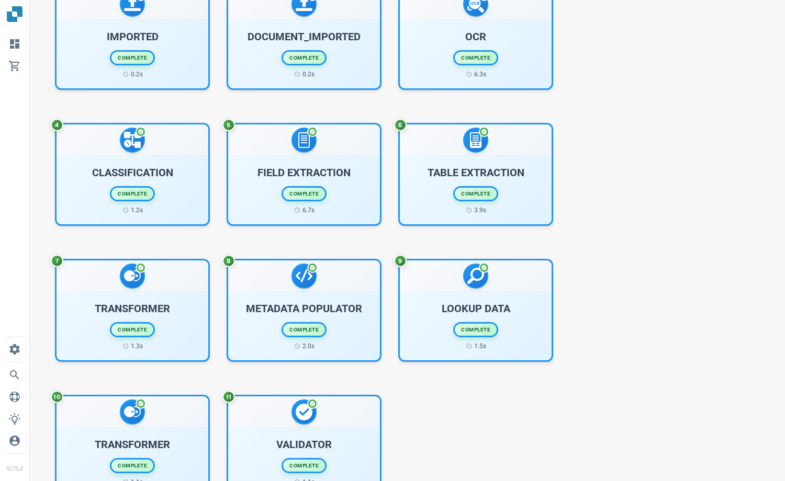

# Przepływ dokumentu

**Document Flow** pokazuje etapy przetwarzania jednego dokumentu. Dzięki niemu zobaczysz, które etapy zostały ukończone, który oczekuje oraz ile trwało przetwarzanie. Poniższy przykład używa syntetycznej faktury w angielskiej wersji Sandbox.

## Otwieranie z pulpitu

Na **Dashboard** znajdź dokument. W jego kolumnie **Actions** wybierz trzy kropki, a następnie **Document flow**. Ta opcja otwiera przepływ dla danego dokumentu; nie zmienia dokumentu.

<figure><figcaption>Wybierz Document flow z menu Actions dokumentu.</figcaption></figure>

## Otwieranie z Field Validation

Otwórz dokument. W **Field Validation** wybierz trzy kropki na prawym pasku akcji, a następnie **Document Flow** w sekcji **More options**.

<figure><figcaption>Ten sam przepływ jest dostępny z widoku dokumentu.</figcaption></figure>

## Odczytywanie przepływu

**Process Statistics** po lewej stronie podsumowuje liczbę etapów, etapy ukończone i oczekujące, ponowne uruchomienia, całkowity czas, bieżący status oraz ogólny postęp. Każda ponumerowana karta przedstawia etap przetwarzania i jego bieżący stan. Przewiń w dół, aby zobaczyć kolejne etapy.

<figure><figcaption>Pierwsze etapy przepływu syntetycznej faktury.</figcaption></figure>

<figure><figcaption>Przewiń, aby śledzić sekwencję przez dalsze etapy.</figcaption></figure>

Wybierz kartę etapu, aby otworzyć **Step Details** po lewej stronie. Zawiera moduł i jego status. Po prawej może otworzyć się także panel **Task Logs**; szczegóły logów zależą od tego, co jest dostępne dla danego zadania. Wybierz **×** w Step Details, aby zamknąć panel.

<figure><figcaption>Step Details wyjaśnia status wybranego modułu.</figcaption></figure>
