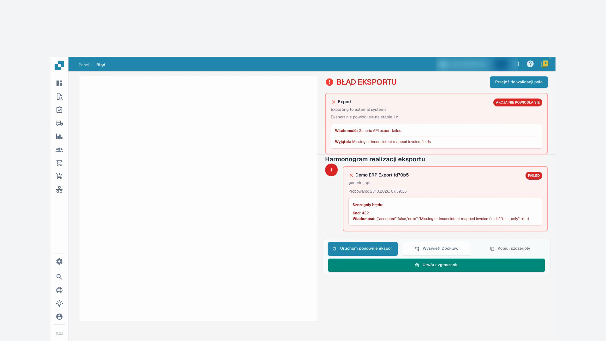
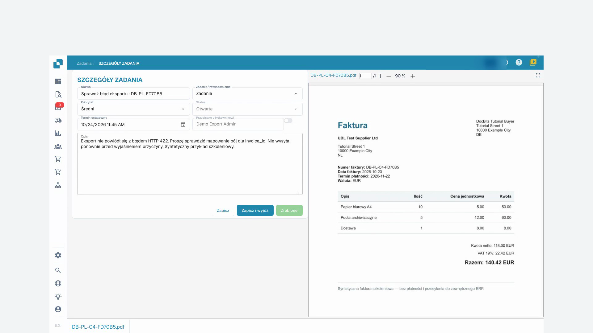

# Status dokumentów

Statusy przetwarzania wskazują etapy takie jak OCR, klasyfikacja i eksport. **Gotowy do walidacji** oznacza możliwość sprawdzenia dokumentu. Statusy zatwierdzania wskazują oczekiwanie na akceptację. **Eksportowano** oznacza zakończenie eksportu dokumentu. Kliknij status **Błąd**, aby zobaczyć dostępne szczegóły.

Jeśli dostępne są czasy przetwarzania, najedź na status, aby zobaczyć etapy i czas ich trwania. Dokumenty z możliwymi duplikatami mają ikonę duplikatu; otwórz ją, aby porównać powiązane dokumenty.

Otwórz wiersz, aby pracować na ekranie walidacji. Menu działań zawiera dozwolone operacje: przypisanie, pobieranie, historię i ponowne uruchomienie przetwarzania. Warianty pobierania zależą od dokumentu i mogą uwzględniać adnotacje lub formaty faktur elektronicznych.

Zaznacz kilka dokumentów i otwórz menu w nagłówku tabeli, aby wykonać dozwolone działania zbiorcze: przypisanie, scalanie, ponowne uruchomienie, ponowny eksport lub usuwanie. Sprawdź zaznaczenie i każde potwierdzenie. Te działania mogą zmieniać dokumenty; zapisanie widoku zmienia tylko wygląd listy pracy.

Wyszukiwanie, działania i widoki opisuje [przewodnik po pulpicie](README.md).

## Instrukcja wideo: Obsługa zablokowanych faktur

Postać i głos są syntetyczne. Nagranie pokazuje rzeczywisty interfejs testowy DocBits z syntetycznymi fakturami szkoleniowymi.


Obsługa zablokowanych faktur


[Oglądaj z napisami i rozdziałami](https://docbits-videos.fra1.cdn.digitaloceanspaces.com/settings-assistant/blocked-invoices-customer/v1/pl.html)

Niektóre etykiety produktu mogą pozostać w innym języku. Zachowano techniczne identyfikatory pól.

Otwieram fakturę w walidacji pól. W tym przykładzie brakuje numeru faktury. Pozostałe wartości są już wypełnione. Porównuję je z oryginałem, zanim cokolwiek zmienię.

Teraz wprowadzam numer faktury i opuszczam pole. Następnie zapisuję fakturę. Czekam na odpowiedź i ponownie ładuję dokument. W ten sposób widzę, czy poprawka rzeczywiście została zachowana.

Numer nadal tam jest po ponownym otwarciu. Błąd pola obowiązkowego został rozwiązany. Zapisanie nie oznacza jednak, że faktura została zatwierdzona lub wyeksportowana do systemu ERP.

W przypadku drugiej faktury lista pokazuje błąd eksportu. Otwieram status i czytam szczegóły. Odbiorca testowy odrzucił przesłane dane z kodem błędu czterysta dwadzieścia dwa. W tym miejscu należy sprawdzić mapowanie techniczne. Nie restartuję po prostu eksportu wielokrotnie.

<figure><figcaption>
Błąd eksportu i odpowiedź odbiorcy
</figcaption></figure>

W zadaniach dokumentu tworzę konkretne zadanie dla naszego administratora testów. Podaję kod błędu i proszę o sprawdzenie numeru faktury w mapowaniu. Na potrzeby tego szkolenia wysyłanie e-maili pozostaje wyłączone.

Po ponownym załadowaniu sprawdzam, czy zadanie zostało zapisane i przypisane do właściwej osoby. Zadanie pozostaje otwarte do momentu wyjaśnienia przyczyny. Utworzenie zadania nie jest jeszcze udanym eksportem.

<figure><figcaption>
Zapisane zadanie przekazania przypisane administratorowi
</figcaption></figure>
