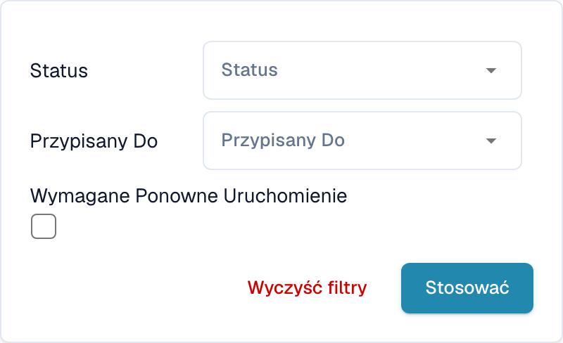

# Filtrowanie dokumentów

W pulpicie wybierz ikonę **Filtry** (trzy suwaki) na prawym końcu paska wyszukiwania. Listę można ograniczyć według **Statusu**, **Przypisanego do** lub **Wymaganego ponownego uruchomienia**.

<figure><figcaption>
Filtry panelu dotyczące przypisania i wymaganego ponownego uruchomienia.
</figcaption></figure>

Wybierz status lub osobę odpowiedzialną i wybierz **Stosować**. Wyczyść filtry, aby usunąć ograniczenia. Opcje dat zależą od konfiguracji i widoku. Sprawdź aktywne filtry przed interpretacją liczby dokumentów.
