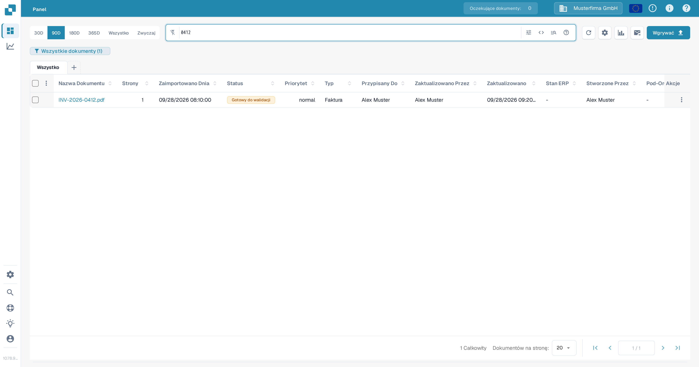
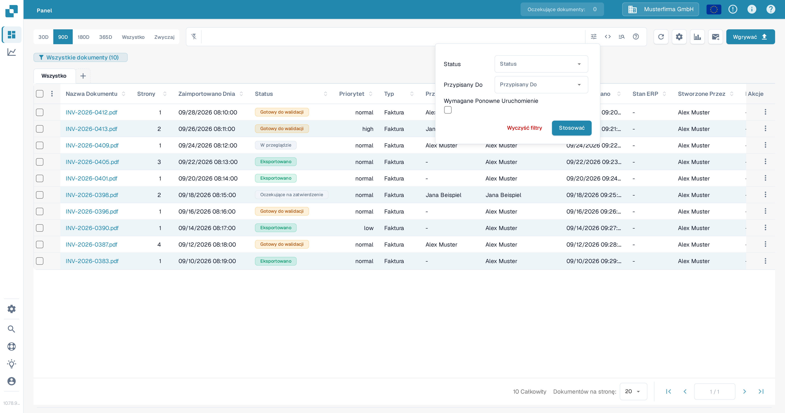
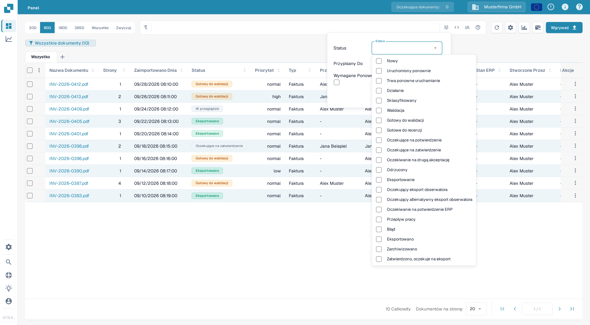
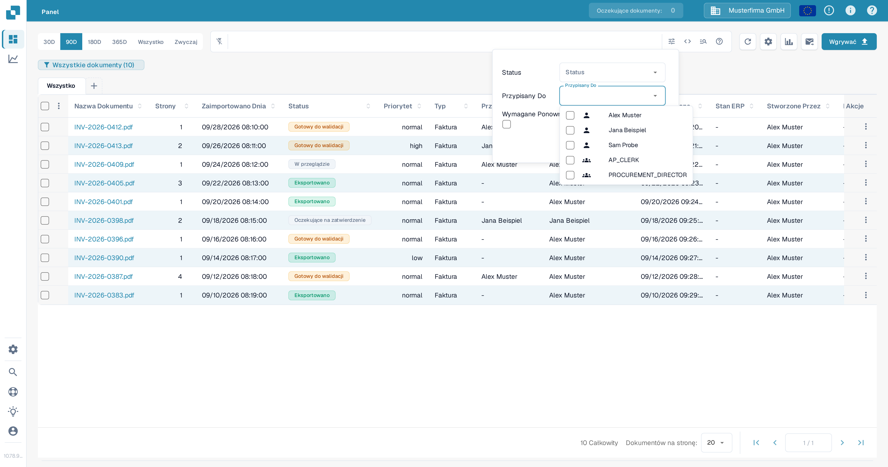
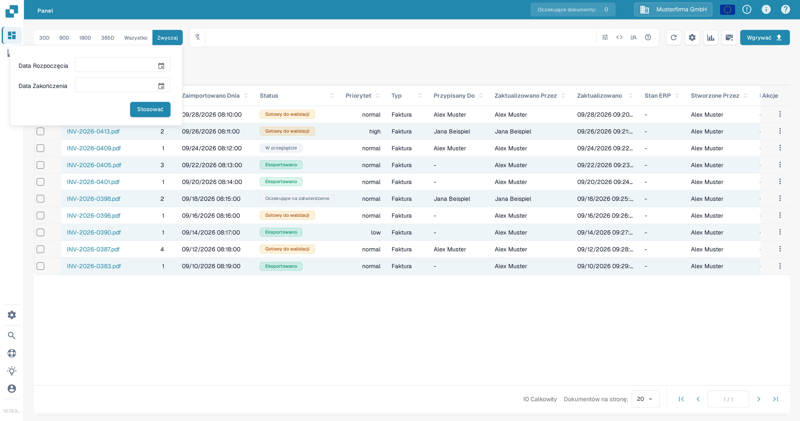
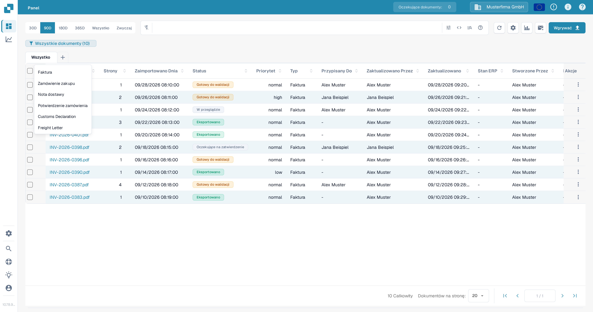
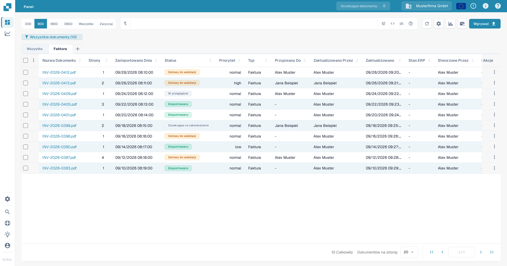

# Filtrowanie dokumentów

Użyj paska wyszukiwania w Panelu, panelu filtrów, zakresu dat i kart typów dokumentów, aby zawęzić listę dokumentów. Elementy te działają razem: dokument musi pasować do aktywnego wyszukiwania i filtrów, aby pozostać w tabeli.

## Znajdź dokument po nazwie

1. Otwórz **Panel**.
2. Wpisz część nazwy dokumentu w pasku wyszukiwania nad tabelą i naciśnij **Enter**. Licznik w plakietce Panelu oraz tabela aktualizują się i pokazują pasujące dokumenty.
3. Zastąp szukaną frazę, gdy chcesz znaleźć inny dokument. Informacje o wyszukiwaniu po polach i składni wyszukiwania znajdziesz w sekcji [Szybkie wyszukiwanie](quick-search.md).

<figure><figcaption>Wyszukiwanie po nazwie dokumentu zawęża testową listę dokumentów.</figcaption></figure>

## Filtruj według statusu, przypisania lub wymaganego ponownego uruchomienia

1. Wybierz ikonę **Filters** (suwaki) na prawym końcu paska wyszukiwania.
2. Wybierz jedną lub więcej wartości **Status**. Możesz wybrać kilka statusów jednocześnie.
3. W polu **Przypisany Do** wybierz użytkowników, których dokumenty chcesz zobaczyć. Jeśli Twoja organizacja ma włączone uprawnienia grupowe, w tej samej liście mogą pojawić się grupy. W tym panelu nie ma osobnego pola **Przypisany do grupy**.
4. Wybierz **Wymagane Ponowne Uruchomienie**, aby pokazać dokumenty wymagające ponownego uruchomienia.
5. Wybierz **Stosować**. Wybierz **Wyczyść filtry** w tym panelu, aby usunąć te wybory; tekst wyszukiwania i zakres dat to osobne elementy.

<figure><figcaption>Aktualny panel filtrów ma trzy kryteria i dwie akcje.</figcaption></figure>

<figure><figcaption>Wybierz potrzebne statusy przetwarzania.</figcaption></figure>

<figure><figcaption>Wybierz użytkownika w polu Przypisany Do.</figcaption></figure>

Wyjaśnienie znaczenia każdego statusu przetwarzania znajdziesz w sekcji [Status Dokumentu](document-status.md).

## Wybierz zakres dat importu

Nad paskiem wyszukiwania wybierz **30D**, **90D**, **180D**, **365D** lub **Wszystko**, aby zmienić zakres dat importu. Wybierz **Zwyczaj**, wskaż **Data Rozpoczęcia** i **Data Zakończenia**, a następnie wybierz **Stosować**, aby ustawić konkretny zakres. Aktualny wybór jest podświetlony.

<figure><figcaption>Użyj opcji Zwyczaj, gdy predefiniowane zakresy dat nie pasują.</figcaption></figure>

## Używaj kart typów dokumentów

1. Wybierz **+** obok **Wszystko**. Menu wyświetla typy dokumentów dostępne dla Twojej organizacji.
2. Wybierz typ, na przykład **Faktura**, aby dodać jego kartę. Następnie wybierz nową kartę, aby przefiltrować tabelę do tego typu. **Wszystko** usuwa ograniczenie typu bez usuwania karty.
3. Aby usunąć kartę typu, wybierz jej **×**. Karty **Wszystko** nie można usunąć.

<figure><figcaption>Dodaj kartę typu dokumentu z menu plus.</figcaption></figure>

<figure><figcaption>Wybierz kartę, aby zastosować filtr typu; użyj ×, aby usunąć kartę.</figcaption></figure>

Jeśli menu **+** nie zawiera żadnych typów, poproś administratora o sprawdzenie, które typy dokumentów są aktywne dla Twojej organizacji. Zobacz [Typy dokumentów](../../../administration-and-setup/settings/global-settings/document-types/README.md). Aby zapisać kombinację filtrów na później, zobacz [Osobiste Panele](personal-dashboards.md).