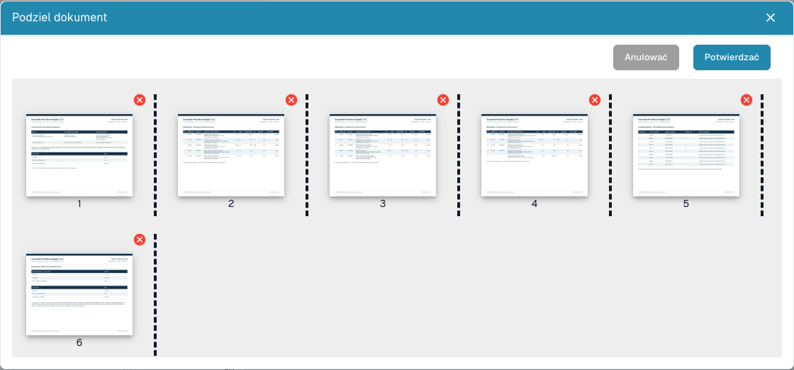

# Dzielenie pliku PDF i porządkowanie stron

<figure><figcaption>
Miniatury, separatory i przyciski usuwania przed wysłaniem podziału.
</figcaption></figure>

Podziel plik ręcznie, jeśli zawiera kilka niezależnych dokumentów. Przykład: faktura A na stronach 1–3, faktura B na 4–7, dokument dostawy na 8–10. Każdy dokument powinien być dalej przetwarzany osobno.

## Przygotowanie

Potrzebujesz uprawnień do edycji i dokumentu wielostronicowego. Zachowaj oryginał. Przed zmianami wyjaśnij blokadę dokumentu z odpowiedzialną osobą.

## Kolejne kroki

1. Otwórz dokument z pulpitu i sprawdź wszystkie oryginalne strony.
2. W przeglądarce dokumentu otwórz dodatkowe opcje i wybierz podział dokumentu.
3. Sprawdź ponumerowane miniatury. Ustaw separatory za ostatnią stroną każdego dokumentu, w przykładzie za stronami **3** i **7**.
4. Przeciągnij miniatury, aby poprawić kolejność. Ponownie sprawdź kolejność i separatory.
5. Usuń stronę **czerwonym krzyżykiem** wyłącznie wtedy, gdy należy ją pominąć. Pusta przekładka może być zbędna; zestawienie podatku lub załącznik mogą być konieczne.
6. Wybierz **Potwierdzać**, przeczytaj komunikat i kontynuuj, gdy grupy są poprawne. **Anulować** zamyka okno bez wysłania podziału.
7. Otwórz na pulpicie każdy powstały dokument. Sprawdź pierwszą/ostatnią stronę, liczbę stron, typ i wyodrębnione wartości.

## Weryfikacja i diagnostyka

Każda oryginalna strona musi należeć do zamierzonego dokumentu lub zostać świadomie pominięta. Podział nie potwierdza poprawnej ekstrakcji, zatwierdzenia ani eksportu do ERP.

Jeśli brakuje opcji, sprawdź liczbę stron, uprawnienia, blokadę i status. Bez separatorów, zmiany kolejności lub usunięcia okno może zgłosić brak zmian. Po błędzie sprawdź pulpit przed ponownym wykonaniem operacji o niepewnym wyniku.

Zobacz [Łączenie dokumentów](document-merging.md) oraz [Klasyfikacja i ekstrakcja](../../../administration-and-setup/settings/document-processing/classification-and-extraction/README.md), aby skonfigurować automatyczny podział według kodów kreskowych.
