# Szybkie wyszukiwanie

**Szybkie wyszukiwanie** (Quick Search) to najszybszy sposób na znalezienie dokumentów na pulpicie (Dashboard). Wpisujesz, czego szukasz — nazwę, status, kwotę, datę — a lista dokumentów filtruje się natychmiast.

Ten przewodnik jest ułożony tak, jak zbudowane jest wyszukiwanie:

1. **Pola standardowe** — kolumny, które ma każdy dokument (nazwa dokumentu, status, daty). Zawsze dostępne.
2. **Pola pełnotekstowe** — wyodrębniona treść (dostawca, zamówienie zakupu, numer faktury, kwoty, pozycje). Dostępne, gdy włączone jest wyszukiwanie pełnotekstowe.
3. **Operatory, skróty i przepisy** — pełna dokumentacja, gdy już poczujesz się swobodnie.

> Nie musisz niczego zapamiętywać: kliknij pasek wyszukiwania i wybierz pole oraz wartość z listy — Quick Search zbuduje zapytanie za Ciebie. Poniższe przykłady pokazują też formę wpisywaną, którą możesz skopiować bezpośrednio.

<figure>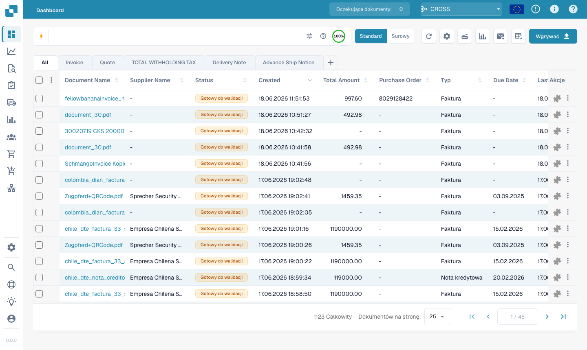<figcaption><p>Pasek Quick Search u góry pulpitu.</p></figcaption></figure>

---

## Jak działa pasek wyszukiwania — chipy, pasek narzędzi i widok surowy

Zanim przejdziemy do samych pól, warto wiedzieć, jak zbudowany jest pasek.

### Warunki zamieniają się w chipy

Gdy uzupełnisz warunek (pole, operator i wartość), Quick Search zamienia go w **chip** — kolorową plakietkę wewnątrz paska — i rozpoczyna kolejny. Chip pokazuje **pole**, **operator** i **wartość** oraz **×** do jego usunięcia. Chipy są oznaczone kolorem zależnie od tego, gdzie znajdują się dane:

| Kolor chipa | Typ pola |
|-------------|------------|
| **Niebieski** | Kolumna standardowa (nazwa dokumentu, status, daty) |
| **Pomarańczowy** | Pole pełnotekstowe / wyodrębnione (dostawca, kwota, numer faktury) |
| **Fioletowy** | Wyszukiwanie wektorowe (semantyczne) |
| **Zielony** | Wyszukiwanie tekstu OCR |

Kliknij chip, aby go edytować (rozwija się z powrotem do tekstu); kliknij **×**, aby go usunąć. Kilka połączonych chipów jest domyślnie odczytywanych jako **AND**.

### Pasek narzędzi

Na prawym końcu paska:

- **ⓘ Help** — otwiera wbudowaną dokumentację **Dashboard Search — Fields & Syntax** wymieniającą każde pole, operator i skrót dostępny w Twoim obszarze roboczym.
- **Filters (tune)** — szybki panel najczęstszych filtrów Status / User / Restart, z przyciskami **Clear filters** i **Apply**.
- **Pierścień indeksu** — mały pierścień postępu pokazujący, jaka część indeksu pełnotekstowego została zbudowana (widoczny tylko gdy wyszukiwanie pełnotekstowe jest włączone).

### Widok standardowy a surowy

Pasek zwykle pokazuje Twoje zapytanie jako chipy (**widok standardowy**). Przełącz na **widok surowy**, aby zobaczyć i edytować zapytanie jako zwykły tekst (np. `status=ready_for_validation AND supplier_name=Test`) — przydatne do kopiowania, udostępniania lub bezpośredniego wpisania długiego zapytania. Zapytanie nie ginie przy przełączeniu i jest zapamiętywane po ponownym załadowaniu pulpitu.

---

## Część 1 — Pola standardowe

Pola standardowe to własne kolumny dokumentu. Są **zawsze dostępne**, niezależnie od tego, czy wyszukiwanie pełnotekstowe jest włączone.

### Znajdowanie dokumentów po nazwie

Nazwa dokumentu to najczęstsze wyszukiwanie. Są trzy sposoby dopasowania — wszystkie **bez rozróżniania wielkości liter**:

#### `=` → zaczyna się od

```
filename=invoice
```

Znajduje dokumenty, których nazwa **zaczyna się od** „invoice". Ponieważ wielkość liter jest ignorowana, wszystkie poniższe pasują do `filename=invoice`:

```
Invoice.pdf   iNVoice.pdf   iNvoiCE.pdf   INVOICE.pdf
Invoice.xml   iNVoice.xml   iNvoiCE.edi   …
```

**Nie** pasuje do `XYZ_Invoice.pdf` (tam „invoice" jest w środku — użyj do tego `:`).

<figure>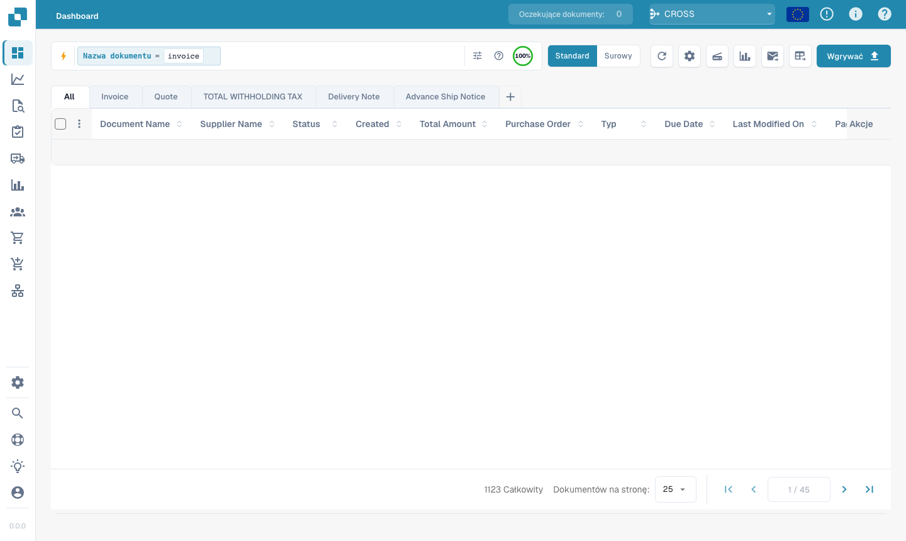<figcaption><p><code>filename=invoice</code> — tylko nazwy, które <strong>zaczynają się od</strong> „invoice", w dowolnej wielkości liter (<code>Invoice.pdf</code>, <code>iNVoice.pdf</code>, <code>INVOICE_2026.pdf</code> … wszystkie pasują). Porównaj z <code>:</code> poniżej.</p></figcaption></figure>

#### `:` → zawiera (gdziekolwiek)

```
filename:invoice
```

Użyj `:`, aby dopasować słowo **w dowolnym miejscu** nazwy — `2026_Invoice.pdf`, `vietnam_einvoice_sample.xml`, `scan_invoice_copy.pdf`.

<figure>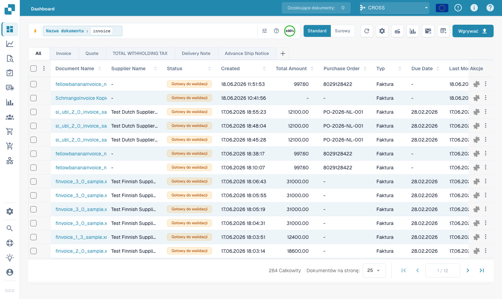<figcaption><p><code>filename:invoice</code> — pasuje do słowa w dowolnym miejscu nazwy dokumentu.</p></figcaption></figure>

#### `="…"` → zaczyna się *lub* kończy na

```
filename="invoice"
```

Cudzysłowy sprawiają, że `=` pasuje do nazw, które **zaczynają się lub kończą** podaną wartością — przydatne dla kodu na początku lub końcówki pliku.

> **Trzy w jednej linii:** `=` → zaczyna się od · `:` → zawiera · `="…"` → zaczyna się lub kończy na. Wszystkie ignorują wielkość liter. Podsumowanie możesz zobaczyć w dowolnej chwili przez **ikonę pomocy** na pasku wyszukiwania (następna sekcja).

### Znajdowanie dokumentów po statusie

```
status=ready_for_validation
```

Status to lista stała, więc `=` oznacza dopasowanie **dokładne**, a pasek oferuje wybór wartości, gdy wpiszesz `status=`.

<figure>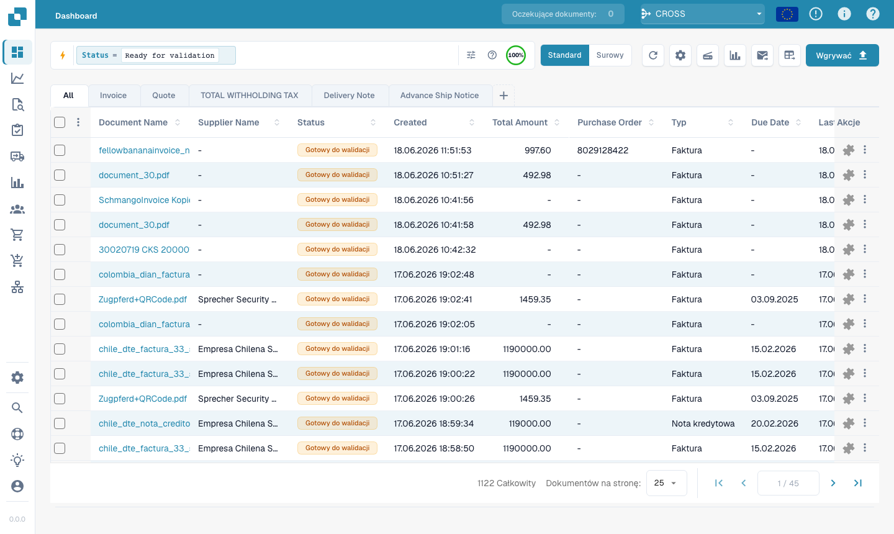<figcaption><p><code>status=ready_for_validation</code> — dokładne dopasowanie na polu z listą stałą.</p></figcaption></figure>

### Znajdowanie dokumentów po dacie

```
created_on>2026-05-25
```

Użyj `>`, `<`, `>=`, `<=` dla zakresów dat. Możesz też użyć dat **względnych**: `today()`, `today()-7` (ostatnie 7 dni), `today()+30` (następne 30 dni).

<figure>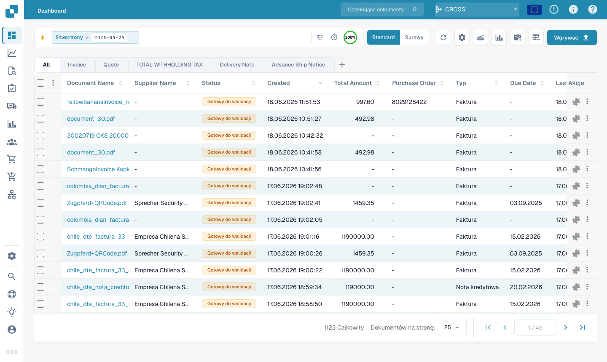<figcaption><p><code>created_on&#62;2026-05-25</code> — dokumenty utworzone po wskazanej dacie.</p></figcaption></figure>

### Znajdowanie dokumentów po podtypie faktury

```
invoice_sub_type="Cost Invoice"
```

Podtyp faktury to lista stała (na przykład **Cost Invoice** lub **Purchase Invoice**), więc `=` oznacza dopasowanie **dokładne**, a pasek oferuje wybór wartości, gdy wpiszesz `invoice_sub_type=`. Użyj `invoice_sub_type!="Cost Invoice"` dla wszystkiego poza tym podtypem.

---

## Część 2 — Pola pełnotekstowe

Pola pełnotekstowe przeszukują **wyodrębnioną treść** dokumentów — dostawcę, zamówienie zakupu, numer faktury, kwoty, pozycje. Pojawiają się na **pomarańczowo** i są dostępne, gdy dla Twojej organizacji **włączone jest wyszukiwanie pełnotekstowe**. Reguły dopasowania są dokładnie takie same jak dla standardowych pól tekstowych (`=` zaczyna się od, `:` zawiera, `="…"` zaczyna się lub kończy na).

### Znajdowanie dokumentów dostawcy

```
supplier_name=Test
```

Dopasowanie „zaczyna się od" na wyodrębnionej nazwie dostawcy. Użyj `supplier_name:fuji`, aby dopasować w dowolnym miejscu, lub `supplier_name:"Ruiz Foods"`, aby ująć w cudzysłów wartość ze spacjami.

<figure><figcaption><p><code>supplier_name=Test</code> — dostawca w każdym wyniku zaczyna się od „Test".</p></figcaption></figure>

### Znajdowanie dokumentów po zamówieniu zakupu

```
purchase_order=PO
```

Dopasowanie „zaczyna się od" na wyodrębnionym numerze zamówienia — świetne dla prefiksu PO.

<figure>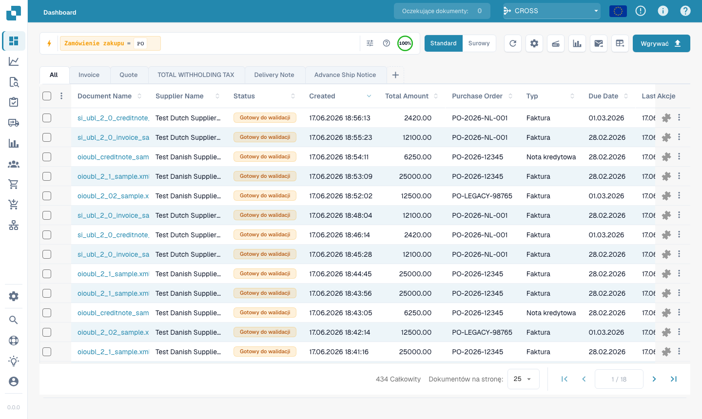<figcaption><p><code>purchase_order=PO</code> — dokumenty, których numer zamówienia zaczyna się od „PO".</p></figcaption></figure>

### Znajdowanie dokumentów po kwocie

```
total_amount>5000
```

Użyj `>`, `<`, `>=`, `<=` lub `between 100 and 500` dla przedziału.

<figure>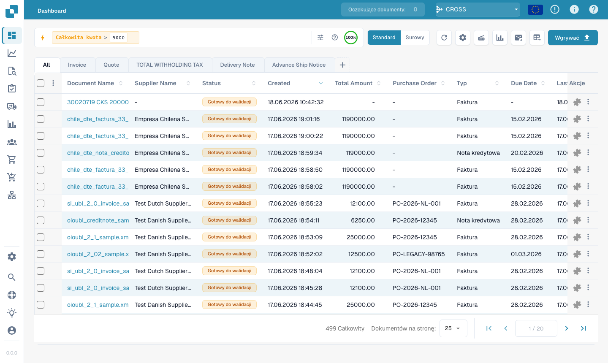<figcaption><p><code>total_amount&#62;5000</code> — faktury powyżej 5 000.</p></figcaption></figure>

Dla przedziału użyj `between`:

```
total_amount between 1000 and 5000
```

To skrót dla `total_amount>=1000 AND total_amount<=5000`.

<figure>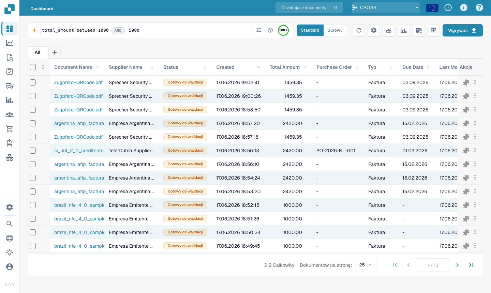<figcaption><p><code>total_amount between 1000 and 5000</code> — każdy wynik mieści się w przedziale.</p></figcaption></figure>

### Znajdowanie tego, czego brakuje

```
supplier_name=""
```

`=""` oznacza „to pole jest **niewypełnione**"; `supplier_name!=""` oznacza „ma dowolnego dostawcę".

<figure>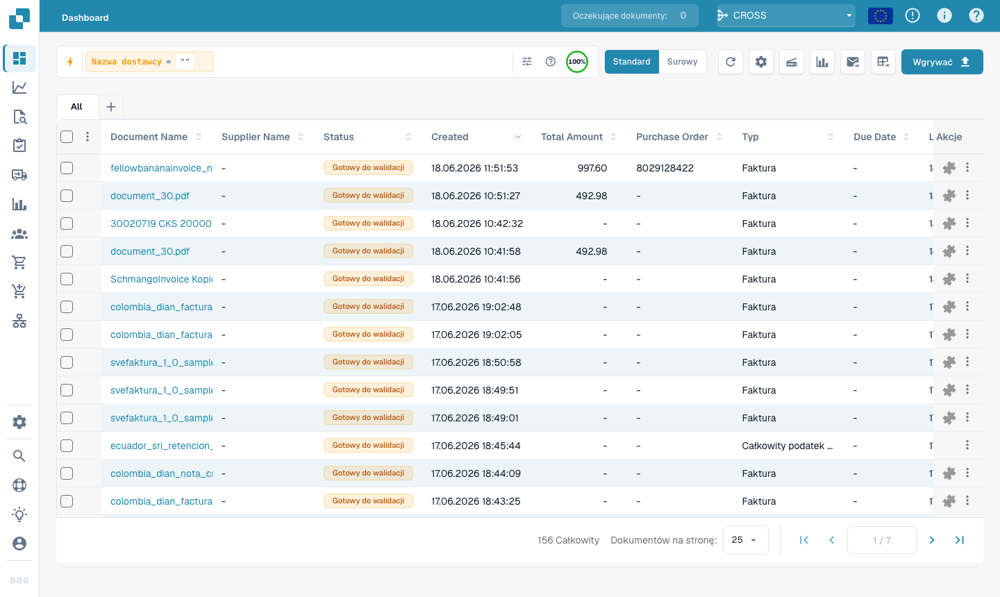<figcaption><p><code>supplier_name=""</code> — dokumenty, które nie mają jeszcze dostawcy.</p></figcaption></figure>

To samo sprawdzenie obecności działa na każdym polu — na przykład dla dokumentów, którym wciąż brakuje kodu przypisania AP:

```
ap_assignment_code=""
```

<figure>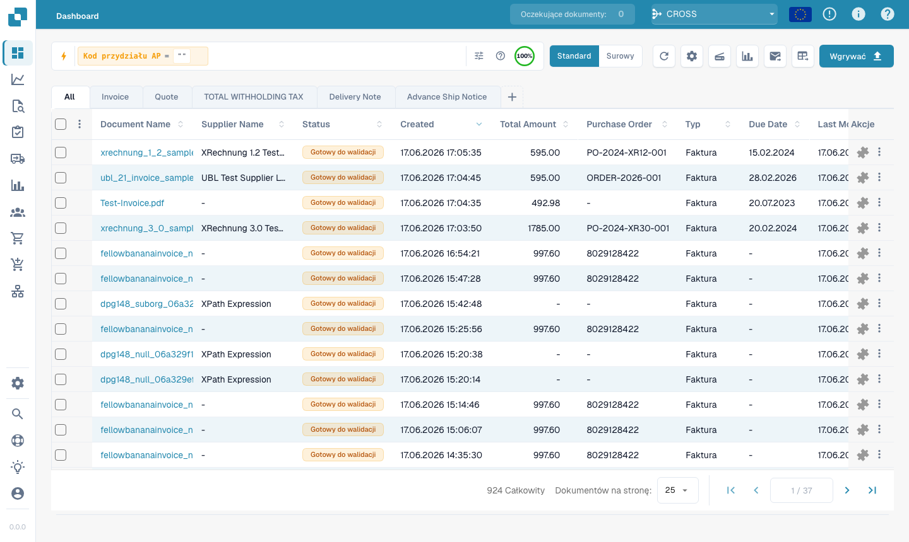<figcaption><p><code>ap_assignment_code=""</code> — dokumenty, które nie mają kodu przypisania AP. Użyj <code>ap_assignment_code!=""</code> dla tych, które go mają.</p></figcaption></figure>

---

## Filtry inteligentne — jedno kliknięcie

U góry listy rozwijanej Quick Search (kliknij w pasek wyszukiwania) znajdziesz **Smart Filters**: gotowe wyszukiwania stosowane jednym kliknięciem. Każdy z nich to po prostu skrót zapytania, które możesz też wpisać samodzielnie:

| Filtr inteligentny | Znajduje | To samo co wpisanie |
|--------------|-------|----------------|
| ⚠️ **Overdue** | Po terminie płatności | `invoice_due_date<today()` |
| 🕐 **Due soon** | W ciągu następnych 7 dni | `invoice_due_date<=today()+7` |
| 👤 **Assigned to me** | Pozycje czekające na Twoje działanie | `assigned_to=<you>` |
| 📅 **Today's inbox** | Zaimportowane dziś | `imported_on>=today()` |
| 📋 **Pending validation** | Gotowe do walidacji | `status=ready_for_validation` |
| 🧾 **Electronic documents** | E-faktury (XML, ZUGFeRD, EDI) | `is_edoc=true` |
| ✅ **Full PO match** | W pełni dopasowane do zamówienia zakupu | `po_match_status=full_matched` |
| ➗ **Partial PO match** | Częściowo dopasowane do zamówienia zakupu | `po_match_status=partial_matched` |
| 📉 **Under PO match** | Ilość lub cena jednostkowa poniżej zamówienia zakupu | `po_match_status=under_matched` |

Trzy filtry **PO match** oraz pola pełnotekstowe wymagają, aby dla Twojej organizacji było włączone wyszukiwanie pełnotekstowe.

<figure><figcaption><p>Smart Filters u góry listy rozwijanej Quick Search — jedno kliknięcie stosuje filtr (Overdue, Due soon, Assigned to me, Today's inbox, Pending validation, Electronic documents, Full / Partial / Under PO match).</p></figcaption></figure>

---

## Grupowanie wyników

Zamiast płaskiej listy możesz **pogrupować** wyniki według dowolnego pola — dostawcy, statusu, typu dokumentu, podorganizacji lub przedziału daty. Dodaj grupowanie z paska wyszukiwania:

```
group by supplier_name
```

Lista pokazuje wtedy zwijalne **nagłówki grup**, każdy z nazwą grupy i **licznikiem** (np. *Ruiz Foods (12)*). Kliknij nagłówek, aby rozwinąć lub zwinąć daną grupę. Dla pól dat możesz grupować według **dnia, tygodnia lub miesiąca**.

<figure>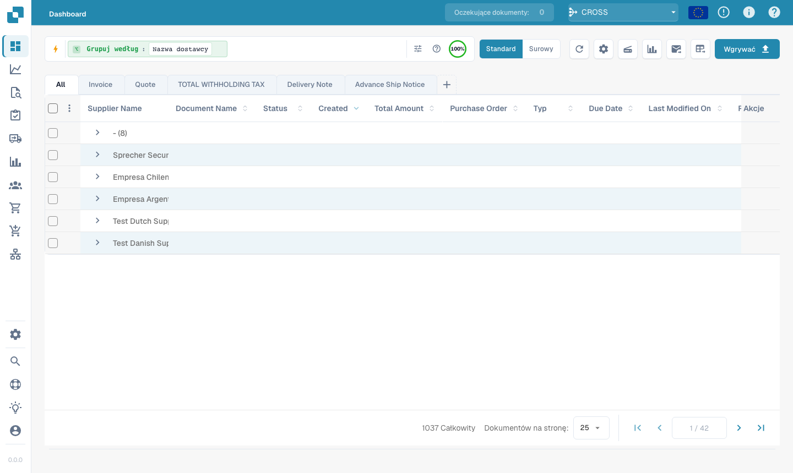<figcaption><p><code>group by supplier_name</code> — wyniki zwijają się w jeden rozwijalny nagłówek na dostawcę.</p></figcaption></figure>

Grupowanie łączy się z dowolnym filtrem — `status=ready_for_validation group by supplier_name` grupuje tylko pasujące dokumenty. Kliknięcie w grupę **schodzi głębiej**: stosuje wartość tej grupy jako filtr i wraca do płaskiej listy dla tego wyboru.

---

## Część 3 — Operatory, łączniki, skróty

### Wbudowana pomoc

**Ikona pomocy** na pasku wyszukiwania otwiera pełną dokumentację wszystkich pól, operatorów i skrótów dostępnych w Twoim obszarze roboczym — wraz z informacją, które pola są standardowe, a które pełnotekstowe.

<figure><figcaption><p>Wbudowana pomoc <strong>Dashboard Search — Fields &#38; Syntax</strong> wymienia każdy operator i sposób dopasowania wartości.</p></figcaption></figure>

### Co oznacza `=` zależnie od typu pola

Każde dopasowanie tekstu ignoruje wielkość liter.

| Typ pola | Przykład | `=` oznacza |
|------------|---------|-----------|
| Tekst (nazwa, dostawca, zamówienie zakupu) | `filename=invoice` | **zaczyna się od** |
| Tekst, w dowolnym miejscu | `filename:invoice` | **zawiera** |
| Tekst, początek *lub* koniec | `filename="invoice"` | **zaczyna się lub kończy na** |
| Status / typ / PO match (listy stałe) | `status=finished` | **dokładne** |
| Identyfikatory (numer faktury, id dostawcy) | `invoice_number=INV-100` | **dokładne** |
| Liczba | `total_amount>5000` | zakres (`> < >= <= between`) |
| Data | `created_on>2026-01-01` | zakres + `today()±N` |

### Operatory

| Operator | Znaczenie |
|----------|---------|
| `=` | zaczyna się od (tekst) / dokładne (lista, liczba, data) |
| `:` | zawiera (tekst, w dowolnym miejscu) |
| `="…"` | zaczyna się od lub kończy na (tekst) |
| `!=` | przeciwieństwo `=` |
| `>` `<` `>=` `<=` | większe / mniejsze niż |
| `between … and …` | zakres włącznie z krańcami |
| `field=""` / `field!=""` | jest puste / jest ustawione |
| `today()`, `today()-7`, `today()+30` | daty względne |

### Łączniki

Łącz warunki za pomocą **AND** (oba prawdziwe), **OR** (którykolwiek), **NOT** oraz nawiasów `( … )` do grupowania:

```
status=ready_for_validation AND supplier_name=Test
(status=error OR status=failed) AND created_on>today()-1
```

<figure>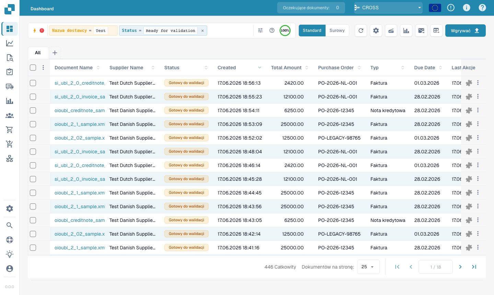<figcaption><p><code>status=ready_for_validation AND supplier_name=Test</code> — dwa połączone warunki.</p></figcaption></figure>

### Skróty

Krótsze sformułowania tych samych zapytań — używaj tego, co czyta się lepiej:

| Skrót | To samo co | Opis |
|----------|---------|-------------|
| `total_amount gt 5000` | `total_amount>5000` | Słowne aliasy operatorów porównania (`gt`/`gte`/`lt`/`lte`/`eq`/`ne`) |
| `due_date > today` | `due_date>today()` | Samo słowo `today` / `yesterday` / `tomorrow` |
| `imported_on this_week` | `imported_on>=today()-7 AND imported_on<=today()` | Okresy względne (`this_week`, `last_week`, `this_month`, …) |
| `ap_assignment_code is empty` | `ap_assignment_code=""` | Czy pole ma jakąkolwiek wartość |
| `status:open` | `status=ready_for_validation` | Przyjazna etykieta statusu (`open`/`closed`/`failed`/`done`) |
| `total_amount not between 100, 200` | `total_amount<100 OR total_amount>200` | Wartość poza przedziałem |
| `status in (finished, error)` | `status=finished OR status=error` | Dopasowanie dowolnej wartości z listy |
| `not status=finished` | `status!=finished` | Negacja dowolnego warunku |
| `filename contains rechnung` | `filename:rechnung` | Dopasowanie ciągu (`contains`/`starts_with`/`ends_with`) |
| `total_amount > 5k` | `total_amount>5000` | Przyrostek walutowy `k` (×1 000), `M` (×1 000 000) |
| `overdue` | `invoice_due_date<today() AND status!=finished` | Nieopłacone faktury po terminie |
| `#INV-1234` | `invoice_id:INV-1234` | Prefiks w stylu Twittera dla id faktury |
| `@User` | `assigned_to:User` | Prefiks w stylu Twittera dla osoby przypisanej |
| `$5000+` | `total_amount>=5000` | Prefiks `$` dla progów kwot |

### Zapytanie skrótowe + galeria wyników

Te przykłady pokazują każdy wzorzec skrótu wraz z wpisywanym zapytaniem i wynikiem, który pokazuje pulpit. Pierwsza grupa używa pól standardowych i działa nawet wtedy, gdy wyszukiwanie pełnotekstowe nie jest włączone. Druga grupa używa pól dostępnych tylko w trybie pełnotekstowym, takich jak kwota lub termin płatności faktury.

#### Działa bez wyszukiwania pełnotekstowego

##### Aliasy operatorów

- Zapytanie: `created_on gt 2026-05-25`
- To samo co: `created_on>2026-05-25`
- Wynik: Filtruje według Created po 25 maja 2026.

<figure>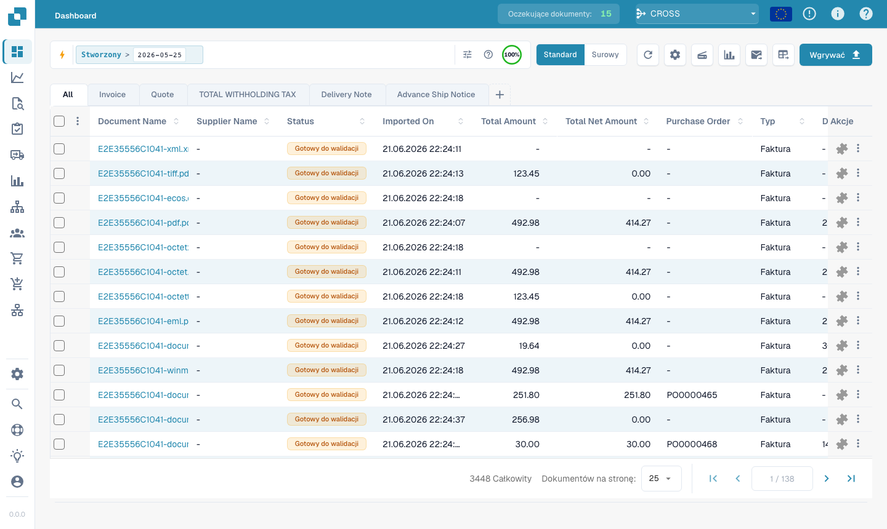<figcaption><p><code>created_on gt 2026-05-25</code> - Filtruje według Created po 25 maja 2026.</p></figcaption></figure>

##### Samo słowo daty

- Zapytanie: `created_on < today`
- To samo co: `created_on<today()`
- Wynik: Rozwija samo słowo today do today().

<figure><figcaption><p><code>created_on &lt; today</code> - Rozwija samo słowo today do today().</p></figcaption></figure>

##### Okres względny

- Zapytanie: `created_on this_month`
- To samo co: `created_on>=first day of this month AND created_on<=last day of this month`
- Wynik: Rozwija this_month do przedziału dat.

<figure><figcaption><p><code>created_on this_month</code> - Rozwija this_month do przedziału dat.</p></figcaption></figure>

##### Słowa „puste" lub „ustawione"

- Zapytanie: `assigned_to is empty`
- To samo co: `assigned_to=""`
- Wynik: Znajduje dokumenty bez osoby przypisanej.

<figure><figcaption><p><code>assigned_to is empty</code> - Znajduje dokumenty bez osoby przypisanej.</p></figcaption></figure>

##### Przyjazny status

- Zapytanie: `status:open`
- To samo co: `status=ready_for_validation`
- Wynik: Mapuje open na status walidacji.

<figure><figcaption><p><code>status:open</code> - Mapuje open na status walidacji.</p></figcaption></figure>

##### Not between

- Zapytanie: `created_on not between 2026-06-01, 2026-06-15`
- To samo co: `(created_on<2026-06-01 OR created_on>2026-06-15)`
- Wynik: Znajduje wartości spoza przedziału dat.

<figure><figcaption><p><code>created_on not between 2026-06-01, 2026-06-15</code> - Znajduje wartości spoza przedziału dat.</p></figcaption></figure>

##### Dopasowanie do listy

- Zapytanie: `status in (ready_for_validation, exported)`
- To samo co: `status=ready_for_validation OR status=exported`
- Wynik: Dopasowuje dowolny z wymienionych statusów.

<figure>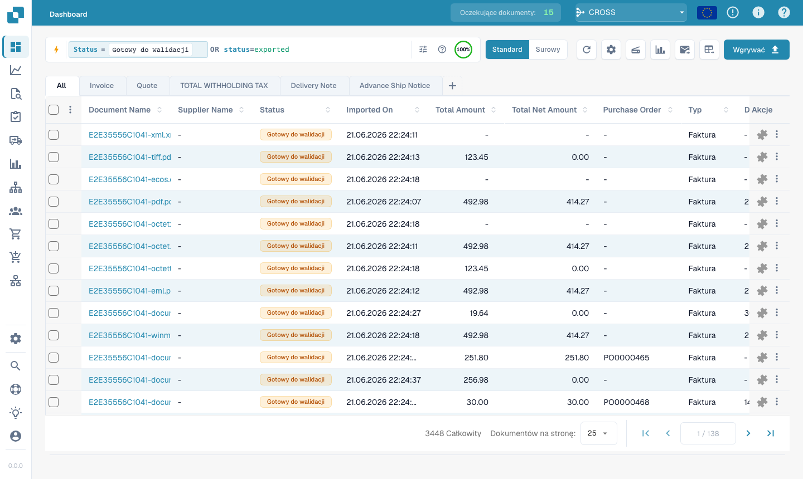<figcaption><p><code>status in (ready_for_validation, exported)</code> - Dopasowuje dowolny z wymienionych statusów.</p></figcaption></figure>

##### Prefiks negacji

- Zapytanie: `not status=finished`
- To samo co: `status!=finished`
- Wynik: Odwraca warunek statusu finished.

<figure><figcaption><p><code>not status=finished</code> - Odwraca warunek statusu finished.</p></figcaption></figure>

##### Ciąg zawiera

- Zapytanie: `filename contains E2E`
- To samo co: `filename:E2E`
- Wynik: Używa contains jako wyszukiwania podciągu w nazwie pliku.

<figure><figcaption><p><code>filename contains E2E</code> - Używa contains jako wyszukiwania podciągu w nazwie pliku.</p></figcaption></figure>

##### Prefiks faktury

- Zapytanie: `#INV-1234`
- To samo co: `invoice_id:INV-1234`
- Wynik: Mapuje #... na wyszukiwanie po id faktury.

<figure>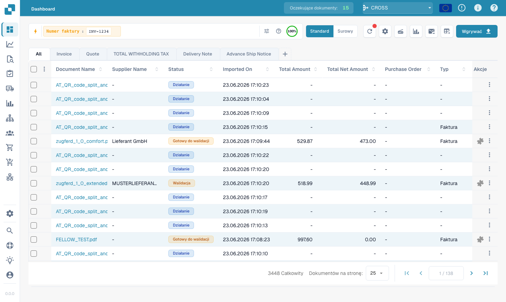<figcaption><p><code>#INV-1234</code> - Mapuje #... na wyszukiwanie po id faktury.</p></figcaption></figure>

##### Prefiks osoby przypisanej

- Zapytanie: `@Daniel`
- To samo co: `assigned_to:"Daniel"`
- Wynik: Mapuje @... na wyszukiwanie po nazwie osoby przypisanej.

<figure>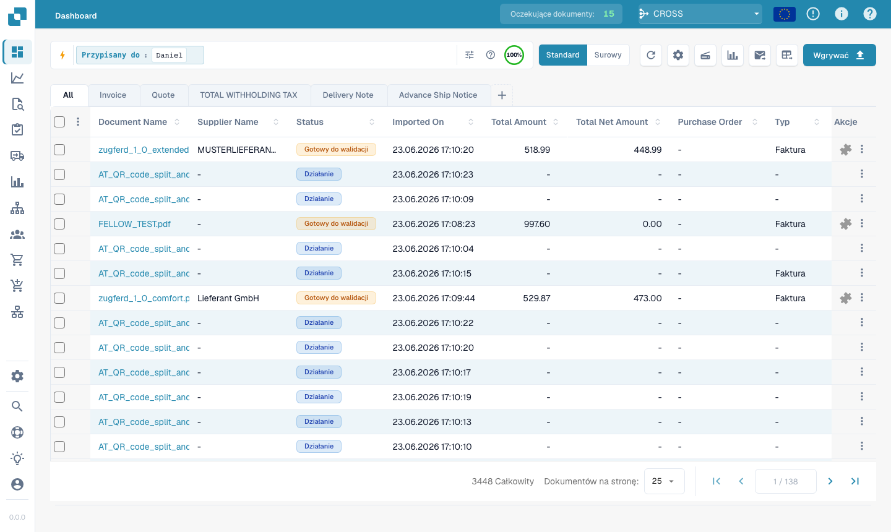<figcaption><p><code>@Daniel</code> - Mapuje @... na wyszukiwanie po nazwie osoby przypisanej.</p></figcaption></figure>

#### Wymaga wyszukiwania pełnotekstowego

Jeśli użyjesz tego samego skrótu z polem dostępnym tylko w trybie pełnotekstowym, zapytanie nadal wymaga wyszukiwania pełnotekstowego. Na przykład `ap_assignment_code is empty` używa tego samego skrótu „puste/ustawione" co `assigned_to is empty`, ale pole przypisania AP jest dostępne tylko w trybie pełnotekstowym.

##### Przyrostek walutowy

- Zapytanie: `total_amount > 5k`
- To samo co: `total_amount>5000`
- Wynik: Rozwija k do tysięcy na polu kwoty.

<figure>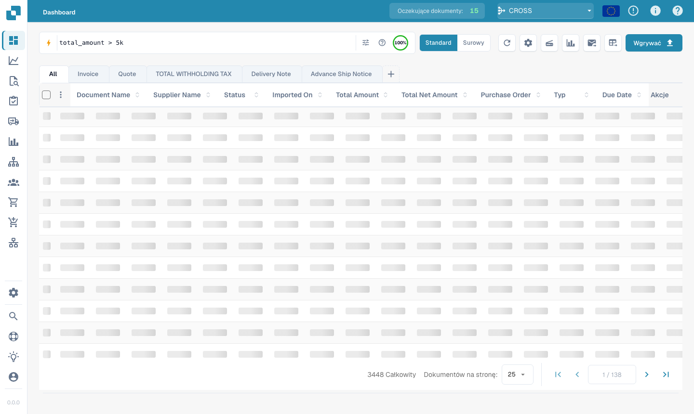<figcaption><p><code>total_amount &gt; 5k</code> - Rozwija k do tysięcy na polu kwoty.</p></figcaption></figure>

##### Skrót overdue

- Zapytanie: `overdue`
- To samo co: `invoice_due_date<today() AND status!=finished`
- Wynik: Znajduje niezakończone faktury po terminie płatności.

<figure>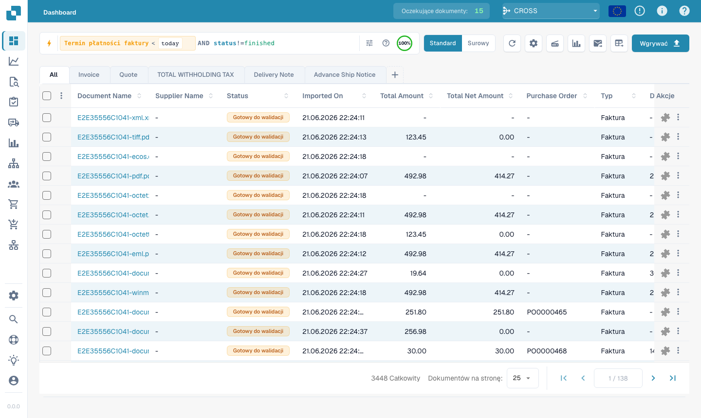<figcaption><p><code>overdue</code> - Znajduje niezakończone faktury po terminie płatności.</p></figcaption></figure>

##### Prefiks kwoty

- Zapytanie: `$5000+`
- To samo co: `total_amount>=5000`
- Wynik: Mapuje $...+ na próg kwoty.

<figure>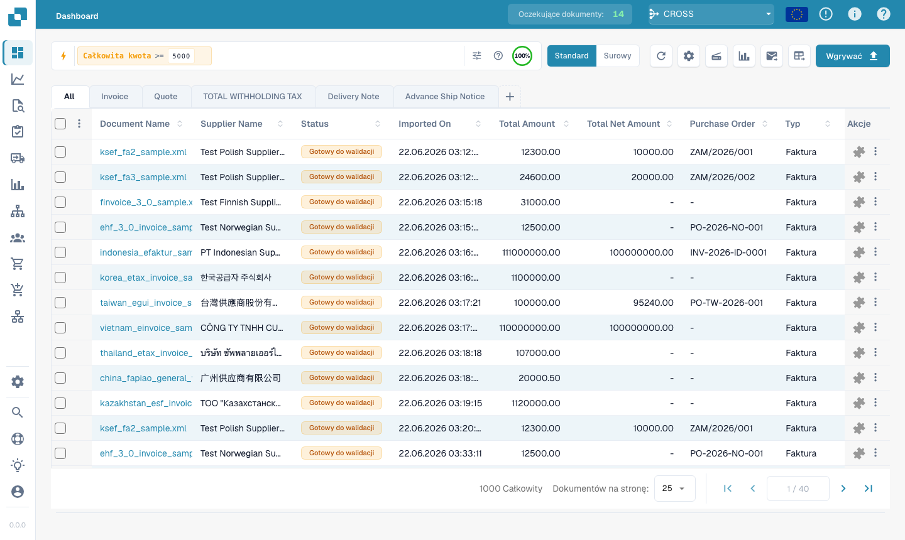<figcaption><p><code>$5000+</code> - Mapuje $...+ na próg kwoty.</p></figcaption></figure>

---

## Część 4 — Zaawansowane tryby wyszukiwania

Poza wyszukiwaniem po polach trzy tryby z prefiksem przeszukują samą treść dokumentu.

### Wyszukiwanie wektorowe (semantyczne) — `vector:`

Dopasowuje według **znaczenia**, a nie dokładnego tekstu — przydatne do „znajdź dokumenty o XYZ". Wymaga modułu Vector; dotyczy treści dokumentu.

```
vector: invoices about office supplies
vector: shipping delays with Hamburg port
```

<figure>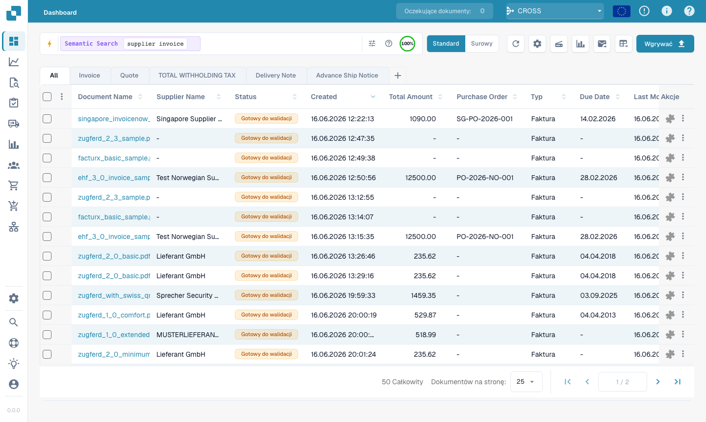<figcaption><p><code>vector: supplier invoice</code> — dokumenty powiązane znaczeniowo, nawet bez tych dokładnych słów.</p></figcaption></figure>

### Wyszukiwanie tekstu OCR — `ocr:`

Przeszukuje **tekst stron** wyodrębniony przez silnik OCR — nie tylko ustrukturyzowane kolumny. Przydatne, gdy wartość, którą pamiętasz, znajduje się w treści dokumentu.

```
ocr: Versandkosten
ocr: "purchase order PO-12345"
ocr: Hamburg AND doc_type=INVOICE
ocr: IBAN
```

<figure>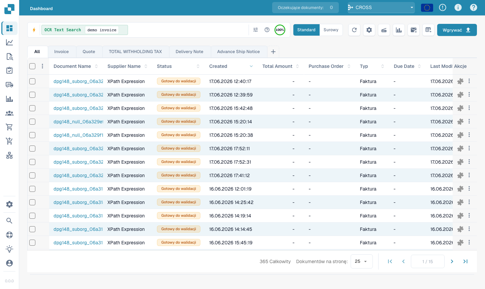<figcaption><p><code>ocr: demo invoice</code> — pasuje do tekstu znalezionego w dowolnym miejscu na stronach dokumentu.</p></figcaption></figure>

### Wyszukiwanie w języku naturalnym (AI) — `ai:`

Opisz, czego chcesz, zwykłym językiem; AI odczytuje Twoje sformułowanie i zamienia filtry (dostawca, daty, kwoty) na ustrukturyzowane zapytanie. W odróżnieniu od Vector **buduje zapytanie**, zamiast szukać podobnych dokumentów.

```
ai: invoices from Ruiz over 1000 last quarter
ai: overdue invoices waiting on approval
ai: shipping documents from Hamburg last month
```

<figure>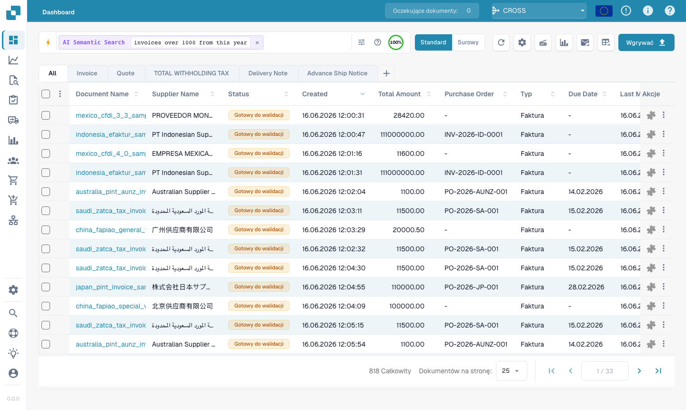<figcaption><p><code>ai: invoices over 1000 from this year</code> — AI automatycznie zamienia zdanie na filtry.</p></figcaption></figure>

---

### Przepisy

| Chcesz… | Wpisz to |
|-----------|-----------|
| Gotowe do walidacji, w pełni dopasowane | `status=ready_for_validation AND po_match_status=full_matched` |
| Ten dostawca, ten tydzień | `supplier_name=Test AND created_on>today()-7` |
| Faktury o wysokiej wartości po terminie | `total_amount>5000 AND invoice_due_date<today()` |
| Dwóch dostawców naraz | `supplier_name=fuji OR supplier_name=acme` |
| Dokumenty z błędem z dzisiaj | `(status=error OR status=failed) AND created_on>today()-1` |
| Elektroniczne noty kredytowe | `is_edoc=true AND sub_doc_type=CREDIT_NOTE` |
| Według prefiksu zamówienia zakupu | `purchase_order=PO-2026` |

> Pola pomarańczowe (pełnotekstowe) wymagają, aby dla Twojej organizacji było włączone **wyszukiwanie pełnotekstowe**. Dosłowny znak `%` lub `_` w wartości jest traktowany jak zwykły znak.
