# Szybkie wyszukiwanie

**Szybkie wyszukiwanie** (Quick Search) to najszybszy sposób na znalezienie dokumentów na pulpicie (Dashboard). Wpisujesz, czego szukasz — nazwę, status, kwotę, datę — a lista dokumentów filtruje się natychmiast.

Ten przewodnik jest ułożony tak, jak zbudowane jest wyszukiwanie:

1. **Pola standardowe** — kolumny, które ma każdy dokument (nazwa dokumentu, status, daty). Zawsze dostępne.
2. **Pola pełnotekstowe** — wyodrębniona treść (dostawca, zamówienie zakupu, numer faktury, kwoty, pozycje). Dostępne, gdy włączone jest wyszukiwanie pełnotekstowe.
3. **Operatory, skróty i przepisy** — pełna dokumentacja, gdy już poczujesz się swobodnie.

> Nie musisz niczego zapamiętywać: kliknij pasek wyszukiwania i wybierz pole oraz wartość z listy — Quick Search zbuduje zapytanie za Ciebie. Poniższe przykłady pokazują też formę wpisywaną, którą możesz skopiować bezpośrednio.

<figure><figcaption><p>Szybkie wyszukiwanie w polskim panelu. Błędna etykieta Wygrać na przycisku oznacza przesyłanie dokumentów.</p></figcaption></figure>

---

## Jak działa pasek wyszukiwania — chipy, pasek narzędzi i widok surowy

Zanim przejdziemy do samych pól, warto wiedzieć, jak zbudowany jest pasek.

### Warunki zamieniają się w chipy

Gdy uzupełnisz warunek (pole, operator i wartość), Quick Search zamienia go w **chip** — kolorową plakietkę wewnątrz paska — i rozpoczyna kolejny. Chip pokazuje **pole**, **operator** i **wartość** oraz **×** do jego usunięcia. Chipy są oznaczone kolorem zależnie od tego, gdzie znajdują się dane:

| Kolor chipa | Typ pola |
|-------------|------------|
| **Niebieski** | Kolumna standardowa (nazwa dokumentu, status, daty) |
| **Pomarańczowy** | Pole pełnotekstowe / wyodrębnione (dostawca, kwota, numer faktury) |
| **Fioletowy** | Wyszukiwanie wektorowe (semantyczne) |
| **Zielony** | Wyszukiwanie tekstu OCR |

Kliknij chip, aby go edytować (rozwija się z powrotem do tekstu); kliknij **×**, aby go usunąć. Kilka połączonych chipów jest domyślnie odczytywanych jako **AND**.

### Pasek narzędzi

Na prawym końcu paska:

- **ⓘ Help** — otwiera wbudowaną dokumentację **Wyszukiwanie w panelu — pola i składnia** wymieniającą każde pole, operator i skrót dostępny w Twoim obszarze roboczym.
- **Filters (tune)** — szybki panel najczęstszych filtrów Status / User / Restart, z przyciskami **Wyczyść filtry** i **Zastosuj**.
- **Pierścień indeksu** — mały pierścień postępu pokazujący, jaka część indeksu pełnotekstowego została zbudowana (widoczny tylko gdy wyszukiwanie pełnotekstowe jest włączone).

### Widok standardowy a surowy

Pasek zwykle pokazuje Twoje zapytanie jako chipy (**widok standardowy**). Przełącz na **widok surowy**, aby zobaczyć i edytować zapytanie jako zwykły tekst (np. `status=ready_for_validation AND supplier_name=Test`) — przydatne do kopiowania, udostępniania lub bezpośredniego wpisania długiego zapytania. Zapytanie nie ginie przy przełączeniu i jest zapamiętywane po ponownym załadowaniu pulpitu.

---

## Część 1 — Pola standardowe

Pola standardowe to własne kolumny dokumentu. Są **zawsze dostępne**, niezależnie od tego, czy wyszukiwanie pełnotekstowe jest włączone.

### Znajdowanie dokumentów po nazwie

Nazwa dokumentu to najczęstsze wyszukiwanie. Są trzy sposoby dopasowania — wszystkie **bez rozróżniania wielkości liter**:

#### `=` → zaczyna się od

```
filename=invoice
```

Znajduje dokumenty, których nazwa **zaczyna się od** „invoice". Ponieważ wielkość liter jest ignorowana, wszystkie poniższe pasują do `filename=invoice`:

```
Invoice.pdf   iNVoice.pdf   iNvoiCE.pdf   INVOICE.pdf
Invoice.xml   iNVoice.xml   iNvoiCE.edi   …
```

**Nie** pasuje do `XYZ_Invoice.pdf` (tam „invoice" jest w środku — użyj do tego `:`).

<figure>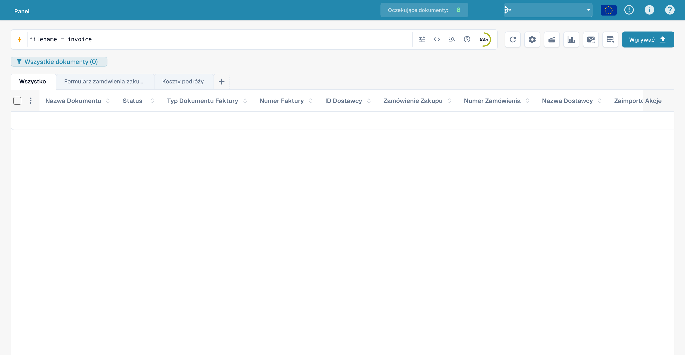<figcaption><p>Wprowadzanie zapytania o nazwę pliku. Błędna etykieta Wygrać oznacza przesyłanie dokumentów.</p></figcaption></figure>

#### `:` → zawiera (gdziekolwiek)

```
filename:invoice
```

Użyj `:`, aby dopasować słowo **w dowolnym miejscu** nazwy — `2026_Invoice.pdf`, `vietnam_einvoice_sample.xml`, `scan_invoice_copy.pdf`.

<figure>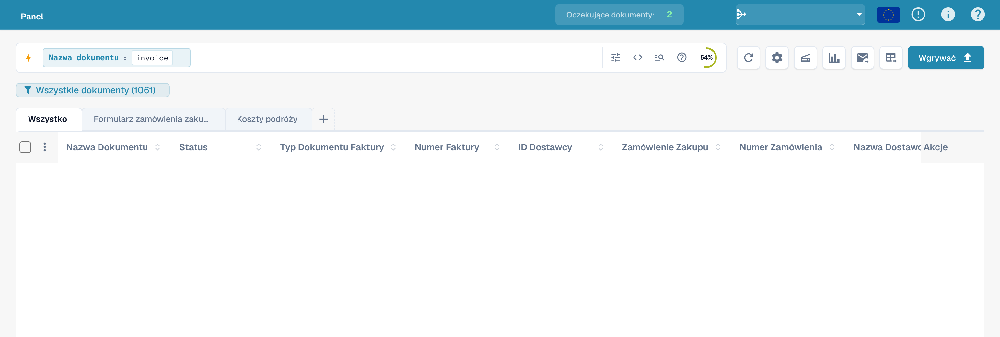<figcaption><p>Wyszukiwanie części nazwy pliku: filename:invoice. Błędna etykieta Wygrać na przycisku oznacza przesyłanie dokumentów.</p></figcaption></figure>

#### `="…"` → zaczyna się *lub* kończy na

```
filename="invoice"
```

Cudzysłowy sprawiają, że `=` pasuje do nazw, które **zaczynają się lub kończą** podaną wartością — przydatne dla kodu na początku lub końcówki pliku.

> **Trzy w jednej linii:** `=` → zaczyna się od · `:` → zawiera · `="…"` → zaczyna się lub kończy na. Wszystkie ignorują wielkość liter. Podsumowanie możesz zobaczyć w dowolnej chwili przez **ikonę pomocy** na pasku wyszukiwania (następna sekcja).

### Znajdowanie dokumentów po statusie

```
status=ready_for_validation
```

Status to lista stała, więc `=` oznacza dopasowanie **dokładne**, a pasek oferuje wybór wartości, gdy wpiszesz `status=`.

<figure><figcaption><p>Wprowadzanie filtra technicznego statusu ready_for_validation. Błędna etykieta Wygrać na przycisku oznacza przesyłanie dokumentów.</p></figcaption></figure>

### Znajdowanie dokumentów po dacie

```
created_on>2026-05-25
```

Użyj `>`, `<`, `>=`, `<=` dla zakresów dat. Możesz też użyć dat **względnych**: `today()`, `today()-7` (ostatnie 7 dni), `today()+30` (następne 30 dni).

<figure>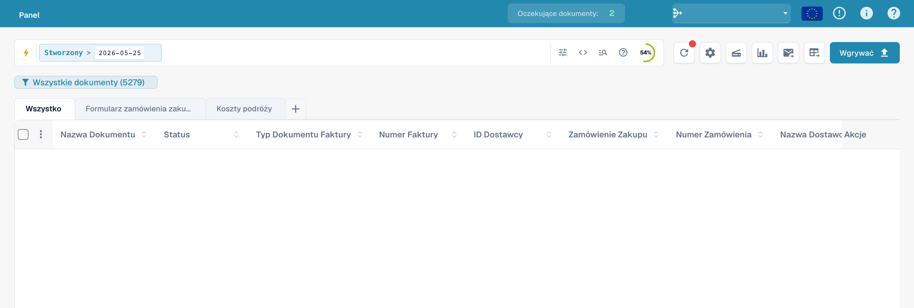<figcaption><p>Zapytanie o dokumenty utworzone po 25 maja 2026 r. Błędna etykieta Wygrać na przycisku oznacza przesyłanie dokumentów.</p></figcaption></figure>

### Znajdowanie dokumentów po podtypie faktury

```
invoice_sub_type="Cost Invoice"
```

Podtyp faktury to lista stała (na przykład **Faktura kosztowa** lub **Faktura zakupu**), więc `=` oznacza dopasowanie **dokładne**, a pasek oferuje wybór wartości, gdy wpiszesz `invoice_sub_type=`. Użyj `invoice_sub_type!="Cost Invoice"` dla wszystkiego poza tym podtypem.

---

## Część 2 — Pola pełnotekstowe

Pola pełnotekstowe przeszukują **wyodrębnioną treść** dokumentów — dostawcę, zamówienie zakupu, numer faktury, kwoty, pozycje. Pojawiają się na **pomarańczowo** i są dostępne, gdy dla Twojej organizacji **włączone jest wyszukiwanie pełnotekstowe**. Reguły dopasowania są dokładnie takie same jak dla standardowych pól tekstowych (`=` zaczyna się od, `:` zawiera, `="…"` zaczyna się lub kończy na).

### Znajdowanie dokumentów dostawcy

```
supplier_name=Test
```

Dopasowanie „zaczyna się od" na wyodrębnionej nazwie dostawcy. Użyj `supplier_name:Example`, aby dopasować w dowolnym miejscu, lub `supplier_name:"Example"`, aby ująć w cudzysłów wartość ze spacjami.

<figure><figcaption><p>Przykład zapytania o dostawcę: supplier_name=Test. Błędna etykieta Wygrać na przycisku oznacza przesyłanie dokumentów.</p></figcaption></figure>

### Znajdowanie dokumentów po zamówieniu zakupu

```
purchase_order=PO
```

Dopasowanie „zaczyna się od" na wyodrębnionym numerze zamówienia — świetne dla prefiksu PO.

<figure><figcaption><p>Przykład zapytania o zamówienie: purchase_order=PO. Błędna etykieta Wygrać na przycisku oznacza przesyłanie dokumentów.</p></figcaption></figure>

### Znajdowanie dokumentów po kwocie

```
total_amount>5000
```

Użyj `>`, `<`, `>=`, `<=` lub `between 100 and 500` dla przedziału.

<figure><figcaption><p>Wprowadzanie filtra kwot całkowitych powyżej 5000. Błędna etykieta Wygrać na przycisku oznacza przesyłanie dokumentów.</p></figcaption></figure>

Dla przedziału użyj `between`:

```
total_amount between 1000 and 5000
```

To skrót dla `total_amount>=1000 AND total_amount<=5000`.

<figure><figcaption><p>Wprowadzanie zapytania o kwoty od 1000 do 5000. Błędna etykieta Wygrać na przycisku oznacza przesyłanie dokumentów.</p></figcaption></figure>

### Znajdowanie tego, czego brakuje

```
supplier_name=""
```

`=""` oznacza „to pole jest **niewypełnione**"; `supplier_name!=""` oznacza „ma dowolnego dostawcę".

<figure><figcaption><p>Wprowadzanie filtra pustej nazwy dostawcy. Błędna etykieta Wygrać na przycisku oznacza przesyłanie dokumentów.</p></figcaption></figure>

To samo sprawdzenie obecności działa na każdym polu — na przykład dla dokumentów, którym wciąż brakuje kodu przypisania AP:

```
ap_assignment_code=""
```

<figure><figcaption><p>Wyszukiwanie dokumentów bez przypisania AP. Błędna etykieta Wygrać na przycisku oznacza przesyłanie dokumentów.</p></figcaption></figure>

---

## Filtry inteligentne — jedno kliknięcie

U góry listy rozwijanej Quick Search (kliknij w pasek wyszukiwania) znajdziesz **Smart Filters**: gotowe wyszukiwania stosowane jednym kliknięciem. Każdy z nich to po prostu skrót zapytania, które możesz też wpisać samodzielnie:

| Filtr inteligentny | Znajduje | To samo co wpisanie |
|--------------|-------|----------------|
| ⚠️ **Zaległy** | Po terminie płatności | `invoice_due_date<today()` |
| 🕐 **Wkrótce** | W ciągu następnych 7 dni | `invoice_due_date<=today()+7` |
| 👤 **Przypisane do mnie** | Pozycje czekające na Twoje działanie | `assigned_to=<you>` |
| 📅 **Dzisiejsza skrzynka odbiorcza** | Zaimportowane dziś | `imported_on>=today()` |
| 📋 **Oczekiwanie na walidację** | Gotowe do walidacji | `status=ready_for_validation` |
| 🧾 **Dokumenty elektroniczne** | E-faktury (XML, ZUGFeRD, EDI) | `is_edoc=true` |
| ✅ **Pełne dopasowanie PO** | W pełni dopasowane do zamówienia zakupu | `po_match_status=full_matched` |
| ➗ **Częściowe dopasowanie PO** | Częściowo dopasowane do zamówienia zakupu | `po_match_status=partial_matched` |
| 📉 **W meczu PO** | Ilość lub cena jednostkowa poniżej zamówienia zakupu | `po_match_status=under_matched` |

Trzy filtry **PO match** oraz pola pełnotekstowe wymagają, aby dla Twojej organizacji było włączone wyszukiwanie pełnotekstowe.

<figure><figcaption><p>Pomoc dotycząca zapytań i filtrów szybkiego wyszukiwania. Błędna etykieta Wygrać oznacza przesyłanie dokumentów.</p></figcaption></figure>

---

## Grupowanie wyników

Zamiast płaskiej listy możesz **pogrupować** wyniki według dowolnego pola — dostawcy, statusu, typu dokumentu, podorganizacji lub przedziału daty. Dodaj grupowanie z paska wyszukiwania:

```
group by supplier_name
```

Lista pokazuje wtedy zwijalne **nagłówki grup**, każdy z nazwą grupy i **licznikiem** (np. *Example (12)*). Kliknij nagłówek, aby rozwinąć lub zwinąć daną grupę. Dla pól dat możesz grupować według **dnia, tygodnia lub miesiąca**.

<figure>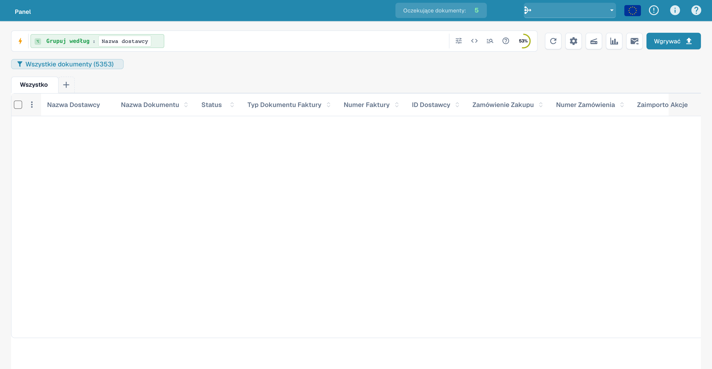<figcaption><p>Wprowadzanie zapytania z grupowaniem według dostawcy. Błędna etykieta Wygrać oznacza przesyłanie dokumentów.</p></figcaption></figure>

Grupowanie łączy się z dowolnym filtrem — `status=ready_for_validation group by supplier_name` grupuje tylko pasujące dokumenty. Kliknięcie w grupę **schodzi głębiej**: stosuje wartość tej grupy jako filtr i wraca do płaskiej listy dla tego wyboru.

---

## Część 3 — Operatory, łączniki, skróty

### Wbudowana pomoc

**Ikona pomocy** na pasku wyszukiwania otwiera pełną dokumentację wszystkich pól, operatorów i skrótów dostępnych w Twoim obszarze roboczym — wraz z informacją, które pola są standardowe, a które pełnotekstowe.

<figure>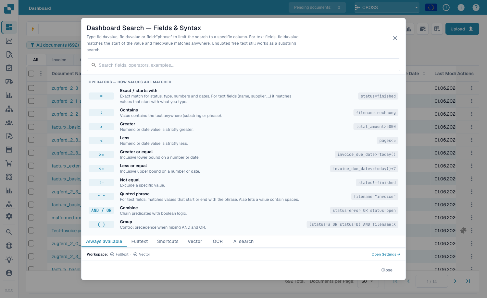<figcaption><p>Wbudowana pomoc <strong>Dashboard Search — Fields &#38; Syntax</strong> wymienia każdy operator i sposób dopasowania wartości.</p></figcaption></figure>

### Co oznacza `=` zależnie od typu pola

Każde dopasowanie tekstu ignoruje wielkość liter.

| Typ pola | Przykład | `=` oznacza |
|------------|---------|-----------|
| Tekst (nazwa, dostawca, zamówienie zakupu) | `filename=invoice` | **zaczyna się od** |
| Tekst, w dowolnym miejscu | `filename:invoice` | **zawiera** |
| Tekst, początek *lub* koniec | `filename="invoice"` | **zaczyna się lub kończy na** |
| Status / typ / PO match (listy stałe) | `status=finished` | **dokładne** |
| Identyfikatory (numer faktury, id dostawcy) | `invoice_number=INV-100` | **dokładne** |
| Liczba | `total_amount>5000` | zakres (`> < >= <= between`) |
| Data | `created_on>2026-01-01` | zakres + `today()±N` |

### Operatory

| Operator | Znaczenie |
|----------|---------|
| `=` | zaczyna się od (tekst) / dokładne (lista, liczba, data) |
| `:` | zawiera (tekst, w dowolnym miejscu) |
| `="…"` | zaczyna się od lub kończy na (tekst) |
| `!=` | przeciwieństwo `=` |
| `>` `<` `>=` `<=` | większe / mniejsze niż |
| `between … and …` | zakres włącznie z krańcami |
| `field=""` / `field!=""` | jest puste / jest ustawione |
| `today()`, `today()-7`, `today()+30` | daty względne |

### Łączniki

Łącz warunki za pomocą **AND** (oba prawdziwe), **OR** (którykolwiek), **NOT** oraz nawiasów `( … )` do grupowania:

```
status=ready_for_validation AND supplier_name=Test
(status=error OR status=failed) AND created_on>today()-1
```

<figure><figcaption><p>Łączenie warunków statusu i dostawcy operatorem AND. Błędna etykieta Wygrać na przycisku oznacza przesyłanie dokumentów.</p></figcaption></figure>

### Przykłady zapytań

Obrazy pokazują wprowadzone zapytania w polskim interfejsie. Dane dokumentów są ukryte. Obraz paska filtrów nie potwierdza dokładnej liczby wyników.

#### Tekstowy operator porównania

```
created_on gt 2026-05-25
```

<figure><figcaption><p>Operator porównania gt w zapytaniu o datę. Błędna etykieta Wygrać na przycisku oznacza przesyłanie dokumentów.</p></figcaption></figure>

#### Przed dzisiejszą datą

```
created_on < today()
```

<figure><figcaption><p>Porównanie created_on z today(). Błędna etykieta Wygrać na przycisku oznacza przesyłanie dokumentów.</p></figcaption></figure>

#### Od daty utworzenia

```
created_on >= 2026-06-01
```

<figure>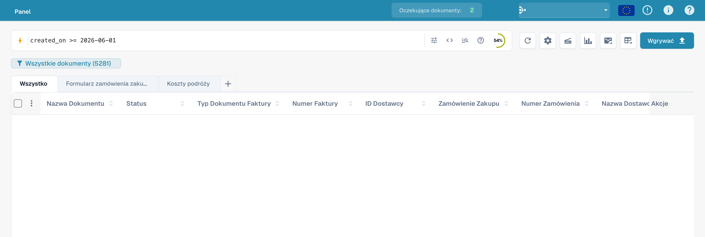<figcaption><p>Wprowadzanie daty utworzenia od 1 czerwca 2026 r. Błędna etykieta Wygrać na przycisku oznacza przesyłanie dokumentów.</p></figcaption></figure>

#### Bez przypisanej osoby

```
assigned_to is empty
```

<figure>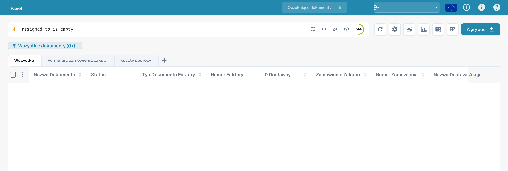<figcaption><p>Wyszukiwanie dokumentów bez przypisanej osoby. Błędna etykieta Wygrać na przycisku oznacza przesyłanie dokumentów.</p></figcaption></figure>

#### Filtr statusu

```
status=ready_for_validation
```

<figure>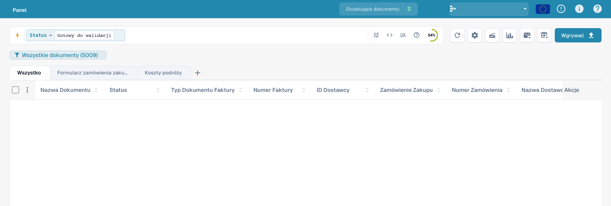<figcaption><p>Przykład filtra statusu w szybkim wyszukiwaniu. Błędna etykieta Wygrać na przycisku oznacza przesyłanie dokumentów.</p></figcaption></figure>

#### Poza okresem

```
created_on not between 2026-06-01 and 2026-06-15
```

<figure><figcaption><p>Wprowadzanie zapytania poza zakresem dat. Błędna etykieta Wygrać na przycisku oznacza przesyłanie dokumentów.</p></figcaption></figure>

#### Alternatywne statusy

```
status=ready_for_validation OR status=exported
```

<figure>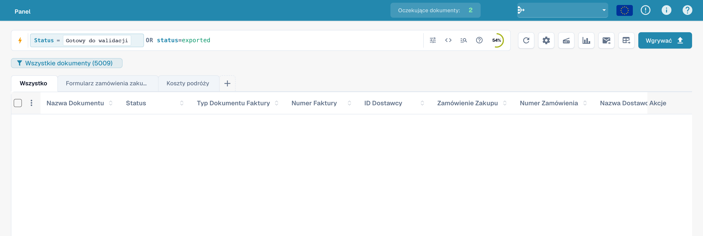<figcaption><p>Łączenie dwóch statusów technicznych operatorem OR. Błędna etykieta Wygrać na przycisku oznacza przesyłanie dokumentów.</p></figcaption></figure>

#### Wykluczenie warunku dostawcy

```
NOT supplier_name=Test
```

<figure><figcaption><p>Wykluczanie warunku dostawcy operatorem NOT. Błędna etykieta Wygrać na przycisku oznacza przesyłanie dokumentów.</p></figcaption></figure>

#### Część nazwy pliku

```
filename:invoice
```

<figure><figcaption><p>Wyszukiwanie terminu w nazwach plików. Błędna etykieta Wygrać na przycisku oznacza przesyłanie dokumentów.</p></figcaption></figure>

#### Zapytanie o numer faktury

```
invoice_number=INV
```

<figure><figcaption><p>Przykład zapytania z invoice_number. Błędna etykieta Wygrać na przycisku oznacza przesyłanie dokumentów.</p></figcaption></figure>

#### Puste przypisanie

```
assigned_to=""
```

<figure><figcaption><p>Wprowadzanie pustego przypisania: assigned_to=&quot;&quot;. Błędna etykieta Wygrać na przycisku oznacza przesyłanie dokumentów.</p></figcaption></figure>

#### Zapytanie o walutę

```
currency=EUR
```

<figure><figcaption><p>Wprowadzanie filtra waluty: currency=EUR. Błędna etykieta Wygrać na przycisku oznacza przesyłanie dokumentów.</p></figcaption></figure>

#### Data płatności przed dzisiaj

```
invoice_due_date<today()
```

<figure>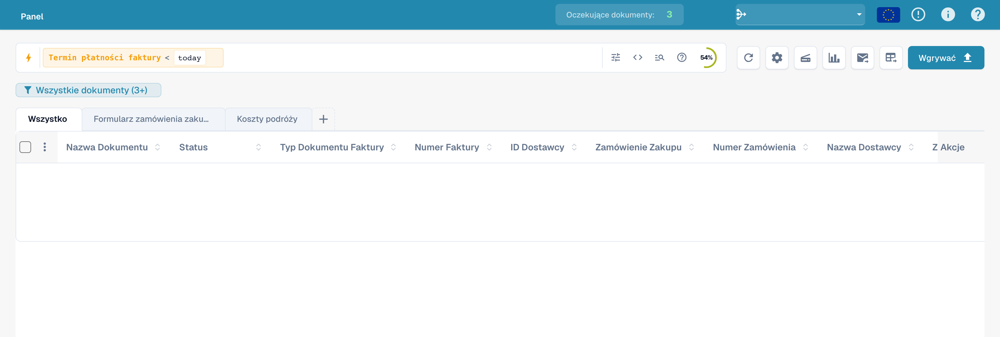<figcaption><p>Wprowadzanie daty płatności przed today(). Błędna etykieta Wygrać na przycisku oznacza przesyłanie dokumentów.</p></figcaption></figure>

#### Próg kwoty

```
total_amount>=1000
```

<figure><figcaption><p>Wprowadzanie kwoty całkowitej co najmniej 1000. Błędna etykieta Wygrać na przycisku oznacza przesyłanie dokumentów.</p></figcaption></figure>

## Uwzględnianie treści dokumentu

Menu wyszukiwania treści określa, czy zapytanie obejmuje tekst dokumentu. Jest to niezależne od technicznych prefiksów vector:, ocr: i ai:.

### Automatycznie

Najpierw przeszukuje widoczne kolumny. Przy braku dopasowań uwzględnia treść, jeśli organizacja ma wymagane funkcje.

<figure>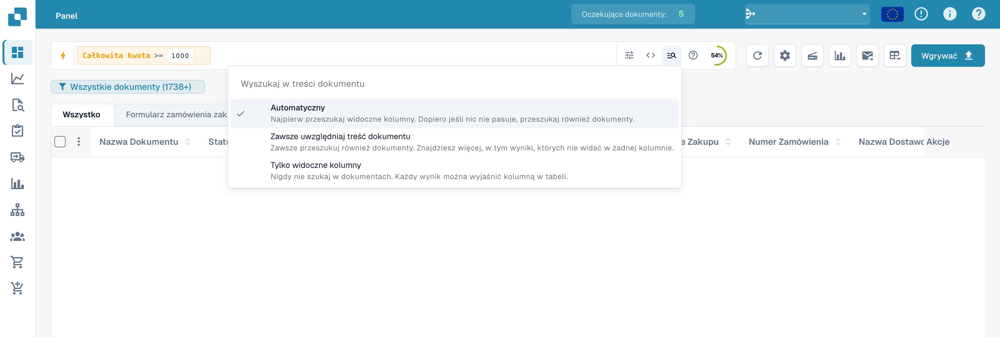<figcaption><p>Automatyczne uwzględnianie treści dokumentów w szybkim wyszukiwaniu. Błędna etykieta Wygrać na przycisku oznacza przesyłanie dokumentów.</p></figcaption></figure>

### Zawsze uwzględniaj treść

Jawnie uwzględnia treść dokumentów. Odpowiednie funkcje wyszukiwania muszą być dostępne.

<figure>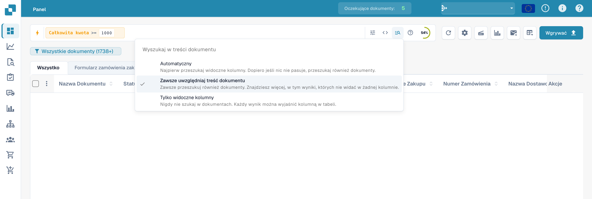<figcaption><p>Stałe uwzględnianie treści dokumentów w szybkim wyszukiwaniu. Błędna etykieta Wygrać na przycisku oznacza przesyłanie dokumentów.</p></figcaption></figure>

### Tylko widoczne kolumny

Ogranicza wyszukiwanie do widocznych kolumn panelu.

<figure>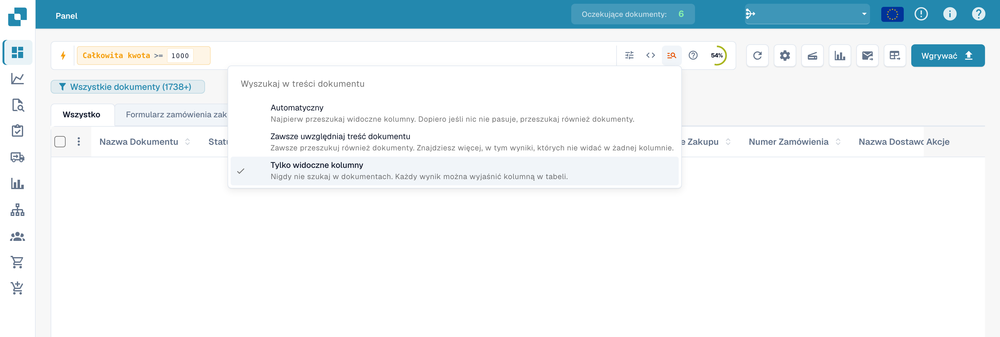<figcaption><p>Ograniczenie wyszukiwania do widocznych kolumn. Błędna etykieta Wygrać na przycisku oznacza przesyłanie dokumentów.</p></figcaption></figure>

### Przepisy

| Chcesz… | Wpisz to |
|-----------|-----------|
| Gotowe do walidacji, w pełni dopasowane | `status=ready_for_validation AND po_match_status=full_matched` |
| Ten dostawca, ten tydzień | `supplier_name=Test AND created_on>today()-7` |
| Faktury o wysokiej wartości po terminie | `total_amount>5000 AND invoice_due_date<today()` |
| Dwóch dostawców naraz | `supplier_name=ExampleA OR supplier_name=ExampleB` |
| Dokumenty z błędem z dzisiaj | `(status=error OR status=failed) AND created_on>today()-1` |
| Elektroniczne noty kredytowe | `is_edoc=true AND sub_doc_type=CREDIT_NOTE` |
| Według prefiksu zamówienia zakupu | `purchase_order=PO-2026` |

> Pola pomarańczowe (pełnotekstowe) wymagają, aby dla Twojej organizacji było włączone **wyszukiwanie pełnotekstowe**. Dosłowny znak `%` lub `_` w wartości jest traktowany jak zwykły znak.
