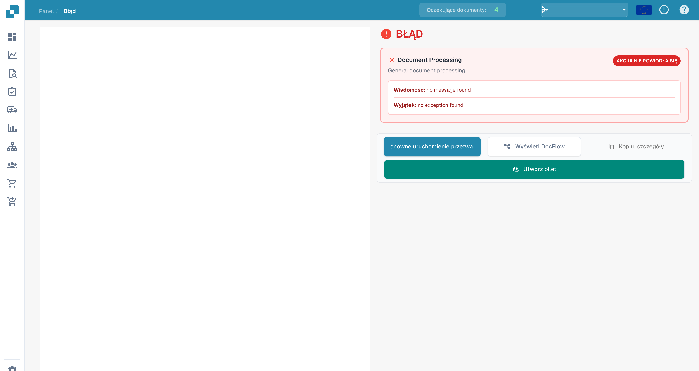
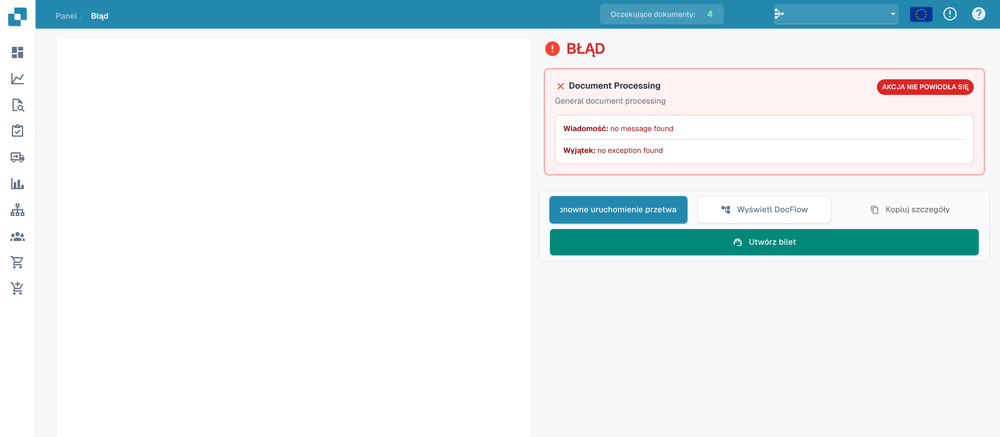

# Widok błędu

W przypadku niepowodzenia przetwarzania widok błędu pozwala sprawdzić etap, komunikat i dostępny wyjątek.

## Badanie szczegółów

<figure><figcaption>
Komunikat i wyjątek w widoku błędu bez zarejestrowanego komunikatu. Tytuły diagnostyczne Document Processing i General document processing pozostają angielskie.
</figcaption></figure>

Ten przykład pokazuje interfejs bez zarejestrowanego błędu. Teksty no message found i no exception found nie są diagnozą incydentu. Przy rzeczywistym błędzie sprawdź dostępne komunikaty i przepływ dokumentu.

## Dostępne działania

<figure><figcaption>
Działania w widoku błędu; przykład nie zawiera zarejestrowanych szczegółów błędu. Tytuły diagnostyczne Document Processing i General document processing pozostają angielskie.
</figcaption></figure>

| Działanie | Zastosowanie |
| --- | --- |
| Ponowne uruchomienie | Ponowna próba po zbadaniu lub usunięciu przyczyny. |
| Otwieranie DocFlow | Sprawdzenie etapów i ich statusów. |
| Kopiowanie szczegółów | Zebranie dostępnych informacji technicznych. |
| Utworzenie zgłoszenia | Przygotowanie prośby o pomoc. |

Dostępność działań dokumentu i podglądu zależy od jego załadowania. Dawny pasek narzędzi PDF nie jest stałym elementem tego widoku.

Przy powtarzającym się błędzie przekaż pomocy technicznej identyfikator dokumentu, dokładny komunikat, czas i wykonane kontrole. Sprawdź informacje poufne przed udostępnieniem szczegółów.
