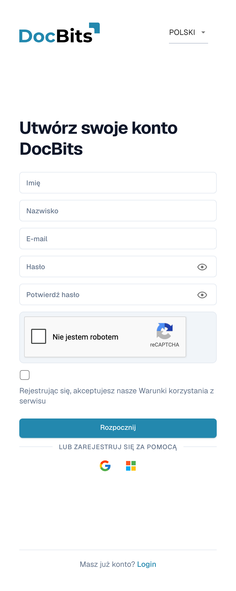
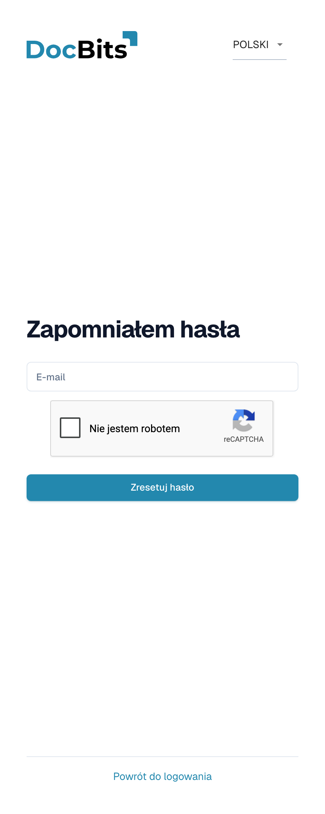
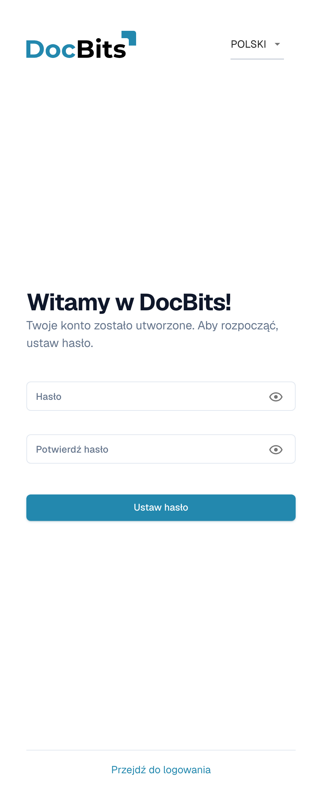

# Uzyskiwanie dostępu i logowanie

Na tej stronie opisano, jak uzyskać konto DocBits i jak się zalogować, gdy nie masz swojego hasła:

* [Rejestracja](#rejestracja) — utwórz własne konto DocBits.
* [Zapomniane hasło](#zapomniane-haslo) — zresetuj hasło za pomocą linku do resetowania.
* [Pierwsze hasło dla kont utworzonych przez administratora](#pierwsze-haslo-dla-kont-utworzonych-przez-administratora) — ustaw pierwsze hasło do konta, które administrator utworzył dla Ciebie.

Logowanie do istniejącego konta oraz Uwierzytelnianie dwuskładnikowe są opisane na stronie [Uwierzytelnianie dwuskładnikowe (2FA)](../../security/two-factor-authentication.md). Jeśli potrzebujesz innego języka wyświetlania, użyj menu języka w prawym górnym rogu tych formularzy.

## Rejestracja

Konto DocBits możesz utworzyć samodzielnie na stronie rejestracji. Otwórz ją za pomocą linku **Rejestr** na ekranie logowania lub przejdź do adresu `https://app.docbits.com/register` (użyj adresu internetowego przekazanego Twojej organizacji).

<figure><figcaption>
Rejestracja: wypełnij Imię, Nazwisko, E-mail, Hasło i Potwierdź hasło. Rozwiąż reCAPTCHA, jeśli się pojawi, zaakceptuj Warunki korzystania z serwisu i wybierz Rozpocznij. Login prowadzi z powrotem do logowania.
</figcaption></figure>

Wypełnij formularz:

1. **Imię** i **Nazwisko** — Twoje imię i nazwisko, tak jak mają być widoczne w DocBits.
2. **E-mail** — Twój służbowy adres e-mail. Jest to Twój identyfikator logowania.
3. **Hasło** i **Potwierdź hasło** — patrz zasady haseł poniżej. Lista kontrolna pod polem hasła pokazuje, które zasady Twoje hasło już spełnia.
4. Jeśli strona wyświetla widget **reCAPTCHA**, wypełnij go. Widget pojawia się tylko wtedy, gdy wdrożenie DocBits ma włączoną ochronę przed botami.
5. Zaznacz pole wyboru, aby potwierdzić, że akceptujesz **Warunki korzystania z serwisu**.
6. Kliknij **Rozpocznij**. Jeśli masz już konto, kliknij **Login** na dole, aby wrócić do strony logowania. **Odwiedź stronę internetową** otwiera witrynę DocBits z informacjami o produkcie.

Użyj ikony oka obok pola hasła, aby pokazać lub ukryć wpisane znaki.

### Zasady haseł

Twoje hasło musi:

* mieć długość od **8 do 20 znaków**,
* zawierać co najmniej jedną **wielką** i jedną **małą** literę,
* zawierać co najmniej jedną **cyfrę**,
* zawierać co najmniej jeden **znak specjalny** (`!@#$%^&*()_+=\[{]\};:,.<>?/\|~-`).

Dozwolone są tylko litery, cyfry i te znaki specjalne.

### Rejestracja przez Google lub Microsoft

Zamiast hasła możesz kliknąć przycisk **Google** lub **Microsoft** pod napisem **LUB ZAREJESTRUJ SIĘ ZA POMOCĄ**. DocBits utworzy Twoje konto za pośrednictwem Twojego dostawcy tożsamości, a później logujesz się w ten sam sposób.

### Potwierdź swój adres e-mail

Po wysłaniu formularza DocBits wyświetla stronę potwierdzenia i wysyła **e-mail weryfikacyjny** na podany adres. Otwórz e-mail i kliknij znajdujący się w nim link — prowadzi on do strony potwierdzenia, która weryfikuje Twój adres. Jeśli e-mail nie dotrze, strona potwierdzenia oferuje opcję **ponownego wysłania**. Gdy adres zostanie zweryfikowany, przejdź do ekranu logowania i zaloguj się swoim adresem e-mail oraz hasłem.

## Zapomniane hasło

DocBits przechowuje hasła logowania jako jednokierunkowe skróty kryptograficzne z solą. Istniejącego hasła nie można odzyskać ze skrótu, dlatego ta procedura ustawia nowe hasło. Zobacz [Bezpieczne przechowywanie danych uwierzytelniających](../../security/secure-storage-of-credentials.md).

Jeśli zapomniałeś hasła:

1. Na ekranie logowania kliknij **Zapomniałeś hasła?**.
2. Na stronie **Zapomniałem hasła** wpisz swój adres **E-mail** i kliknij **Zresetuj hasło**. Jeśli wyświetlany jest widget reCAPTCHA, najpierw go wypełnij.

   <figure><figcaption>
Wpisz E-mail i wybierz Zresetuj hasło, aby poprosić o link do resetowania, albo użyj Powrót do logowania. Rozwiąż reCAPTCHA, gdy się pojawi.
</figcaption></figure>

   Jeśli nie chcesz resetować hasła, kliknij **Powrót do logowania**, aby wrócić do ekranu logowania.

3. DocBits wysyła Ci e-mailem **link do resetowania hasła**. Otwórz e-mail i kliknij link — otworzy się strona resetowania hasła.
4. Wpisz swoje **nowe hasło dwa razy**. Obowiązują te same zasady haseł co podczas [rejestracji](#zasady-hasel), a lista kontrolna pokazuje, które zasady są spełnione.
5. Kliknij **Zresetuj hasło**. DocBits potwierdza zmianę i przenosi Cię z powrotem na ekran logowania, gdzie możesz zalogować się nowym hasłem.


Linki do resetowania hasła wygasają po krótkim czasie. Jeśli link już nie działa, powtórz powyższe kroki, aby poprosić o nowy.


## Pierwsze hasło dla kont utworzonych przez administratora

Gdy administrator doda Cię jako użytkownika (zobacz [Użytkownicy](../../administration-and-setup/settings/global-settings/groups-users-and-permissions/users/README.md)), otrzymasz e-mail z danymi do logowania oraz linkiem do ustawienia **pierwszego hasła**. Link otwiera stronę **Ustaw hasło**:

<figure><figcaption>
Pierwsze hasło do konta utworzonego przez administratora: wypełnij Hasło i Potwierdź hasło, a następnie wybierz Ustaw hasło. Przejdź do logowania prowadzi do ekranu logowania.
</figcaption></figure>

1. Kliknij link w e-mailu z zaproszeniem. Strona wita Cię komunikatem „Witamy w DocBits! Twoje konto zostało utworzone. Aby rozpocząć, ustaw hasło."
2. Wpisz swoje hasło dwa razy — obowiązują te same [zasady haseł](#zasady-hasel).
3. Kliknij **Ustaw hasło**. Następnie możesz zalogować się swoim adresem e-mail i tym hasłem.

Ikony oka pokazują lub ukrywają wpisane znaki. Jeśli wyjdziesz przed ustawieniem hasła, **Przejdź do logowania** wraca do ekranu logowania.

Link jest powiązany z Twoim kontem i działa tylko raz. Jeśli wygaśnie, zanim go użyjesz, poproś administratora o ponowne wysłanie zaproszenia albo użyj opcji **Zapomniałeś hasła?** ze swoim adresem e-mail.
