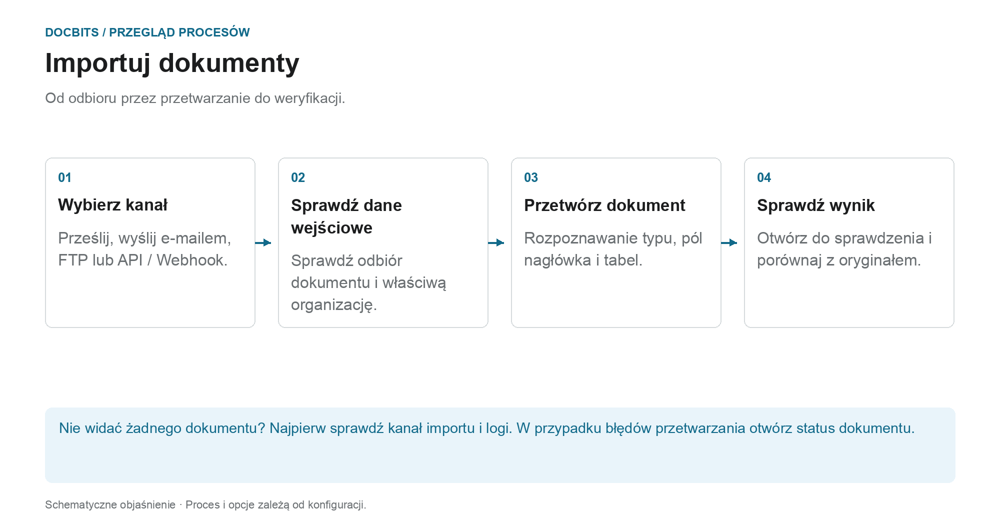

# Jak importować dokumenty

## Od paragonu po dokument gotowy do przeglądu

<figure><figcaption>
Od odbioru przez przetwarzanie do weryfikacji. Schemat ma charakter schematyczny; aktywne ustawienia Twojej organizacji określają rzeczywiste zachowanie.
</figcaption></figure>

Najpierw wybierz trasę importu. Pomyślne wysłanie wiadomości e-mail lub przesłanie żądania API nie oznacza, że ​​dokument został w pełni przetworzony. Sprawdź jego odbiór w DocBits, a następnie status dokumentu.

1. **Wybierz kanał importu:** Użyj ręcznego przesyłania pojedynczych plików lub skonfiguruj automatyczny kanał dla regularnych danych wejściowych.
2. **Sprawdź paragon:** Znajdź dokument we właściwej organizacji. W przypadku przychodzących wiadomości e-mail sprawdź, jeśli to konieczne, dzienniki importu; czy reguły dotyczące formatu i nadawcy obsługują załącznik?
3. **Czekaj na przetwarzanie:** DocBits przetwarza dokument zgodnie z typem dokumentu i aktywnymi ustawieniami. W przypadku PDFs, OCR lub istniejącego tekstu PDF można zastosować tekst; dokumenty elektroniczne mogą dostarczać uporządkowanych danych. Nie każdy import przechodzi tę samą ścieżkę ekstrakcji.
4. **Otwórz wynik:** Gdy dokument będzie gotowy do sprawdzenia, porównaj rozpoznane wartości z oryginałem. Import dokumentu nie powoduje jego zatwierdzenia ani eksportu do ERP.

### Znajdź właściwą trasę importu

| Wejście | Instrukcje |
| --- | --- |
| Prześlij pojedyncze dokumenty | [Import ręczny](manual-import.md) |
| Podłącz skrzynkę pocztową lub przesyłaj dalej wiadomości e-mail | [Import poczty e-mail](email/README.md) |
| Pobieraj pliki za pośrednictwem skonfigurowanego kanału FTP | [FTP](ftp.md) |
| Przesyłanie dokumentów z aplikacji | [Webhook / API](webhook.md) |

**Jeśli czegoś brakuje:** Najpierw sprawdź kanał wejściowy. Jeśli dokument już istnieje w DocBits, [Stan dokumentu](../dashboard/document-status.md) i [Przepływ dokumentów](../dashboard/document-flow.md) pomagają znaleźć odpowiedni etap przetwarzania.


DocBits Samouczek importowania: przesyłanie dokumentów, przeciąganie i upuszczanie + klasyfikacja ręczna i automatyczna


Przewodnik po przesyłaniu dokumentów do DocBits.
