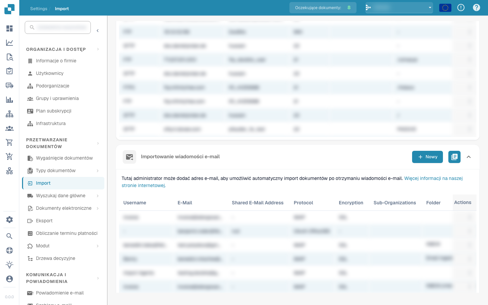
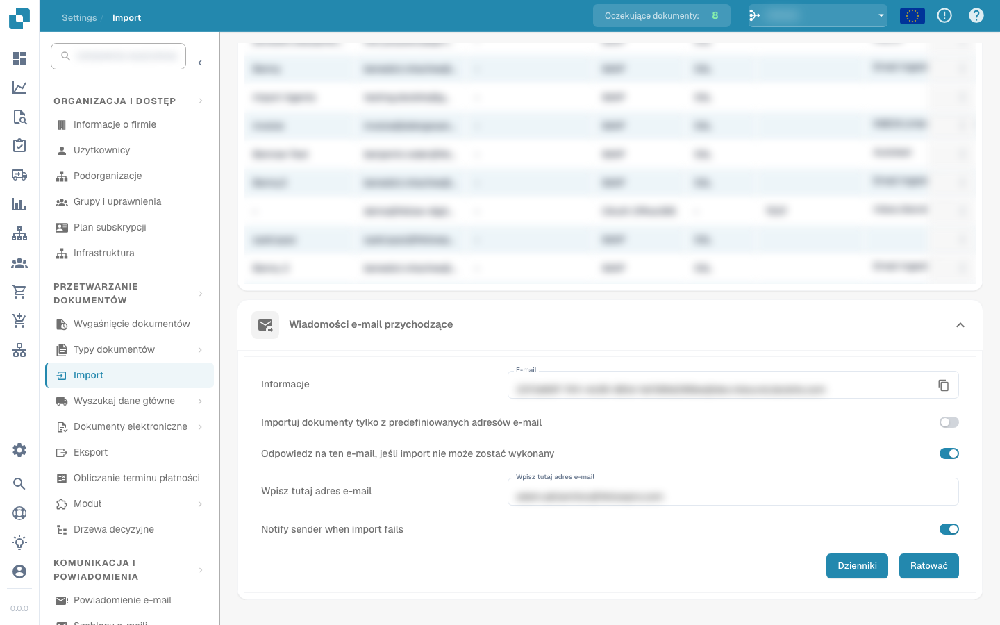

# E-mail

DocBits może importować dokumenty z poczty e-mail na dwa sposoby. Oba konfiguruje się w **Settings → Import** (Przetwarzanie dokumentów).

## Metoda 1 — Importowanie wiadomości e-mail (podłączenie skrzynki)

Podłącz konto e-mail, a DocBits automatycznie zaimportuje dokumenty w momencie nadejścia nowych wiadomości. Na stronie Import otwórz sekcję **Importowanie wiadomości e-mail** i kliknij **+ Nowy**.

<figure><figcaption>Importowanie wiadomości e-mail — podłącz skrzynkę do automatycznego importu dokumentów</figcaption></figure>

Następnie wybierz protokół swojej skrzynki:

* **IMAP** — zobacz [IMAP](imap.md)
* **OAuth (Office 365)** — zobacz [OAuth Office365](oauth-office365.md)

## Metoda 2 — Wiadomości e-mail przychodzące (przekazywanie do DocBits)

Przekaż — lub wyślij bezpośrednio — wiadomości na unikalny adres przychodzący Twojej organizacji, a DocBits automatycznie zaimportuje załączniki. Podłączenie skrzynki nie jest wymagane. Otwórz sekcję **Wiadomości e-mail przychodzące** na stronie Import.

<figure><figcaption>Wiadomości e-mail przychodzące — przekazuj dokumenty na swój adres DocBits</figcaption></figure>

* **Informacje / E-mail** — unikalny adres przychodzący Twojej organizacji (format `<org-id>@inbound.docbits.com`). Przekazuj dokumenty na ten adres; użyj ikony kopiowania, aby go skopiować.
* **Importuj dokumenty tylko z predefiniowanych adresów e-mail** — gdy opcja jest włączona, importowane są tylko wiadomości od nadawców dodanych do białej listy; wiadomości od innych nadawców są ignorowane.
* **Odpowiedz na ten e-mail, jeśli import nie może zostać wykonany** — wysyła nadawcy automatyczną odpowiedź, gdy import się nie powiedzie.
* **Notify sender when import fails** — powiadamia nadawcę, jeśli jego wiadomości nie udało się zaimportować.
* **Dzienniki** — otwiera dziennik przetwarzania wiadomości przychodzących. Kliknij **Ratować** (zapisz ustawienia), aby zastosować zmiany.

## Obsługiwane załączniki dokumentów

Obie metody importu e-mail akceptują następujące załączniki dokumentów:

| Format | Rozszerzenia plików | Typowe zastosowanie |
| --- | --- | --- |
| PDF | `.pdf` | Faktury i inne dokumenty PDF |
| TIFF | `.tif`, `.tiff` | Zeskanowane dokumenty |
| XML | `.xml` | Ustrukturyzowane dokumenty elektroniczne |
| EDI / dane zamówienia zakupu | `.edi`, `.purchaseorder` | Elektroniczna wymiana danych i zamówienia zakupu |

Jeśli usługa przekazująca oznaczy plik PDF, TIFF lub XML jako ogólny załącznik, DocBits potrafi rozpoznać go na podstawie zawartości pliku lub znanego rozszerzenia. Przekazane wiadomości `.eml` mogą również zawierać obsługiwane dokumenty; DocBits wyodrębnia te wewnętrzne załączniki przed importem.

Obrazy, takie jak PNG, JPG, GIF i BMP, nie są importowane jako dokumenty. Obrazy podpisów i logo osadzone w przekazanych wiadomościach są pomijane. Pliki pakietu Office, takie jak Word, Excel i PowerPoint, nie są obsługiwane przez te metody importu e-mail.

W przypadku przekazanych wiadomości sprawdź **Dzienniki** w sekcji **Wiadomości e-mail przychodzące**, jeśli brakuje dokumentu. Gdy włączona jest opcja **Notify sender when import fails**, nadawca otrzymuje wyjaśnienie i link do tej strony. W przypadku podłączonej skrzynki skorzystaj z przewodnika konfiguracji [IMAP](imap.md) lub [OAuth (Office 365)](oauth-office365.md).
