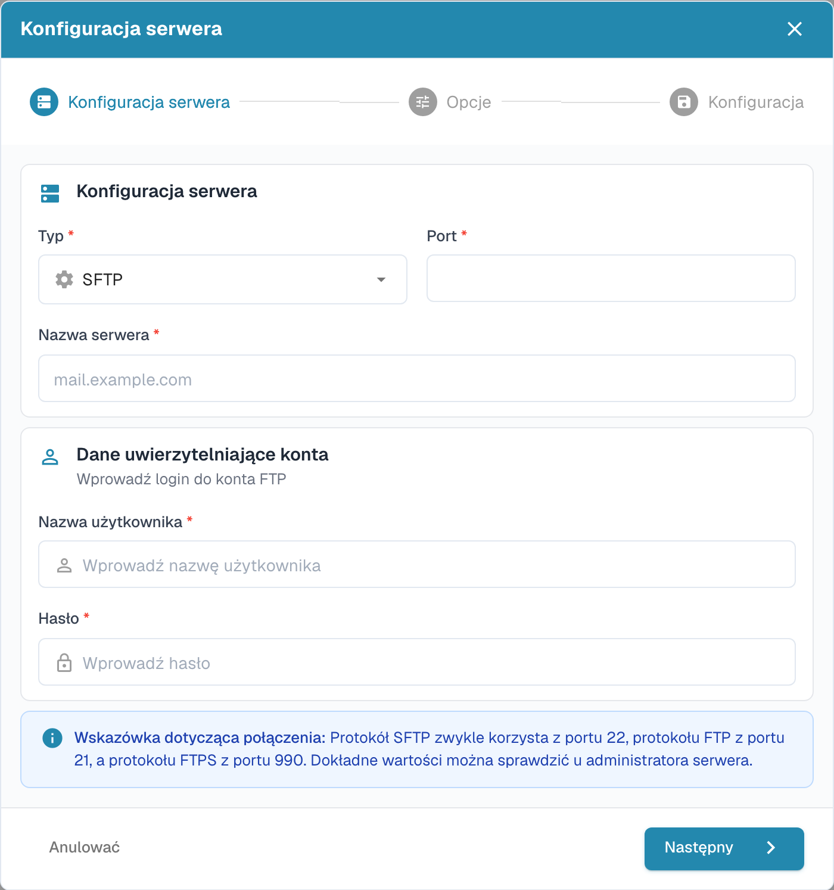

# Import przez FTP i SFTP

Automatyczny import wymaga zatwierdzonych danych połączenia i katalogu dostępnego dla konta serwera.

## Tworzenie połączenia

Otwórz ustawienia importu i utwórz nowe połączenie w sekcji FTP.

<figure><figcaption>
Przegląd połączeń FTP z ukrytymi danymi połączeń.
</figcaption></figure>

Kreator zaczyna od konfiguracji serwera. Wybierz właściwy protokół, serwer, port i dane logowania. Użyj wartości potwierdzonych przez administratora serwera.

<figure><figcaption>
Pierwszy krok kreatora importu FTP: konfiguracja serwera.
</figcaption></figure>

Przejdź do opcji i konfiguracji. Sprawdź całe połączenie przed zapisaniem.

## Archiwizowanie plików

Jeżeli połączenie obsługuje archiwizację, ustaw ją w opcjach importu. Sprawdź, czy konto może zapisywać w katalogu archiwum, i przetestuj działanie na przykładowym pliku. Dawny oddzielny formularz archiwizacji został zastąpiony aktualnym kreatorem.
